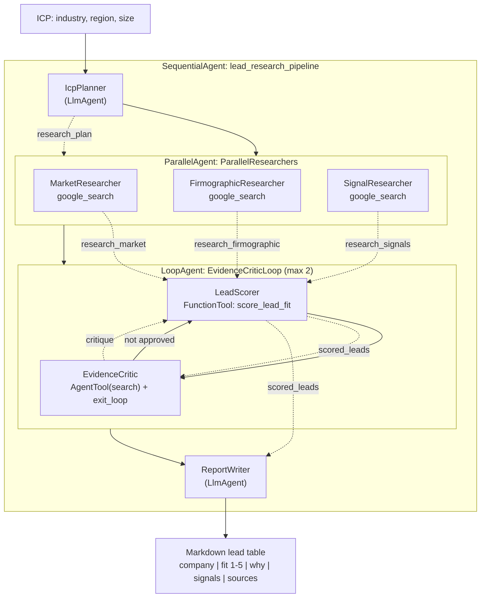

# Agent A — B2B lead research pipeline

**Status: see the status line in [../README.md](../README.md)**

You give it an ideal customer profile — industry, region, company size — and it
returns a markdown lead table where every company carries a **1–5 fit score**, a
one-line reason, the buying signals found, and source URLs.

The pipeline is the point: a planner splits the work, three researchers run in
parallel, a critic loop refuses leads that are not evidenced, and a writer
formats what survived.

## Architecture



Dotted arrows are session state, passed with `output_key` and read back in the
next prompt as `{research_plan}`, `{scored_leads}` and so on.

## The 1–5 fit score

This is our addition; the reference produces a narrative report with no number.

The model **observes**, the code **decides**. The scorer agent calls
`score_lead_fit` once per company with what it actually found, and
[`lead_research/scoring.py`](lead_research/scoring.py) computes the integer:

| Dimension | exact | adjacent | none |
|---|---|---|---|
| Industry | 2.0 | 1.0 | 0 |
| Region | 1.5 | 0.75 | 0 |
| Size | 1.5 | 0.75 | 0 |

Plus 0.5 per buying signal, capped at +1.0. The raw total is rounded and
clamped to 1–5.

**A lead with no source URL is capped at 2**, however well it matches. That
rule is what gives the critic something concrete to push on, and it is why an
unsourced "perfect match" cannot quietly reach the top of the table.

Because the arithmetic lives in code rather than in the prompt, the score is
reproducible and fully testable without touching the API.

## Our changes from the reference

The reference ([MagnIeeT/leadGenerationAgentADK](https://github.com/MagnIeeT/leadGenerationAgentADK))
is an interactive investment-lead finder: it learns "pre-investment signals"
from companies that already entered a market, asks the user several questions
mid-run, and uses dynamically constructed `BaseAgent` orchestrators to fan out
per candidate.

1. **Every lead gets a 1–5 fit score from a deterministic tool** (above). The
   reference has a boolean `is_valid` validator and no ranking.
2. **A real critic loop instead of a one-shot validator.** Ours is a
   `LoopAgent` of scorer + critic: the critic reads the whole scored list,
   writes a specific critique into state, and the scorer re-scores against it
   on the next pass. The critic ends the loop by calling `exit_loop`, and the
   loop is capped so a stubborn critic cannot spin.
3. Domain and input changed: an explicit ICP (industry / region / company size)
   for B2B prospecting, rather than a country-plus-industry investment thesis.
4. Non-interactive. The reference stops to ask the user how many companies to
   analyse; ours runs start to finish, which makes it reproducible.

## The `google_search` tool conflict, verified

The brief asked us to check this against the installed ADK. Here is what
**ADK 2.13.0** actually does, from
`google/adk/agents/llm_agent.py::_convert_tool_union_to_tools`:

- Putting `google_search` on an agent alongside other tools **does not raise at
  construction time**. It fails later, when the request reaches Gemini, because
  a built-in tool cannot be sent with function declarations.
- ADK will auto-wrap `google_search` into an internal agent tool, but **only**
  when `GoogleSearchTool(bypass_multi_tools_limit=True)` is used and the agent
  has more than one tool. The exported `google_search` singleton has
  `bypass_multi_tools_limit=False`, so it gets no such protection.

So in this pipeline:

- The three researchers hold `google_search` **and nothing else**.
- The critic needs both search and `exit_loop`, so its search capability is a
  separate agent wrapped in `AgentTool`.

`tests/test_pipeline.py::test_no_agent_mixes_builtin_google_search_with_another_tool`
walks the whole agent tree, including inside `AgentTool`s, and fails if anyone
ever breaks this rule.

## Setup

```powershell
cd Assignment3\a_deep_research_agent
py -3.11 -m venv .venv
.\.venv\Scripts\python.exe -m pip install -r requirements.txt
Copy-Item .env.example .env
```

Then map your key in:

```powershell
$lines = @("GOOGLE_GENAI_USE_VERTEXAI=FALSE", "GOOGLE_API_KEY=$env:GEMINI_API_KEY")
Set-Content -Path .env -Value $lines -Encoding utf8
Copy-Item .env lead_research\.env
```

## Run

```powershell
cd Assignment3\a_deep_research_agent
.\.venv\Scripts\adk.exe web --port 8741
```

Open <http://127.0.0.1:8741>, pick `lead_research`, and give it an ICP:

> ICP: industrial IoT and sensor manufacturers, Nordics, 200-1000 employees.

Tests:

```powershell
.\.venv\Scripts\python.exe -m pytest tests\ -q
```

## Environment variables

| Variable | Required | Purpose |
|---|---|---|
| `GOOGLE_API_KEY` | yes | AI Studio key. Falls back to `GEMINI_API_KEY`. |
| `GOOGLE_GENAI_USE_VERTEXAI` | yes | `FALSE` for the AI Studio path. Defaulted in code. |
| `LEAD_RESEARCH_MODEL` | no | Default `gemini-2.5-flash`. |
| `LEAD_RESEARCH_MAX_LOOPS` | no | Critic iterations, default 2. Each costs 2 model calls. |

## Versions

- Python 3.11.0, `google-adk==2.13.0`, `python-dotenv==1.2.4`, `pytest==9.2.0`

## Known limits

- **This pipeline is expensive.** One run is 7–11 model calls: 1 planner + 3
  researchers + 2 per critic loop + 1 writer. On the AI Studio free tier
  (**20 requests/day**, 5/minute) that is a third of a day's budget per run.
  Every model is built with `HttpRetryOptions` retrying 429 with long backoff,
  which is what makes the parallel stage survive the per-minute cap at all.
- **Grounding quality is whatever Google Search returns.** The critic checks
  that a URL is present and plausible; it does not fetch the page. A lead can
  be well-sourced and still wrong.
- **`ParallelAgent`, `SequentialAgent` and `LoopAgent` are deprecated** in ADK
  2.13.0 in favour of `Workflow`. We kept them because the brief names them,
  they still work, and the deprecation notice itself says `Workflow` cannot yet
  be used as an `LlmAgent` sub-agent.
- **Fit scores are comparable only within one run.** The weights are fixed, but
  the `exact`/`adjacent`/`none` judgements come from the model.
- **The critic can approve a thin list.** It is capped at 2 iterations; if the
  research simply found nothing good, the writer reports a short table rather
  than inventing rows.

## Sources

- [MagnIeeT/leadGenerationAgentADK](https://github.com/MagnIeeT/leadGenerationAgentADK)
  — the multi-stage lead generation shape, `AgentTool` composition, and
  `output_key` state passing. Read for structure; no files copied.
- [Google Cloud blog — *Build a deep research agent with Google ADK*](https://cloud.google.com/blog/products/ai-machine-learning/build-a-deep-research-agent-with-google-adk)
  — the planner / parallel researchers / critic-loop / writer pattern.
- [ADK docs — Workflow agents](https://google.github.io/adk-docs/agents/workflow-agents/)
  — `SequentialAgent`, `ParallelAgent`, `LoopAgent` and `exit_loop` semantics.
