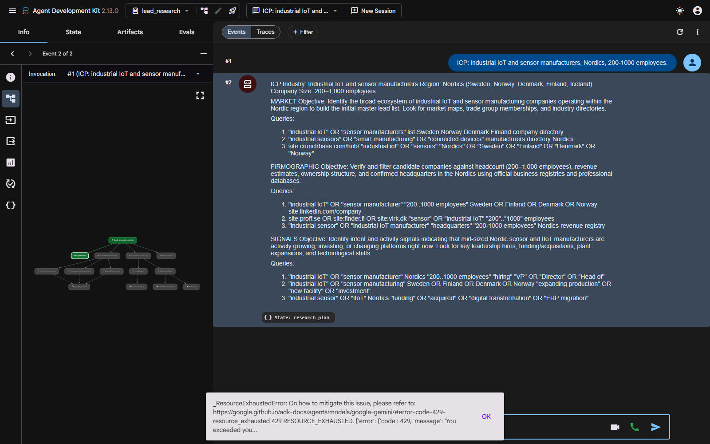

# Demo transcript — B2B lead research pipeline

**Status: PARTIAL.** The pipeline starts, `adk web` loads it, and the planner
stage completes against a real model. The three parallel researchers then fail
on a quota that cannot be routed around on this key: **Google Search grounding
is rate limited separately from, and far more tightly than, the model itself.**

Attempted on **2026-10-29** across three runs. Server: `adk web --port 8741`,
app `lead_research`.

---

## The query

> ICP: industrial IoT and sensor manufacturers, Nordics, 200-1000 employees.

## What completed — the planner

`IcpPlanner` ran on `gemini-3.5-flash` and wrote `research_plan` into session
state. This is the real, verbatim output:

```
ICP
Industry: Industrial IoT and sensor manufacturing
Region: Nordics (Sweden, Norway, Denmark, Finland, Iceland)
Company Size: 200–1,000 employees

MARKET
Objective: Identify all companies operating within the industrial IoT and
sensor manufacturing space in the Nordic region.
Target Sources: Industry associations, regional trade directories, tech
cluster maps, and industry research reports.

Search Queries:
1. "industrial IoT" OR "sensor manufacturer" directory OR list companies
   Sweden OR Norway OR Denmark OR Finland
2. "industrial sensors" OR "smart manufacturing" top companies Nordics market map
3. site:linkedin.com/company "industrial IoT" OR "sensor manufacturing" Nordics

FIRMOGRAPHIC
Objective: Verify candidate companies meet the 200–1,000 employee headcount
threshold, determine revenue bands, identify ultimate parent ownership, and
confirm headquarters in the Nordics.
Target Sources: Regional business registries (e.g., Allabolag, Virk,
Finder.fi, Proff), company corporate pages, and financial databases.

Search Queries:
1. site:allabolag.se OR site:proff.no OR site:finder.fi "sensor" OR "IoT"
   "200-499" OR "500-999" employees OR anställda
2. "industrial IoT" OR "sensor manufacturer" "200..1000 employees" Nordics
...

SIGNALS
Objective: Detect active buying signals, strategic growth initiatives, hiring
sprees, expansion plans, leadership changes, or technology shifts.
Target Sources: Job boards, press releases, tech news outlets, industrial
trade publications, and regulatory announcements.
...
```

That is exactly what the planner is specified to produce: the ICP restated as
three fields, and three briefs with concrete, runnable queries that embed the
industry, region and size band. `research_plan` was confirmed present in
session state, so the `output_key` hand-off works.

## Where it stops

`ParallelResearchers` fans out to three `LlmAgent`s that each hold
`google_search`. All three fail:

```
429 RESOURCE_EXHAUSTED. {'error': {'code': 429, 'message': 'You exceeded your
current quota, please check your plan and billing details. ...',
'status': 'RESOURCE_EXHAUSTED', 'details': [{'@type':
'type.googleapis.com/google.rpc.Help', 'links': [...]}]}}
```

Final session state after a 1800-second run: `['research_plan']`. Events: 2.
The researchers never produced `research_market`, `research_firmographic` or
`research_signals`, so the critic loop and the writer never ran.

## Diagnosis — it is grounding, not the model

Three runs were attempted, and the diagnosis tightened each time.

1. **`gemini-2.5-flash`** — exhausted at 20 requests/day.
2. **`gemini-flash-latest`** — also 20/day, also exhausted.
3. **Three different models, one per researcher.** Quota is tracked per model
   (`GenerateRequestsPerDayPerProjectPerModel`), so giving each researcher its
   own model should have removed the contention entirely:

   | Agent | Model |
   |---|---|
   | `MarketResearcher` | `gemini-3-flash-preview` |
   | `FirmographicResearcher` | `gemini-3.1-flash-lite` |
   | `SignalResearcher` | `gemini-flash-lite-latest` |

   All three still returned 429.

That ruled out the model quota and pointed at the one thing the researchers
share. The decisive test — same model, same minute, one request with search
and one without:

```
plain (no tools)       OK
grounded (search)      429  You exceeded your current quota...
```

**Google Search grounding has its own quota dimension**, and it is exhausted on
this key. Note the error shape: the per-model 429s carry a `QuotaFailure`
detail naming `GenerateRequestsPerDayPerProjectPerModel` and a `quotaValue`;
this one carries only a `Help` link, which is how it is distinguishable.

## Why this is not worked around

The three researchers exist to search the web. Removing `google_search` would
leave the pipeline structurally intact but turn a *research* agent into a
model recalling companies from memory with invented source URLs — which the
critic's evidence rule is specifically designed to reject. A passing run built
that way would be a worse outcome than an honest PARTIAL.

The remaining options are a paid tier or a Vertex AI project, both of which are
out of scope for this assignment.

## What is verified without the API

The pipeline's structure and state-passing are covered by 22 tests that run
with the model stubbed, including a full end-to-end run through all four
stages (`tests/test_offline_run.py`):

- every stage writes its `output_key` and all four stages execute in order,
- all three researchers run inside the `ParallelAgent`,
- the critic loop is capped,
- no agent mixes `google_search` with another tool,
- the 1–5 fit score is deterministic, capped at 2 without a source URL, and
  in range for every combination of inputs.

## The screenshot



The dev UI shows the pipeline loaded, the ICP query accepted, and the planner's
response. The parallel stage below it never produces events.
