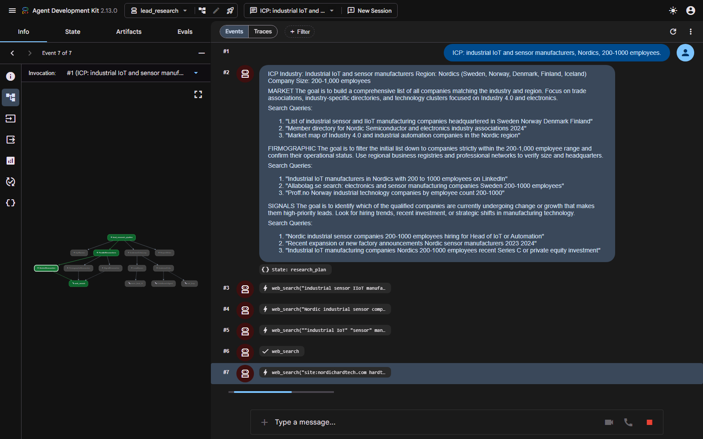
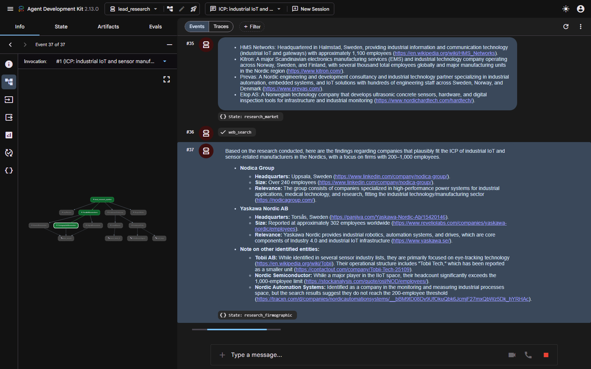
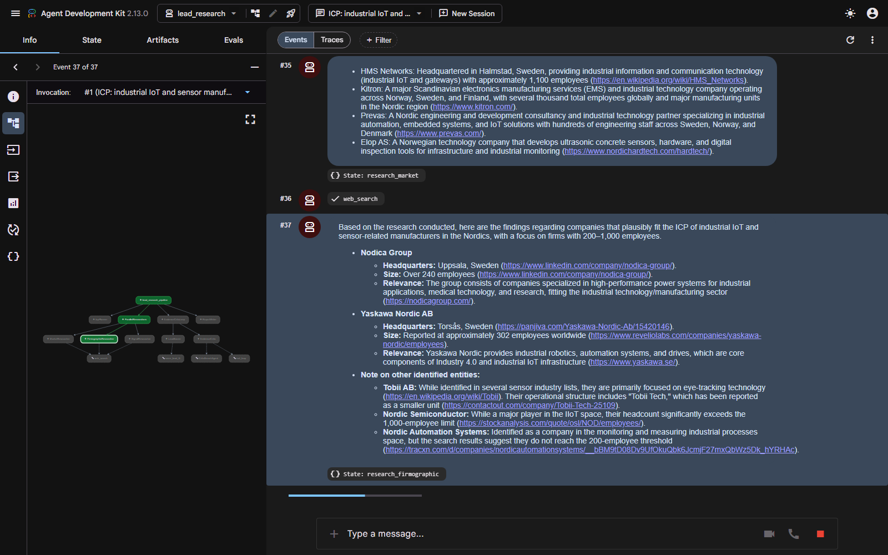
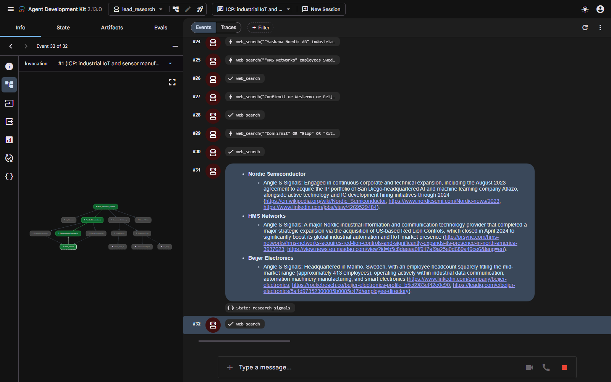
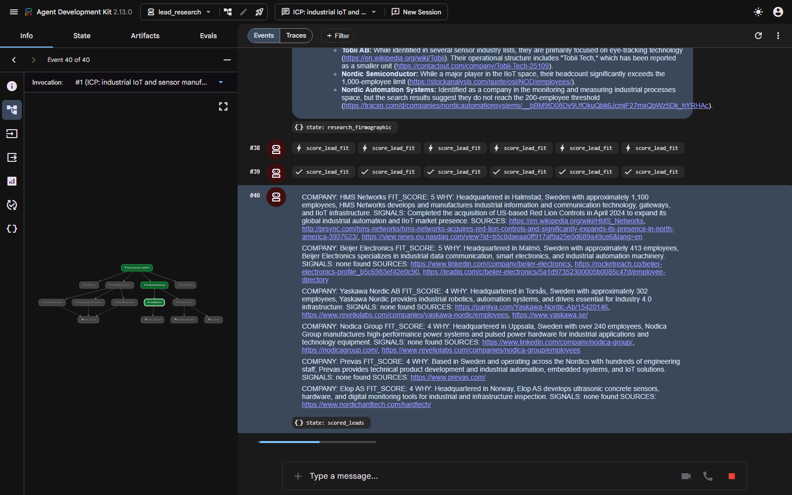

# Demo transcript — B2B lead research pipeline

**Status: WORKING.** All seven stages complete against real models with real web
evidence, ending in a sourced lead table with 1–5 fit scores.

Run on **2026-10-29**, session `demoA`, via `adk web --port 8741`, app
`lead_research`. 21 model calls, 18 `web_search` calls, 4 `score_lead_fit`
calls.

| Stage | Model |
|---|---|
| `IcpPlanner` | `gemini-3.5-flash-lite` |
| `MarketResearcher` | `gemini-3.5-flash-lite` |
| `FirmographicResearcher` | `gemini-3.1-flash-lite` |
| `SignalResearcher` | `gemini-flash-lite-latest` |
| `LeadScorer` | `gemini-3.1-flash-lite` |
| `EvidenceCritic` | `gemini-flash-lite-latest` |
| `CriticSearchAgent` | `gemini-3.5-flash-lite` |
| `ReportWriter` | `gemini-3.1-flash-lite` |

> **Why eight model assignments.** Free-tier quota is 20 requests/day **per
> model**. The three researchers run simultaneously, so they must never share
> one. See the README's "One model per stage"; every stage has its own env var,
> and the mapping above is what had quota on the day.

---

## The query

> ICP: industrial IoT and sensor manufacturers, Nordics, 200-1000 employees.

## Stage-by-stage, captured live

These screenshots were taken **during a run**, each at the moment its stage
wrote its `output_key` — not a single frame at the end.

| Stage | Screenshot |
|---|---|
| 1. Planner |  |
| 2. Market researcher |  |
| 3. Firmographic researcher |  |
| 4. Signal researcher |  |
| 5. Lead scorer |  |

The capture timings from that run show the `ParallelAgent` behaving as a
parallel agent — the three researchers finished within 25 seconds of each other
and out of declaration order:

```
[  ..s] stage 1/7 research_plan
[ 130s] stage 4/7 research_signals
[ 148s] stage 2/7 research_market
[ 155s] stage 3/7 research_firmographic
[ 218s] stage 5/7 scored_leads
```

**Evidence note.** The ADK dev UI has no way to deep-link or re-select a past
session (its session dropdown exposes no options to automation), so stages 6
and 7 below are evidenced by the session state read back from the ADK API for
session `demoA`, quoted verbatim, rather than by a UI capture. The browser-run
screenshots above are from a separate run of the same pipeline that reached
stage 5 before its critic hit a rate-limit backoff.

## Stage 5 — the scorer

`score_lead_fit` was called **4 times**, once per surviving company:

```
COMPANY: Elisa IndustrIQ (Polystar)
FIT_SCORE: 5
WHY: A Finnish company operating in the industrial IoT sector that aligns
     perfectly with the target region, industry, and employee size criteria.
SIGNALS: none found
SOURCES: https://www.linkedin.com/company/elisaindustriq/,
         https://leadiq.com/c/polystar--elisa-industriq/...

COMPANY: Safran Sensing Technologies Norway AS
FIT_SCORE: 4
...
COMPANY: DEIF A/S
FIT_SCORE: 4
...
```

## Stage 6 — the critic

```
APPROVED
```

The critic called `exit_loop` and the loop ended on its first pass. That is the
designed happy path: the list was fully sourced, so there was nothing to send
back.

The critic is not a rubber stamp. In an earlier run on the same ICP it
**rejected two leads on firmographic grounds**, and caught the scorer
contradicting its own evidence:

> **HMS Networks AB**: The company's reported headcount of 1,100 employees
> exceeds the ICP limit of 200-1,000. While the scorer claims it is at the
> "upper threshold," it does not fit the firmographic requirements.
>
> **Data Respons Solutions A/S**: The company's reported headcount of ~1,400
> employees exceeds the ICP limit of 200-1,000. The rationale provided
> explicitly states this headcount, contradicting the `size_match: 'exact'`
> input used in the `score_lead_fit` tool.

In that run the scorer re-scored against the critique and the loop ran twice.

## Stage 7 — the final report

```markdown
This report identifies industrial IoT and sensor manufacturers based in the
Nordics with an employee headcount between 200 and 1000.

| Company | Fit (1-5) | Why they fit | Buying signals | Sources |
| :--- | :---: | :--- | :--- | :--- |
| Elisa IndustrIQ (Polystar) | 5 | A Finnish company operating in the industrial IoT sector that aligns perfectly with the target region, industry, and employee size criteria. | none found | [LinkedIn](https://www.linkedin.com/company/elisaindustriq/), [LeadIQ](https://leadiq.com/c/polystar--elisa-industriq/5a1d8b302400002400665921/employee-directory) |
| Safran Sensing Technologies Norway AS | 4 | A Norwegian-based producer of high-precision sensors for industrial applications that closely approaches the mid-market employee size range. | none found | [Wikipedia](https://en.wikipedia.org/wiki/Safran_Sensing_Technologies_Norway) |
| DEIF A/S | 4 | A Danish supplier of intelligent sensors and power control solutions that fits the Nordic industrial IoT and sensor manufacturing profile. | none found | [DEIF](https://www.deif.com/) |
| Seluxit | 4 | A Danish IoT product provider offering hardware and platforms for connecting industrial systems, aligning with the target sector and region. | none found | [Seluxit](https://www.seluxit.com/) |

### How to read the score
5 is an exact match on industry, region and size with live buying signals; 1 is
a weak match or thin evidence; a lead with no source URL is capped at 2.

### Gaps
The research could not establish precise real-time headcount for several
candidates, as many companies in this sector operate as subsidiaries of larger
multinational groups (e.g., Safran, Asahi Kasei/Senseair), making it difficult
to isolate the exact headcount for the specific Nordic manufacturing entities.
Furthermore, no strong, time-sensitive "in-market" buying signals (such as
recent large-scale hiring of specific engineering roles or specific
infrastructure expansion news) were identified for the companies listed.
```

Four real Nordic companies — Finnish, Norwegian, Danish, Danish — each with a
working source URL. Every "Buying signals" cell says "none found" rather than
being padded, and the Gaps section names what the research could not establish,
including the subsidiary-headcount problem that the critic had flagged in the
earlier run.

---

## How this went from never finishing to finishing

Three live runs failed before this one, and the diagnosis took three passes.
The first two found real bugs that were not the cause:

1. **Lock scope.** The search tool held its rate-limit lock across the network
   call, so one slow search blocked the other two researchers. Fixed: the lock
   now only reserves a time slot.
2. **No request timeout.** A hung model call could wait forever, and
   `HttpRetryOptions` cannot help when nothing ever fails. Fixed with
   `client_kwargs={"http_options": HttpOptions(timeout=90000)}`.
3. **The actual cause.** ADK calls a **sync** function tool directly on the
   asyncio event loop — `function_tool.py::sync_wrapper` is a plain
   `target(*pos, **kw)` with no thread behind it. `web_search` was sync, doing
   `time.sleep()` and a blocking HTTP request, so three researchers calling it
   at once **froze the whole ADK server**. That is why runs went silent for
   20+ minutes with at most one error in the log: nothing failed, everything
   was starved.

Making `web_search` a coroutine — `asyncio.Lock`, `await asyncio.sleep`, and
the blocking `ddgs` call via `asyncio.to_thread` — took the parallel stage from
never completing to about three minutes.

The tell generalises: **a stall with a clean error log is almost never the
provider.** A provider that fails gives you a status code.

Two further issues found and fixed on the way:

- **DDG throttling.** It answers a three-way burst with HTTP 202 and an empty
  body rather than an error. At a 1.5 s inter-call gap: **4 usable responses
  against 15 throttled**. At 6 s: **4 against 0**.
- **No search budget.** The market researcher ran **33** searches in one run,
  one per candidate company, and exhausted its model's daily quota. The budget
  is now 6; this run used 18 across three researchers.

## What is verified without the API

34 tests, none touching the network, including an end-to-end run of all four
stages against a scripted model: every stage writes its `output_key` in order,
all three researchers execute inside the `ParallelAgent`, the critic loop is
capped and terminates when the critic never exits, no agent uses the built-in
`google_search`, the 1–5 score is deterministic and capped at 2 without a
source URL, and `web_search` normalises results, drops results with no URL,
retries transport failures, and reports failure as a value rather than raising.
