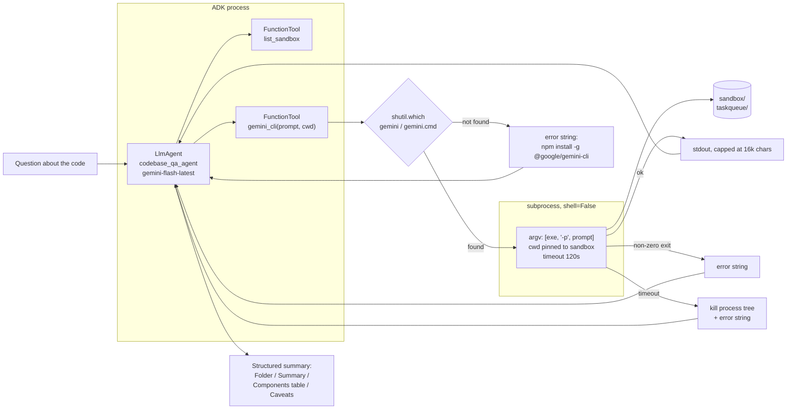

# Agent B — codebase Q&A through the Gemini CLI

**Status: WORKING**

**Demo video:** one video covers all five agents — see the link at the top of [the assignment README](../README.md).


An `LlmAgent` that answers questions about a code folder by shelling out to the
**Gemini CLI** and turning its answer into a structured summary. The agent
never reads the files itself; the CLI does, inside a pinned sandbox.

## Architecture



## The tool contract

`gemini_cli(prompt, cwd)` runs `gemini -p <prompt>` and **never raises**. Every
failure comes back as `{"ok": false, "error": "..."}` so the model can tell the
user what went wrong instead of the turn dying.

| Rule | Why |
|---|---|
| **argv list, `shell=False`** | The reference builds `gemini -p "{task}"` and runs it with `shell=True`. A prompt containing `"` or `;` becomes shell syntax there. Here the prompt is always exactly one argv element — asserted in `tests/test_cli_tool.py`. |
| **`shutil.which`** | On Windows npm installs the entry point as `gemini.cmd`; a bare `"gemini"` does not resolve without a shell. Falls back to `%APPDATA%\npm`. |
| **`cwd` pinned to a sandbox** | `_resolve_cwd` resolves the path and refuses anything outside `./sandbox`. The reference clones an arbitrary GitHub URL into `/tmp` and runs there. |
| **No auto-approve flags** | Only `-p` is ever passed, and the argv is scanned for `--yolo`, `-y`, `--approval-mode`, `--allow-all` before executing. |
| **120-second timeout** | Plus a process-tree kill, see below. |
| **Output capped at 16k chars** | Flagged with `truncated: true`, which the prompt requires be surfaced in Caveats. |

### Two things the CLI does that cost real debugging

**Workspace trust.** Since 0.6x the CLI exits **55** with "not running in a
trusted directory". The documented headless escape is
`GEMINI_CLI_TRUST_WORKSPACE=true`, which we set **on the subprocess env only**,
and only because `cwd` is already pinned inside our own sandbox. Trusting a
workspace is not the same as auto-approving tool calls: we still pass no
`--yolo` and no `--approval-mode`, so the CLI stays read-only and
non-interactive. A test asserts the variable does not leak into our process.

**Killing it is not straightforward.** `subprocess.run(timeout=...)` kills
`gemini.cmd`, but that is a shim: the real work is a `node.exe` grandchild,
which survives, keeps the stdout pipe open, and makes the follow-up
`communicate()` block forever. The first version of this tool hung for 400+
seconds on a 120-second timeout. The fix is `Popen` with
`CREATE_NEW_PROCESS_GROUP` and `taskkill /F /T` on the whole tree, then a short
drain. Verified: it now returns in 15.3s on a 15s timeout and leaves zero
orphaned node processes.

### Auth: API key, or "Login with Google"

`GEMINI_CLI_USE_OAUTH=true` switches the CLI from the AI Studio API key to its
own OAuth session, whose personal-account allowance is far larger than the
key's free tier. Getting that to work takes two steps, not one:

1. **Remove the keys from the child env.** With `GEMINI_API_KEY` or
   `GOOGLE_API_KEY` present the CLI always prefers the key and never looks at
   cached OAuth credentials.
2. **Name the auth method.** With no key and nothing else set, the CLI exits
   **41**: `Please set an Auth method in your settings.json or specify one of
   the following environment variables ... GEMINI_API_KEY,
   GOOGLE_GENAI_USE_VERTEXAI, GOOGLE_GENAI_USE_GCA`. The OAuth path is
   `GOOGLE_GENAI_USE_GCA=true` (Gemini Code Assist).

To log in, from a shell with the keys cleared:

```powershell
cd Assignment3_gemini_cli_agent\sandbox
$env:GEMINI_API_KEY = ""
$env:GOOGLE_API_KEY = ""
$env:GEMINI_CLI_TRUST_WORKSPACE = "true"
gemini
```

Then choose **Login with Google**. Credentials cache to
`~/.gemini/oauth_creds.json`.

**This did not work on the account cached here**, and the failure is worth
recording because it is not a configuration mistake:

```
Gemini CLI exited 1: Error authenticating: IneligibleTierError:
Your current account is not eligible for Gemini Code Assist for individuals,
the free version of Gemini Code Assist.
```

That is what Google returns for managed Google Workspace accounts, which are
excluded from the free individual tier. A personal `@gmail.com` account would
work. The flag is therefore **off by default** and this agent runs on the API
key; set `GEMINI_CLI_USE_OAUTH=true` only once an eligible account is logged in.

## Our changes from the reference

The reference ([derrickchwong/gemini-cli-on-adk](https://github.com/derrickchwong/gemini-cli-on-adk))
takes `gemini_cli(task, github_url)`, clones that repo into `/tmp`, runs the
CLI there with `shell=True` and a 600s timeout on Vertex AI, and returns raw
stdout.

1. **Answers questions about a local code folder, and returns a structured
   summary.** The signature is `gemini_cli(prompt, cwd)` — no cloning, no URLs.
   The prompt requires a fixed output shape (Folder / Summary / Components
   table / Key details / Caveats), so the agent synthesises rather than
   forwarding raw CLI stdout.
2. **Sandboxed and hardened execution**: argv instead of a shell string,
   `shutil.which` for Windows, cwd confined to one folder, 120s instead of
   600s, capped output, a `list_sandbox` tool so the agent can see what exists
   before spending a slow CLI call, and errors as values rather than exceptions.
3. AI Studio with an API key instead of Vertex AI with ADC and metadata-server
   project discovery, so it runs locally with no cloud project.

## Installing the CLI

Not a pip dependency — it comes from npm:

```powershell
npm install -g @google/gemini-cli
gemini --version   # verified against 0.66.0
```

On Windows this lands at `%APPDATA%\npm\gemini.cmd`, which is exactly the case
`find_gemini_executable` handles. The CLI reads `GEMINI_API_KEY` from the
environment; the agent copies `GOOGLE_API_KEY` into it if only one is set.

## Setup

```powershell
cd Assignment3\b_gemini_cli_agent
py -3.11 -m venv .venv
.\.venv\Scripts\python.exe -m pip install -r requirements.txt
Copy-Item .env.example .env
```

```powershell
$lines = @("GOOGLE_GENAI_USE_VERTEXAI=FALSE", "GOOGLE_API_KEY=$env:GEMINI_API_KEY")
Set-Content -Path .env -Value $lines -Encoding utf8
Copy-Item .env gemini_cli_agent\.env
```

## Run

```powershell
cd Assignment3\b_gemini_cli_agent
.\.venv\Scripts\adk.exe web --port 8761
```

Open <http://127.0.0.1:8761>, pick `gemini_cli_agent`, and ask:

> What is in the taskqueue package, and how does a task get retried?

Tests:

```powershell
.\.venv\Scripts\python.exe -m pytest tests\ -q
```

The CLI subprocess is stubbed in every test, so the suite is fast and spends no
API quota.

## The sandbox

[`sandbox/taskqueue/`](sandbox/) is a small, real Python package — a priority
task queue and a worker with a retry budget — written to be small enough that
the CLI can read all of it in one pass. Point `GEMINI_CLI_SANDBOX` at a
different folder to analyse your own code.

## Environment variables

| Variable | Required | Purpose |
|---|---|---|
| `GOOGLE_API_KEY` | yes | AI Studio key for the ADK agent. Mirrored into `GEMINI_API_KEY` for the CLI. |
| `GOOGLE_GENAI_USE_VERTEXAI` | yes | `FALSE`. Defaulted in code. |
| `GEMINI_CLI_AGENT_MODEL` | no | Default `gemini-flash-latest`. |
| `GEMINI_CLI_SANDBOX` | no | Folder the CLI may run in. Default `./sandbox`. |
| `GEMINI_CLI_TIMEOUT` | no | Seconds, default 120. |
| `GEMINI_CLI_MAX_OUTPUT` | no | Characters, default 16000. |
| `GEMINI_CLI_USE_OAUTH` | no | `true` runs the CLI under OAuth instead of the API key. Off by default; see Auth above. |

## Versions

- Python 3.11.0, `google-adk==2.13.0`, `pytest==9.2.0`
- `@google/gemini-cli` **0.66.0** (npm, global), Node v24.19.0

## Known limits

- **Two model budgets, one key.** A single question costs one ADK call *and*
  one or more CLI calls, all against the same AI Studio quota (20 requests/day
  free tier). When the quota is exhausted the CLI does not fail fast — it
  retries internally and then hits our 120-second timeout, which looks like a
  hang. If this agent times out, check the quota first.
- **The CLI is slow**, routinely tens of seconds, because it reads files and
  calls a model. The 120s cap is a real ceiling on how much code it can chew.
- **Read-only by design.** No write tools, no auto-approve. If the user asks
  for an edit, the agent says it only reads code.
- **Output cap can truncate a long answer.** Flagged, not silent.
- **The sandbox boundary is a path check**, not an OS sandbox. The CLI runs
  with this user's permissions; a symlink deliberately placed inside the
  sandbox would be followed.
- `--version` on the CLI resolves to `gemini.ps1` under PowerShell but
  `gemini.CMD` under `shutil.which`; both are the same package.

## Sources

- [derrickchwong/gemini-cli-on-adk](https://github.com/derrickchwong/gemini-cli-on-adk)
  — the idea of exposing the Gemini CLI as an ADK function tool, and the
  subprocess shape. Read for structure; no files copied, and the shell/cloning
  behaviour was deliberately replaced.
- [Gemini CLI docs](https://github.com/google-gemini/gemini-cli) — `-p`
  non-interactive mode and the
  [trusted folders](https://geminicli.com/docs/cli/trusted-folders/#headless-and-automated-environments)
  behaviour for headless environments.
- [ADK docs — Function tools](https://google.github.io/adk-docs/tools/function-tools/).
