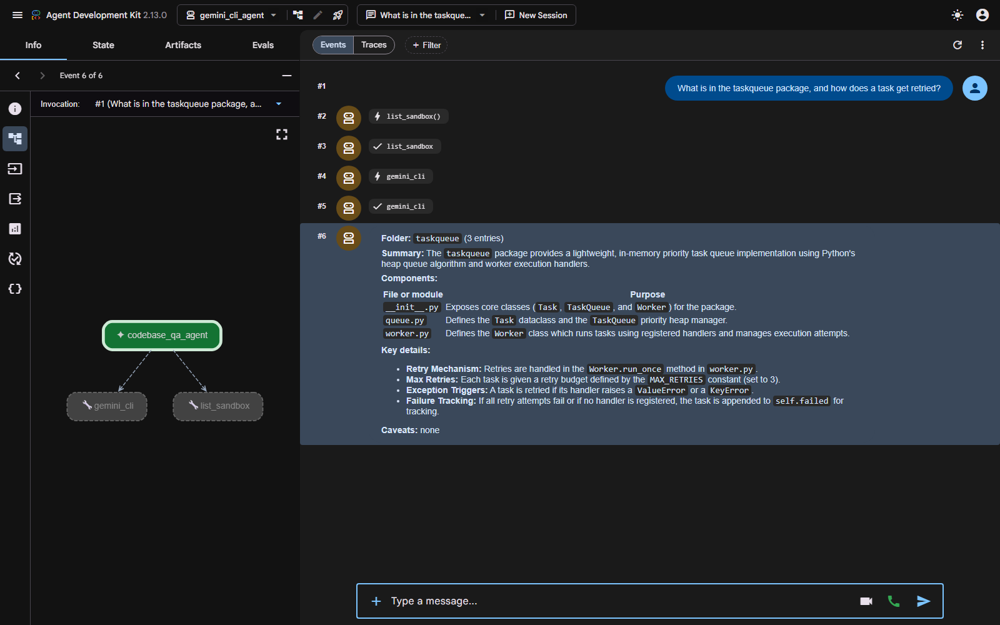

# Demo transcript — codebase Q&A through the Gemini CLI

Real run on **2026-10-29**. ADK agent model **`gemini-3.5-flash-lite`**; the
CLI subprocess pinned to **`gemini-3-flash-preview`** via `-m`.
Server: `adk web --port 8761`, app `gemini_cli_agent`.
Run time **22 seconds**, 6 events, 2 tool calls. The CLI call itself took 14.1 s.

> **Model note.** Every model on this key has its own 20-requests/day free-tier
> bucket, so the agent and the CLI are pinned to *different* models and do not
> compete. Defaults: `GEMINI_CLI_AGENT_MODEL` and `GEMINI_CLI_MODEL`.



---

## The query

> What is in the taskqueue package, and how does a task get retried?

## Tool calls in the trace

```
>>> list_sandbox({})
>>> gemini_cli({
      "cwd": "taskqueue",
      "prompt": "What files are in the taskqueue package, what does each file
                 do, and how does a task get retried within this package?"
    })
```

The agent did exactly what the prompt asks: it spent the cheap tool first to
see what existed, then wrote **one** CLI prompt that asked for everything it
needed in a single pass, rather than burning several slow calls.

## Tool result — `list_sandbox`

```json
{"ok": true, "folder": ".", "directories": ["taskqueue"], "files": ["README.md"]}
```

## Tool result — `gemini_cli` (abridged)

```json
{
  "ok": true,
  "folder": "taskqueue",
  "files_visible": ["__init__.py", "queue.py", "worker.py"],
  "file_count": 3,
  "truncated": false,
  "elapsed_seconds": 14.1,
  "exit_code": 0,
  "output": "The `taskqueue` package consists of three files ...
             ### How a Task is Retried:
             * Retry Budget: ... global constant `MAX_RETRIES` (default is 3).
             * Retry Loop: ... a `for` loop that runs up to `MAX_RETRIES` times.
             * Exception Handling: If the handler raises a `ValueError` or
               `KeyError`, the worker logs the failure and immediately attempts
               the next retry ...
             * Failure: If the task fails all `MAX_RETRIES` attempts (or if no
               handler is registered), it is added to the `self.failed` list ..."
}
```

The CLI read the real files and quoted the real retry loop back, including the
exact `except (ValueError, KeyError)` clause.

## Model response — the structured summary

This is our change from the reference, which returns raw CLI stdout. The
agent reshaped it into the fixed format the prompt demands:

> **Folder:** `taskqueue` (3 entries)
>
> **Summary:** The `taskqueue` package provides a lightweight, in-memory
> priority task queue implementation using Python's heap queue algorithm and
> worker execution handlers.
>
> **Components:**
>
> | File or module | Purpose |
> |---|---|
> | `__init__.py` | Exposes core classes (`Task`, `TaskQueue`, and `Worker`) for the package. |
> | `queue.py` | Defines the `Task` dataclass and the `TaskQueue` priority heap manager. |
> | `worker.py` | Defines the `Worker` class which runs tasks using registered handlers and manages execution attempts. |
>
> **Key details:**
> - **Retry Mechanism:** Retries are handled in the `Worker.run_once` method in `worker.py`.
> - **Max Retries:** Each task is given a retry budget defined by the `MAX_RETRIES` constant (set to 3).
> - **Exception Triggers:** A task is retried if its handler raises a `ValueError` or a `KeyError`.
> - **Failure Tracking:** If all retry attempts fail or if no handler is registered, the task is appended to `self.failed` for tracking.
>
> **Caveats:** none

Every claim checks out against
[`sandbox/taskqueue/worker.py`](../sandbox/taskqueue/worker.py): `MAX_RETRIES`
is 3, the loop catches `(ValueError, KeyError)`, and both the no-handler branch
and the exhausted-retries branch append to `self.failed`.

---

## Auth: what was tried

The brief asked for Gemini CLI OAuth, which draws on a personal-account
allowance rather than the API key's free tier. It is implemented behind
`GEMINI_CLI_USE_OAUTH=true`, and getting there needed two steps:

1. **Strip the keys from the child env.** With `GEMINI_API_KEY` or
   `GOOGLE_API_KEY` present the CLI always prefers the key and never consults
   cached OAuth credentials.
2. **Name the auth method.** With no key and nothing else set, the CLI exits
   **41**: `Please set an Auth method ... GEMINI_API_KEY,
   GOOGLE_GENAI_USE_VERTEXAI, GOOGLE_GENAI_USE_GCA`. OAuth is
   `GOOGLE_GENAI_USE_GCA=true`.

With both correct, the cached account was refused:

```
Gemini CLI exited 1: Error authenticating: IneligibleTierError:
Your current account is not eligible for Gemini Code Assist for individuals,
the free version of Gemini Code Assist.
```

That is Google's response for managed Workspace accounts. A personal
`@gmail.com` would work. The flag therefore defaults to **off** and this
transcript was produced on the API key.

## Rate limiting and timeouts, observed

An earlier attempt on an exhausted model did **not** fail fast: the CLI retried
internally and then hit our 120-second timeout, which from the outside looks
like a hang. That is recorded as a known limit — if this agent times out, check
the model's quota before suspecting the tool.

The timeout path itself was verified separately. With `GEMINI_CLI_TIMEOUT=15`
the tool returned in **15.3 s** and left **zero** orphaned `node.exe`
processes, which only works because it kills the whole process tree: on Windows
`gemini.cmd` is a shim, and killing it alone leaves a `node` grandchild holding
the stdout pipe (an earlier version hung for 400+ seconds on a 120-second
timeout).
