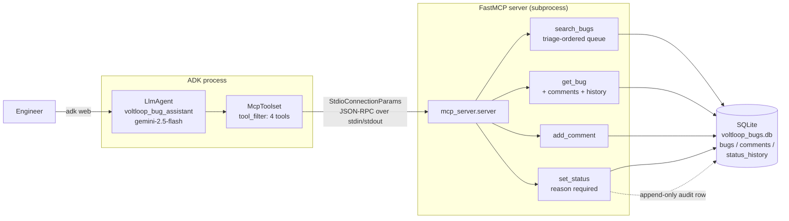

# Agent C — VoltLoop bug triage assistant (MCP over SQLite)

**Status: WORKING**

A bug triage assistant for VoltLoop, a synthetic electric-scooter sharing
platform. The agent itself owns no tools. Every capability arrives over the
Model Context Protocol from a FastMCP server that we start as a stdio
subprocess, backed by a SQLite tracker seeded with 30 synthetic bugs.

You ask it what to work on next; it returns a severity- and component-ranked
triage queue, reads bug history, records findings, and moves bugs through the
workflow — but only with a reason it can justify.

## Architecture



## What it does

| Tool | Behaviour |
|---|---|
| `search_bugs` | Filters on free text, component, severity, status. Returns bugs **ordered by triage score**, plus a summary counting matches by severity and component and flagging critical-path hits. |
| `get_bug` | One bug in full, with its comments and its complete status history. |
| `add_comment` | Appends an attributed investigation note. |
| `set_status` | Moves a bug between `open`/`in_progress`/`blocked`/`resolved`/`closed`. **Refuses to act without a reason of 15+ characters**, and writes that reason to an append-only audit trail. |

### The triage score

`search_bugs` is a queue, not a search. The score is deterministic (see
`mcp_server/db.py::triage_score`):

- **Severity dominates:** S1 = 1000, S2 = 500, S3 = 200, S4 = 50.
- **Critical-path component boost:** `payments` and `auth` +120,
  `dispatch-api` and `iot-firmware` +60, everything else +0. A payments bug
  outranks a maps bug of the same severity — but the boost can never overcome a
  whole severity step, which is asserted in the tests.
- **Age nudge:** +1 per day, capped at 30, so stale bugs surface.
- **Status damping:** `in_progress` −150 and `blocked` −40, so the queue points
  at untouched work. `resolved`/`closed` −5000, large enough that finished work
  always sorts below any live bug.

## Our changes from the reference

The upstream sample is a coffee-machine company (QuantumRoast) bug assistant
backed by **Postgres via MCP Toolbox for Databases** over **streamable HTTP**,
with vector-similarity ticket search plus Google Search and StackExchange tools.

Changed domain: electric-scooter sharing (VoltLoop), eight components of its
own, and an S1–S4 severity scheme in place of the P0–P3 priority scheme.

Two behavioural changes, as required:

1. **Triage by severity and component.** Upstream `search-tickets` does a cosine
   vector search and returns similarity matches. Ours returns a ranked work
   queue: results are ordered by the triage score above, and the response
   carries a `triage_summary` with per-severity and per-component counts and a
   `critical_path_matches` total. The ranking is server side, and the prompt
   tells the model to trust the score rather than re-rank by intuition.
2. **`set_status` requires a reason.** Upstream `update-ticket-status` takes an
   ID and a status. Ours takes a mandatory `reason`, rejects anything under 15
   characters with `status_unchanged: true` and an explanation, and on success
   writes a `status_history` row recording old status, new status, reason,
   author, and timestamp. The prompt forbids inventing a reason to clear the
   gate; the model must ask the engineer instead.

Infrastructure also differs: **FastMCP over stdio against local SQLite**,
instead of MCP Toolbox over streamable HTTP against Postgres. That removes the
external Toolbox binary and the database server, so the agent runs from a clean
clone with no cloud resources.

## Setup

```powershell
cd Assignment3\c_bug_assistant_agent
py -3.11 -m venv .venv
.\.venv\Scripts\python.exe -m pip install -r requirements.txt
Copy-Item .env.example .env
```

Then put your AI Studio key in `.env`. If `GEMINI_API_KEY` is already in your
environment, this maps it across:

```powershell
$lines = @("GOOGLE_GENAI_USE_VERTEXAI=FALSE", "GOOGLE_API_KEY=$env:GEMINI_API_KEY")
Set-Content -Path .env -Value $lines -Encoding utf8
Copy-Item .env bug_assistant\.env
```

The SQLite file is created and seeded with the 30 bugs on first tool call. To
reset it between demos:

```powershell
Remove-Item voltloop_bugs.db -ErrorAction SilentlyContinue
```

## Run

```powershell
cd Assignment3\c_bug_assistant_agent
.\.venv\Scripts\adk.exe web --port 8731
```

Open <http://127.0.0.1:8731>, pick `bug_assistant`, and try:

> What should I pick up first? Show me the open payments and auth bugs by triage order.

Tests:

```powershell
cd Assignment3\c_bug_assistant_agent
.\.venv\Scripts\python.exe -m pytest tests\ -q
```

**22 passed.** No test touches the network. Most call the MCP tool functions
directly; `tests/test_mcp_roundtrip.py` additionally drives the real path
end to end — `McpToolset` -> stdio subprocess -> FastMCP -> SQLite and back —
with only the model replaced by a scripted stand-in that emits fixed tool
calls. Each test gets a throwaway SQLite file via `BUG_DB_PATH`, and the
suite strips `GOOGLE_API_KEY`/`GEMINI_API_KEY` so an accidental live call
fails loudly rather than spending quota.

## Environment variables

| Variable | Required | Purpose |
|---|---|---|
| `GOOGLE_API_KEY` | yes | AI Studio key. `agent.py` falls back to `GEMINI_API_KEY` if this is unset. |
| `GOOGLE_GENAI_USE_VERTEXAI` | yes | Must be `FALSE` for the local AI Studio path. Defaulted in code. |
| `BUG_ASSISTANT_MODEL` | no | Model override. Default `gemini-2.5-flash`. |
| `BUG_DB_PATH` | no | SQLite location. Default `voltloop_bugs.db` in this folder. Tests set it per-test. |

## Versions

- Python 3.11.0
- `google-adk==2.13.0`
- `fastmcp==4.1.4`, `mcp==2.3.0`
- `pytest==9.2.0`, `pytest-asyncio==1.4.1`, `python-dotenv==1.2.4`

## Known limits

- **Text search is `LIKE`, not semantic.** The upstream sample does vector
  similarity over ticket descriptions; we dropped that rather than pull in an
  embedding dependency. "double charge" will not match "billed twice".
- **SQLite with one writer.** Fine for a single agent; concurrent writers would
  need a real database.
- **The reason gate checks length, not sincerity.** A 15-character string of
  nonsense passes the server check. The prompt is what makes the model supply a
  real reason, and a prompt is a weaker guarantee than code.
- **No authentication.** Any caller can set any bug's status. The `author` field
  is self-reported.
- **The MCP server starts fresh per `adk web` session**, paying interpreter
  startup on the first tool call. The `StdioConnectionParams` timeout is set to
  60s to absorb that.
- **Triage weights are hardcoded**, not configurable per team.

## Sources

- [`google/adk-samples` — `python/agents/software-bug-assistant`](https://github.com/google/adk-samples)
  — the agent/prompt/tools layout and the triage-assistant framing. The sample
  has since been removed from `main` in the upstream restructure; it was read at
  commit `fd9b4fe^` (the commit that deleted it). Read for structure only; no
  files copied.
- [Google Codelab — *From Zero to Assistant: Build a Software Bug Assistant with ADK*](https://codelabs.developers.google.com/your-first-agent-with-adk)
  — the MCP-backed bug tracker pattern.
- [ADK docs — MCP tools](https://google.github.io/adk-docs/tools/mcp-tools/) —
  `McpToolset` + `StdioConnectionParams` wiring.
- [FastMCP docs](https://gofastmcp.com/) — the `@mcp.tool` server.
