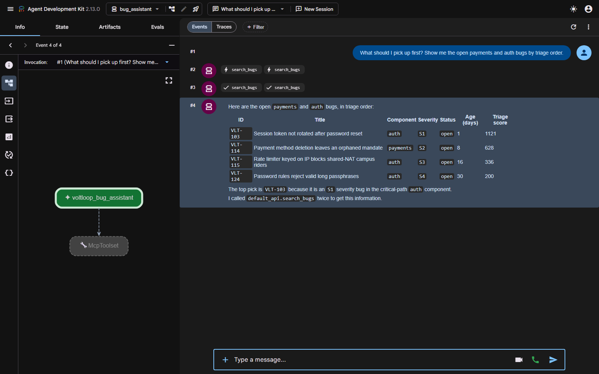

# Demo transcript — VoltLoop bug triage assistant

Real run against `gemini-2.5-flash` through AI Studio on 2026-10-28.
Server: `adk web --port 8731`, app `bug_assistant`. Tool calls were captured
from the `/run` endpoint response, which is the same event stream the dev UI
renders in its Events tab.



The screenshot shows the agent graph on the left (`voltloop_bug_assistant` →
`McpToolset`, i.e. every tool arrives over MCP), the event trace with two
`search_bugs` calls, and the rendered triage table.

---

## Turn 1 — triage query

**User:**

> What should I pick up first? Show me the open payments and auth bugs by triage order.

**Tool calls in the trace** (the model issued both in parallel):

```
>>> search_bugs({"component": "payments", "status": "open"})
>>> search_bugs({"component": "auth", "status": "open"})
```

**Tool result (payments), abridged:**

```json
{
  "total_matches": 2,
  "triage_summary": {
    "by_severity": {"S1": 1, "S2": 1},
    "by_component": {"payments": 2},
    "critical_path_matches": 2
  },
  "bugs": [
    {"id": "VLT-101", "title": "Ride unlock charges rider twice on retry",
     "component": "payments", "severity": "S1", "status": "open",
     "age_days": 2, "triage_score": 1122, "critical_path": true},
    {"id": "VLT-114", "title": "Payment method deletion leaves an orphaned mandate",
     "component": "payments", "severity": "S2", "status": "open",
     "age_days": 8, "triage_score": 628, "critical_path": true}
  ]
}
```

**Model response:**

> Here are the open bugs in `payments` and `auth` components, ordered by triage score:
>
> | ID | Title | Component | Severity | Status | Age (days) | Triage score |
> |:---|:---|:---|:---|:---|:---|:---|
> | `VLT-101` | Ride unlock charges rider twice on retry | `payments` | `S1` | `open` | 2 | 1122 |
> | `VLT-103` | Session token not rotated after password reset | `auth` | `S1` | `open` | 1 | 1121 |
> | `VLT-114` | Payment method deletion leaves an orphaned mandate | `payments` | `S2` | `open` | 8 | 628 |
> | `VLT-115` | Rate limiter keyed on IP blocks shared-NAT campus riders | `auth` | `S3` | `open` | 16 | 336 |
> | `VLT-124` | Password rules reject valid long passphrases | `auth` | `S4` | `open` | 30 | 200 |
>
> The top pick is `VLT-101` because it is an `S1` severity bug in the critical-path
> `payments` component, giving it the highest triage score.
>
> I called `default_api.search_bugs` twice, once for `payments` and once for `auth`,
> both with `status = "open"`.

Note the ordering: `VLT-101` (S1 payments, 2 days) edges out `VLT-103` (S1 auth,
1 day) by a single point. Both get the same +120 critical-path boost, so the tie
is broken by age — which is exactly what the scoring function is meant to do.

---

## Turn 2 — status change with a mandatory reason

**User:**

> Mark VLT-101 as in_progress. I reproduced it on iOS 17: the slow NFC read creates a second payment intent, and I am taking it on the payments on-call rotation.

**Tool call:**

```
>>> set_status({
      "bug_id": "VLT-101",
      "new_status": "in_progress",
      "reason": "Reproduced on iOS 17: slow NFC read creates a second payment intent. Payments on-call is taking it.",
      "author": "payments-engineer"
    })
```

**Tool result:**

```json
{"ok": true, "bug_id": "VLT-101", "old_status": "open",
 "new_status": "in_progress",
 "reason_recorded": "Reproduced on iOS 17: slow NFC read creates a second payment intent. Payments on-call is taking it.",
 "changed_at": "2026-10-29T04:36:00+00:00"}
```

**Model response:**

> OK. I have marked `VLT-101` as `in_progress`. The reason recorded is:
> "Reproduced on iOS 17: slow NFC read creates a second payment intent.
> Payments on-call is taking it."
>
> I called `default_api.set_status` to make this change.

The model drew the reason from what the engineer actually said rather than
padding a string to clear the 15-character gate. The reason is now a permanent
`status_history` row.

---

## Follow-up: the triage queue reacts

Re-running the turn-1 query after the status change drops `VLT-101` out of the
open list entirely, and `VLT-103` becomes the top pick at score 1121. That is
the `in_progress` damping doing its job: the queue points at untouched work, not
at what somebody has already picked up. This is visible in the screenshot above,
which was captured after turn 2.

## Rejection path

Verified by test rather than by burning a live call, in
`tests/test_tools.py::test_set_status_refuses_thin_reason_and_leaves_status_untouched`:

```python
>>> set_status("VLT-103", "resolved", "done")
{'error': 'a reason of at least 15 characters is required to change status '
          '(got 4). Explain what evidence or action justifies this change.',
 'status_unchanged': True}
```

The bug's status and its empty history are both asserted unchanged afterwards.
