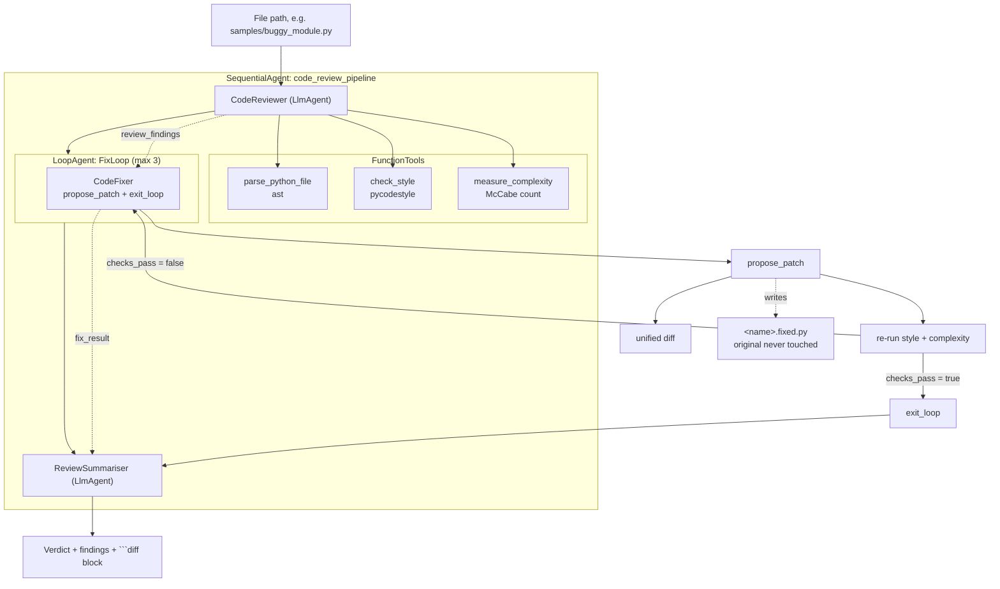

# Agent D — Python code review and fix agent

**Status: WORKING**

Give it a path to a Python file. It parses the file, runs PEP 8 checks and
cyclomatic complexity over it, writes findings with explicit severities, then
tries up to three times to patch the file — **emitting a unified diff** and
re-running every check on each attempt, and leaving the loop through
`exit_loop` only once the checks genuinely pass.

## Architecture



## Tools

| Tool | What it does |
|---|---|
| `parse_python_file` | `ast` parse: functions, classes, imports, docstring presence, line numbers. Reports syntax errors with a line number, and then nothing else matters. |
| `check_style` | `pycodestyle` violations, grouped by code, with a separate **serious** list (`E722` bare except, `E711`/`E712` identity comparisons, `E741` ambiguous names, `W605`). |
| `measure_complexity` | McCabe count per function: 1 + branch points, where each extra operand of a boolean operator counts. Warn at 10, fail at 15. |
| `propose_patch` | Takes the full corrected source. Returns a **unified diff**, whether it parses, and style + complexity re-run against the patch. Sets `checks_pass`. |

All four take a **file path**, and all four refuse paths outside the sandbox.

## Our changes from the reference

The reference ([ayoisio/adk-code-review-assistant](https://github.com/ayoisio/adk-code-review-assistant))
is an educational grading assistant: a student pastes code into chat, it gets a
style score, generated-and-executed tests, encouraging feedback and persistent
per-student progress tracking.

1. **File paths, not pasted source.** Every tool reads from disk inside a
   sandbox root. This is not cosmetic: the fixer can diff against the real
   file, nothing depends on the model echoing a hundred lines of source back to
   itself accurately, and the sandbox check is a real boundary
   (`tests/test_tools.py` asserts `../../../etc/passwd` and friends are refused).
2. **The fixer must emit a unified diff.** `propose_patch` returns a real
   `difflib.unified_diff` with `---`/`+++` headers and `@@` hunks, and both the
   fixer and summariser prompts require it to be shown in a ` ```diff ` block.
   The reference returns rewritten code with no diff.
3. Reframed from education to CI-style review: findings carry
   **BLOCKER / MAJOR / MINOR** severities instead of a numeric style score and
   encouragement, and there is no per-student history.
4. Dropped the reference's generate-and-run-tests stage (see Known limits).

One design choice worth calling out: **the fixer cannot call the analysis tools
directly.** Only `propose_patch` can, and it always runs all of them. That
stops the model from checking style, declaring victory, and never looking at
complexity. `tests/test_agent_wiring.py` asserts this.

## The sample

[`samples/buggy_module.py`](samples/buggy_module.py) has planted problems, and
the tools find them. Measured, not asserted by hand:

- **24 style violations**, 6 of them serious: `E722` (bare `except:`), `E711`
  (`!= None`), `E712` ×3 (`== True`), `E741` (variable named `l`).
- **`get_discount` scores complexity 16**, over the fail threshold of 15.
- No module docstring and no function docstrings.
- `load_config` opens a file and never closes it.
- Class `orderProcessor` is not PascalCase.

## Setup

```powershell
cd Assignment3\d_code_review_agent
py -3.11 -m venv .venv
.\.venv\Scripts\python.exe -m pip install -r requirements.txt
Copy-Item .env.example .env
```

```powershell
$lines = @("GOOGLE_GENAI_USE_VERTEXAI=FALSE", "GOOGLE_API_KEY=$env:GEMINI_API_KEY")
Set-Content -Path .env -Value $lines -Encoding utf8
Copy-Item .env code_review\.env
```

## Run

```powershell
cd Assignment3\d_code_review_agent
.\.venv\Scripts\adk.exe web --port 8751
```

Open <http://127.0.0.1:8751>, pick `code_review`, and ask:

> Review samples/buggy_module.py

Tests:

```powershell
.\.venv\Scripts\python.exe -m pytest tests\ -q
```

To reset the sample between runs:

```powershell
Remove-Item samples\*.fixed.py -ErrorAction SilentlyContinue
```

## Environment variables

| Variable | Required | Purpose |
|---|---|---|
| `GOOGLE_API_KEY` | yes | AI Studio key. Falls back to `GEMINI_API_KEY`. |
| `GOOGLE_GENAI_USE_VERTEXAI` | yes | `FALSE`. Defaulted in code. |
| `CODE_REVIEW_MODEL` | no | Default `gemini-flash-latest`. |
| `CODE_REVIEW_MAX_FIX_ATTEMPTS` | no | Loop cap, default 3. |
| `CODE_REVIEW_SANDBOX` | no | Root the agent may read and write. Default: this project folder. |

## Versions

- Python 3.11.0, `google-adk==2.13.0`, `pycodestyle==2.15.0`, `pytest==9.2.0`

## Known limits

- **The patch is never applied to the original.** `propose_patch` writes
  `<name>.fixed.py` beside it. Adopting the patch is a human decision; this
  agent will not rewrite your working tree.
- **No tests are generated or executed.** The reference generates 15–20 test
  cases and runs them in a code executor. We dropped that: executing
  model-written code needs a real sandbox, and "the checks pass" here means
  parses + PEP 8 clean + complexity under threshold, **not** "still correct".
  The prompt tells the fixer to preserve behaviour, but nothing enforces it.
- **Complexity is structural only.** A McCabe count says nothing about whether
  the logic is right.
- **Three attempts may not be enough** to get a badly tangled function under
  the complexity threshold, since that needs real decomposition. When the loop
  runs out, the summariser reports what is still failing rather than claiming
  success.
- **`SequentialAgent`/`LoopAgent` are deprecated** in ADK 2.13.0 in favour of
  `Workflow`; kept because the brief names them and `Workflow` cannot yet be an
  `LlmAgent` sub-agent.
- The sandbox check resolves symlinks via `Path.resolve()`, but a file the
  operator deliberately links into the sandbox is still reachable.

## Sources

- [ayoisio/adk-code-review-assistant](https://github.com/ayoisio/adk-code-review-assistant)
  — the review-pipeline / fix-loop split, the AST + pycodestyle tool pair, and
  the `LoopAgent` + validator shape. Read for structure; no files copied.
- [ADK docs — Function tools](https://google.github.io/adk-docs/tools/function-tools/)
  and [Workflow agents](https://google.github.io/adk-docs/agents/workflow-agents/).
- [`pycodestyle` docs](https://pycodestyle.pycqa.org/) — the `StyleGuide` and
  custom `BaseReport` API used to collect violations instead of printing them.
