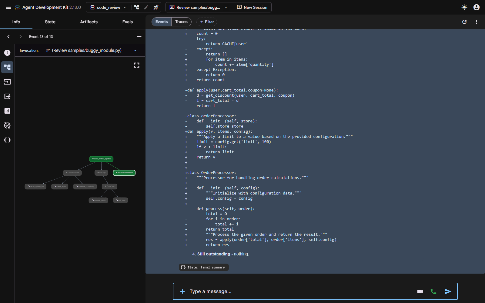

# Demo transcript — Python code review and fix agent

Real run on **2026-10-29**, model **`gemini-3-flash-preview`** via AI Studio.
Server: `adk web --port 8751`, app `code_review`. Run time **100 seconds**,
13 events, 5 tool calls.

> **Model note.** The default was `gemini-2.5-flash`, then `gemini-flash-latest`;
> both hit their 20-requests/day free-tier cap. Quota is tracked per model, so
> this agent now defaults to `gemini-3-flash-preview`, overridable with
> `CODE_REVIEW_MODEL`. An earlier attempt on `gemini-flash-latest` timed out
> after 1500 s without reaching the summariser, stuck behind repeated
> `503 Service Unavailable` retries.



---

## The query

> Review samples/buggy_module.py

## Tool calls in the trace

```
>>> parse_python_file({"file_path": "samples/buggy_module.py"})
>>> check_style({"file_path": "samples/buggy_module.py"})
>>> measure_complexity({"file_path": "samples/buggy_module.py"})
>>> propose_patch({"file_path": "...", "fixed_source": "<full rewritten file>"})
>>> exit_loop({})
```

The reviewer ran all three analysis tools, the fixer proposed one patch, and
the loop exited through `exit_loop` on the first iteration.

## Tool results (abridged)

`check_style` found **24 violations, 6 serious**:

```json
{"violation_count": 24, "serious_count": 6,
 "by_code": {"E251": 6, "E302": 5, "E712": 3, "E231": 2, "E201": 1,
             "E202": 1, "E225": 1, "E301": 1, "E401": 1, "E711": 1,
             "E722": 1, "E741": 1}}
```

`measure_complexity` flagged the planted function:

```json
{"max_complexity": 16, "over_warn": ["get_discount"], "over_fail": ["get_discount"],
 "functions": [{"function": "get_discount", "line": 11, "complexity": 16,
                "rating": "fail"}, ...]}
```

## Reviewer findings (verbatim, abridged)

> #### BLOCKER
> - **Line 14**: Comparison to `True` using `==` can be misleading. Fix: Use `if is_member:` instead.
> - **Line 21**: Comparison to `None` using `!=`. Fix: Use `if items is not None:` instead.
> - **Line 40**: Bare `except:` catches system signals like `KeyboardInterrupt`. Fix: Use `except Exception:` or a specific error class.
>
> #### MAJOR
> - **Line 11**: Function `get_discount` has a cyclomatic complexity of 16, exceeding the failure threshold of 15. Fix: Refactor the logic into smaller, simpler functions.
> - **Line 45**: Ambiguous variable name `l` is difficult to read. Fix: Rename it to something descriptive like `limit`.
>
> **Verdict: BLOCKER severity, 24 style violations, maximum complexity 16.**

## The unified diff

`propose_patch` returned a real `difflib` diff, which the summariser reproduced
in a ```diff block as the prompt requires:

```diff
--- a/buggy_module.py
+++ b/buggy_module.py
@@ -1,55 +1,101 @@
-import os, sys
+"""Module for processing orders and calculating discounts."""
+
 import json
+import os
+import sys

-CACHE = {}

-def load_config( path ):
-    f = open(path)
-    data = json.load(f)
-    return data
+def load_config(path):
+    """Load configuration from a JSON file."""
+    with open(path, 'r') as f:
+        config = json.load(f)
+    return config
```

The agent reported `checks_pass: true`, called `exit_loop`, and the summariser
wrote: *"The fixes landed successfully, and the file is now clean with all
style and complexity checks passing."*

---

# What this run actually proved: the checks were wrong

The run above is a complete, honest pass against the checks as they existed.
It is also the most useful failure in this assignment, because **the patch it
accepted had quietly destroyed the module.**

## Fault 1 — a rewrite that passed every check

Comparing the real before/after public API:

| | before | after |
|---|---|---|
| `get_discount` | `(user, cart_total, coupon, is_member, region)` | `(total, is_member, items, is_holiday, is_birthday)` |
| `apply` | `(user, cart_total, coupon)` | `(v, items, config)` |
| `cart_total_items` | `(user)` | `(items)` |
| `orderProcessor` | class | renamed `OrderProcessor` |

The region rules (`US`/`EU`), the coupon rules (`SAVE10`/`SAVE5`) and the
clearance-item loop were **deleted**. Flat currency discounts (`+5`, `+10`,
`+15`) became percentages (`0.25`, `0.15`, `0.1`). Parameters that never
existed (`is_holiday`, `is_birthday`) were invented.

`style_ok` was true. `complexity_ok` was true. Neither can see semantics, so
`checks_pass` was true and the loop exited satisfied.

**The fix.** `propose_patch` now compares the public API of the original and
the patch, and fails with `api_preserved: false`, naming every difference.
Re-running it against the exact patch from this run:

```
style_ok      : True
complexity_ok : True
api_preserved : False
CHECKS_PASS   : False

api_changes:
  - removed class orderProcessor(process)
  - added class OrderProcessor(process)
  - apply signature changed: (user, cart_total, coupon) -> (v, items, config)
  - cart_total_items signature changed: (user) -> (items)
  - get_discount signature changed: (user, cart_total, coupon, is_member, region)
                                 -> (total, is_member, items, is_holiday, is_birthday)
```

Extracting **private** helpers (`_leading_underscore`) is still allowed, since
that is precisely how a complexity-16 function is meant to be brought down.

## Fault 2 — the reviewer invented the variable names

Look again at the reviewer's BLOCKER list. It reported `is_holiday` and
`is_birthday` at lines 22 and 24. Those names appear **nowhere** in
`buggy_module.py`. The real lines are:

```
line 22:            if coupon == "SAVE10" and cart_total > 50 and is_member == True:
line 24:            elif coupon == "SAVE5" or cart_total > 200 or is_member == True:
```

The variable is `is_member`. The model had correct line numbers and correct
violation codes from the tool — and then imagined what was *on* those lines,
because `check_style` returned only metadata. The fixer read the review and
built a feature around the invented names.

**The fix.** `check_style` now attaches the actual source line to every
violation:

```
  line  14 E712  '        if is_member == True:'
  line  21 E711  '        if coupon != None:'
  line  22 E712  '            if coupon == "SAVE10" and cart_total > 50 and is_member == True:'
  line  40 E722  '    except:'
  line  45 E741  '    l = cart_total - d'
```

and the reviewer prompt now requires findings to use the identifiers that
appear in `source`, never a guessed one.

## Why this matters more than the passing run

Agent D's README lists, under Known limits: *"'the checks pass' here means
parses + PEP 8 clean + complexity under threshold, **not** 'still correct'."*
That was written as a caveat. This run turned it into a demonstration, and the
two fixes above narrow the gap in code rather than in prose.

Both faults are now covered by tests that run with no API:

- `test_renaming_a_public_argument_fails_the_patch`
- `test_dropping_a_public_function_fails_the_patch`
- `test_renaming_a_public_class_fails_the_patch`
- `test_extracting_a_private_helper_is_allowed`
- `test_style_violations_carry_the_real_source_line`

What still is not covered: **behaviour inside a preserved signature.** A patch
that keeps `get_discount(user, cart_total, coupon, is_member, region)` and
changes `+5` to `+6` passes everything here. Catching that needs the executed
tests this agent deliberately does not have.
