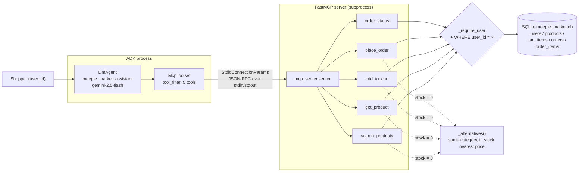

# Agent E — Meeple Market shopping assistant

**Status: see the status line in [../README.md](../README.md)**

A board game shop assistant. Five tools — `search_products`, `get_product`,
`add_to_cart`, `place_order`, `order_status` — all served over MCP from a local
FastMCP server backed by SQLite.

Two properties define it: **every tool is scoped to a `user_id`**, and
**nothing is ever a dead end** — anything out of stock comes back with in-stock
alternatives.

## Architecture



## Ownership

Every tool takes `user_id` as its first argument, and every cart or order query
filters on it **in the SQL WHERE clause**, not after the fetch:

```sql
SELECT * FROM orders WHERE id = ? AND user_id = ?
```

Two consequences that `tests/test_ownership.py` pins down:

- A user reading someone else's order gets an error and **no order fields at
  all** — not a redacted record.
- "Exists but is not yours" and "does not exist" return the **same message**.
  Different errors would make the tool an oracle for which order IDs are real.

Carts are keyed `(user_id, product_id)`, so they cannot bleed between users,
and `place_order` only ever consumes the caller's cart.

## Out-of-stock alternatives

Our headline change. When stock is 0 or insufficient, the response carries an
`alternatives` list: in-stock products **in the same category**, ranked by how
close they are in price, each with a `price_difference` and a `why`. If the
category is empty it falls back to any in-stock product, so the list is never
empty.

This fires in four places: `get_product`, `search_products` (per out-of-stock
row), `add_to_cart`, and `place_order` (per unsupplied line).

`place_order` **re-checks stock at order time**, because something may have
sold out while it sat in the cart. The test for that races two users for the
last copy: the first order succeeds, the second fails cleanly with
alternatives, and stock never goes negative.

## AlloyDB → SQLite, and why

The reference ([mtoscano84/sports-agent-adk-mcp-alloydb](https://github.com/mtoscano84/sports-agent-adk-mcp-alloydb))
runs **AlloyDB** behind **MCP Toolbox for Databases** deployed on Cloud Run,
with pgvector semantic product search, a React frontend and JWT auth.

We swapped AlloyDB for local SQLite because **AlloyDB requires a paid cluster**:
there is no free tier, the smallest cluster bills continuously, and it needs a
VPC plus a Cloud Run deployment of the Toolbox service to reach it. The brief
puts cloud deployment out of scope and asks for no GCP resources, so a
cloud-only datastore would have made this agent unrunnable from a clean clone.

What that swap costs us, honestly:

| | Reference (AlloyDB) | Here (SQLite) |
|---|---|---|
| Search | pgvector semantic similarity | `LIKE` substring match |
| Concurrency | Many writers | One writer |
| Transport | MCP Toolbox over HTTP on Cloud Run | FastMCP over stdio, local subprocess |
| Auth | JWT verified at the app layer | `user_id` argument checked per tool |
| Cost | Paid cluster, always on | Free, a file |

The MCP interface is the same shape either way, which is the point: the agent
talks to tools, not to a database. Moving back to AlloyDB means replacing
`mcp_server/db.py` and the queries, not the agent.

## Our changes from the reference

1. **Out-of-stock items return alternatives** everywhere, rather than an empty
   result (above).
2. **Per-tool ownership checks.** The reference authenticates once with a JWT
   at the FastAPI layer and then trusts the toolset. Ours passes `user_id` into
   every tool and enforces it in SQL, so a tool cannot be invoked for another
   user even if the model is talked into trying — and the prompt tells the
   model to refuse such requests outright.
3. Domain changed from sports gear ("Finn", GenAI Sports) to board games
   ("Meeple Market"), with its own catalogue of 24 products across 6 categories
   and game-specific attributes (player count, play time, complexity weight).
4. Infrastructure changed as described above, plus money stored as integer
   cents so totals never drift.

## Setup

```powershell
cd Assignment3\e_ecommerce_agent
py -3.11 -m venv .venv
.\.venv\Scripts\python.exe -m pip install -r requirements.txt
Copy-Item .env.example .env
```

```powershell
$lines = @("GOOGLE_GENAI_USE_VERTEXAI=FALSE", "GOOGLE_API_KEY=$env:GEMINI_API_KEY")
Set-Content -Path .env -Value $lines -Encoding utf8
Copy-Item .env shop_agent\.env
```

The database is created and seeded on the first tool call. To reset:

```powershell
Remove-Item meeple_market.db -ErrorAction SilentlyContinue
```

## Run

```powershell
cd Assignment3\e_ecommerce_agent
.\.venv\Scripts\adk.exe web --port 8771
```

Open <http://127.0.0.1:8771>, pick `shop_agent`, and try:

> I want a strategy game for 4 players under $65. Is Terra Vineyards available?

Seeded users are `u_ana`, `u_ben`, `u_chi`; the agent assumes `u_ana`.

Tests:

```powershell
.\.venv\Scripts\python.exe -m pytest tests\ -q
```

## Environment variables

| Variable | Required | Purpose |
|---|---|---|
| `GOOGLE_API_KEY` | yes | AI Studio key. Falls back to `GEMINI_API_KEY`. |
| `GOOGLE_GENAI_USE_VERTEXAI` | yes | `FALSE`. Defaulted in code. |
| `SHOP_AGENT_MODEL` | no | Default `gemini-2.5-flash`. |
| `SHOP_DB_PATH` | no | SQLite location. Default `meeple_market.db` here. Tests set it per-test. |

## Versions

- Python 3.11.0, `google-adk==2.13.0`, `fastmcp==4.1.4`, `mcp==2.3.0`,
  `pytest==9.2.0`

## Known limits

- **`user_id` is an argument, not an identity.** The tools enforce that a
  caller only touches their own rows, but nothing authenticates *who* the
  caller is — the model supplies the id. In a real deployment that id must come
  from a verified session (the reference's JWT), never from the conversation.
  The prompt instructs the agent to refuse to act as another user, and a prompt
  is a weaker guarantee than code.
- **Search is `LIKE`, not semantic.** "co-op game" will not match
  "cooperative". This is the main capability lost with pgvector.
- **Alternatives are category-and-price based**, not taste based. A shopper who
  wanted a heavy 4-hour game may be offered a lighter one at a similar price.
- **One SQLite writer.** Fine for one agent; the order-time stock re-check
  guards the obvious race but this is not a warehouse system.
- **No payment, shipping, returns or cancellation.** `place_order` moves stock
  and writes a row; order status is seeded, not advanced by anything.
- **Prices are USD with no tax or shipping**, and totals are display strings
  formatted from integer cents by the server, which is why the prompt forbids
  the model recomputing them.

## Sources

- [mtoscano84/sports-agent-adk-mcp-alloydb](https://github.com/mtoscano84/sports-agent-adk-mcp-alloydb)
  — the MCP-backed retail agent shape, the five-tool surface, and the
  per-user cart/order model. Read for structure; no files copied.
- [AlloyDB pricing](https://cloud.google.com/alloydb/pricing) — the basis for
  the swap decision described above.
- [ADK docs — MCP tools](https://google.github.io/adk-docs/tools/mcp-tools/)
  and [FastMCP docs](https://gofastmcp.com/).
