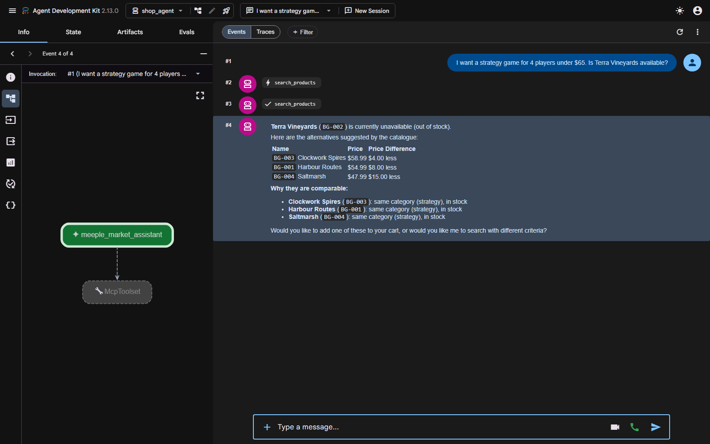

# Demo transcript — Meeple Market shopping assistant

Real run on **2026-10-29**, model **`gemini-flash-latest`** via AI Studio.
Server: `adk web --port 8771`, app `shop_agent`.

> **Model note.** The original plan used `gemini-2.5-flash`, but that model's
> free-tier allowance is 20 requests/day and it was exhausted. Quota is tracked
> *per model* (`GenerateRequestsPerDayPerProjectPerModel`), so switching to
> `gemini-flash-latest` gave a fresh bucket. The default is set in
> `shop_agent/agent.py` and overridable with `SHOP_AGENT_MODEL`.



The screenshot shows the agent graph on the left — `meeple_market_assistant` →
`McpToolset`, i.e. every tool arrives over MCP — the `search_products` call in
the event trace, and the rendered alternatives table.

---

## The query

> I want a strategy game for 4 players under $65. Is Terra Vineyards available?

## Tool call in the trace

```
>>> search_products({"query": "Terra Vineyards", "user_id": "u_ana"})
```

The model supplied `user_id` without being asked for it in the query, because
every tool in this agent requires one.

## Tool result (abridged)

```json
{
  "user_id": "u_ana",
  "match_count": 1,
  "in_stock_count": 0,
  "out_of_stock_ids": ["BG-002"],
  "products": [{
    "id": "BG-002",
    "name": "Terra Vineyards",
    "category": "strategy",
    "publisher": "Vermillion",
    "stock": 0,
    "players": "1-4",
    "play_minutes": 110,
    "weight": 3.6,
    "price": "$62.99",
    "in_stock": false,
    "alternatives": [
      {"id": "BG-003", "name": "Clockwork Spires", "price": "$58.99",
       "stock": 4, "price_difference": "$4.00 less",
       "why": "same category (strategy), in stock"},
      {"id": "BG-001", "name": "Harbour Routes", "price": "$54.99",
       "stock": 7, "price_difference": "$8.00 less",
       "why": "same category (strategy), in stock"},
      {"id": "BG-004", "name": "Saltmarsh", "price": "$47.99",
       "stock": 2, "price_difference": "$15.00 less",
       "why": "same category (strategy), in stock"}
    ]
  }]
}
```

## Model response

> **Terra Vineyards** (`BG-002`) is currently unavailable (out of stock).
>
> Here are the in-stock alternatives:
>
> | Name | Price | Price Difference |
> | :--- | :--- | :--- |
> | Clockwork Spires | $58.99 | $4.00 less |
> | Harbour Routes | $54.99 | $8.00 less |
> | Saltmarsh | $47.99 | $15.00 less |
>
> **Why they are comparable:**
> - **Clockwork Spires** (`BG-003`): same category (strategy), in stock
> - **Harbour Routes** (`BG-001`): same category (strategy), in stock
> - **Saltmarsh** (`BG-004`): same category (strategy), in stock
>
> Would you like to know more about any of these options, add one to your cart,
> or would you like me to run a different search?

---

## What this run demonstrates

**Out of stock is not a dead end.** This is the headline change from the
reference agent. The server attached `alternatives` to the out-of-stock product
— same category, ranked by closeness in price — and the model presented them as
alternatives rather than passing one off as the thing that was asked for. Every
price and every "why" in the answer came from the tool result; none was
invented.

**The ranking is server-side and deterministic.** `BG-003` leads at $4.00 less,
then `BG-001` at $8.00, then `BG-004` at $15.00. That ordering is computed in
`mcp_server/server.py::_alternatives`, not chosen by the model.

**The whole surface is MCP.** The agent node connects only to `McpToolset`; the
call crossed a JSON-RPC stdio boundary into a FastMCP subprocess and back.

## Rate limiting, observed

This run took **467 seconds** end to end, almost all of it waiting. The server
log shows why:

```
00:11:39  HTTP Request: POST .../gemini-flash-latest:generateContent "HTTP/1.1 503 Service Unavailable"
00:11:39  Retrying ... in 20 seconds as it raised ServerError: 503 UNAVAILABLE.
          'This model is currently experiencing high demand...'
```

The `HttpRetryOptions(http_status_codes=[429, 503, 504])` configured on the
model absorbed it and the run completed normally. Without that retry the run
would simply have failed. This is also why the screenshot tooling detects
completion by polling the ADK sessions API rather than watching the page: during
a backoff the UI is completely static, and an earlier attempt that watched the
DOM concluded "finished" mid-retry and cancelled the run by closing the browser
(`Root node meeple_market_assistant was cancelled`).

## Ownership, verified by test rather than by a live call

The ownership rules are asserted in `tests/test_ownership.py` and in
`tests/test_mcp_roundtrip.py` (which drives the real MCP path), so they did not
need to spend API quota:

```python
>>> order_status("u_ben", "ORD-1001")   # ORD-1001 belongs to u_ana
{'error': "no order 'ORD-1001' for this user"}
```

The denial carries no order fields, and it is byte-identical to the answer for
an order that does not exist — so the tool cannot be used to discover which
order IDs are real.
