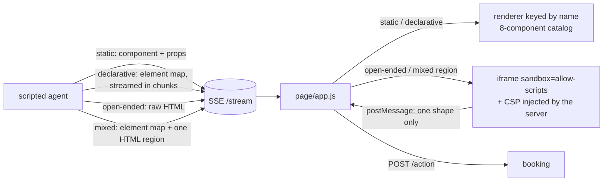
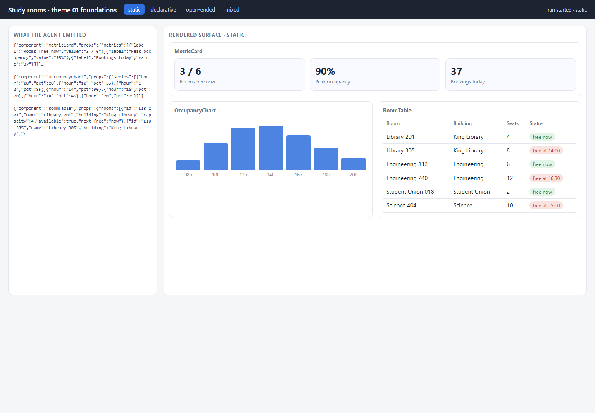
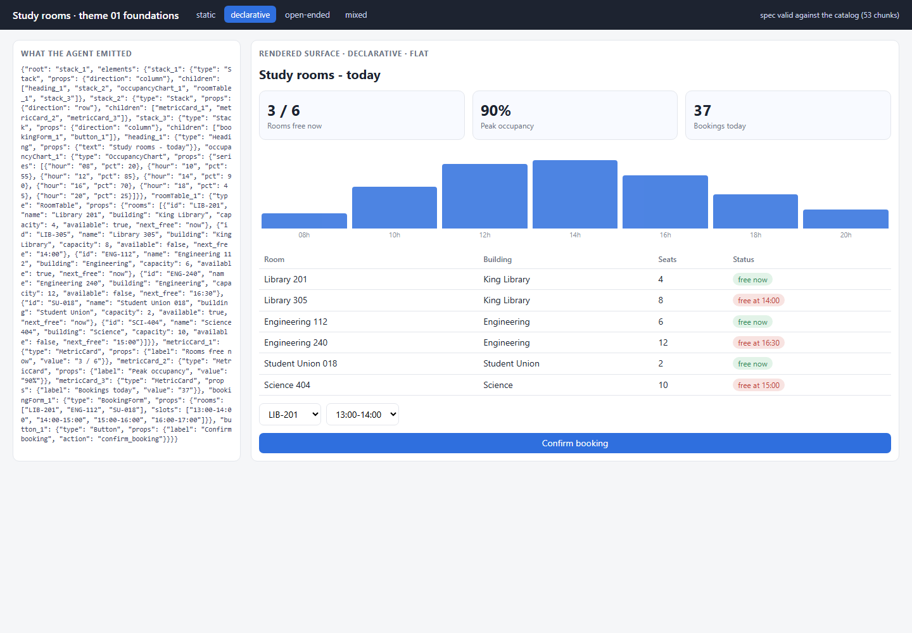
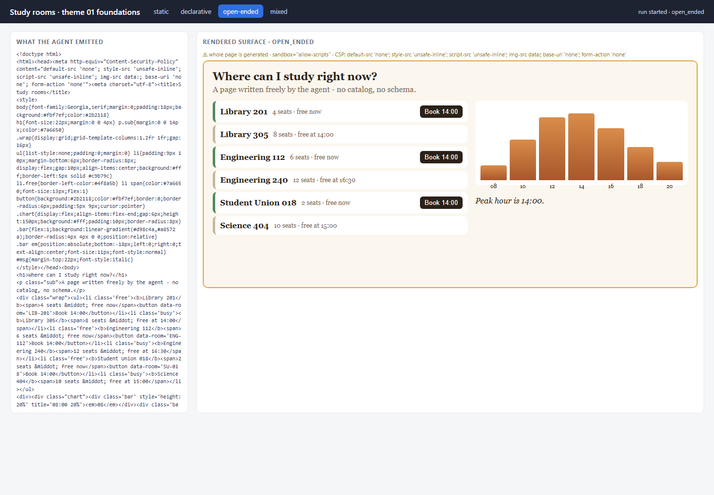
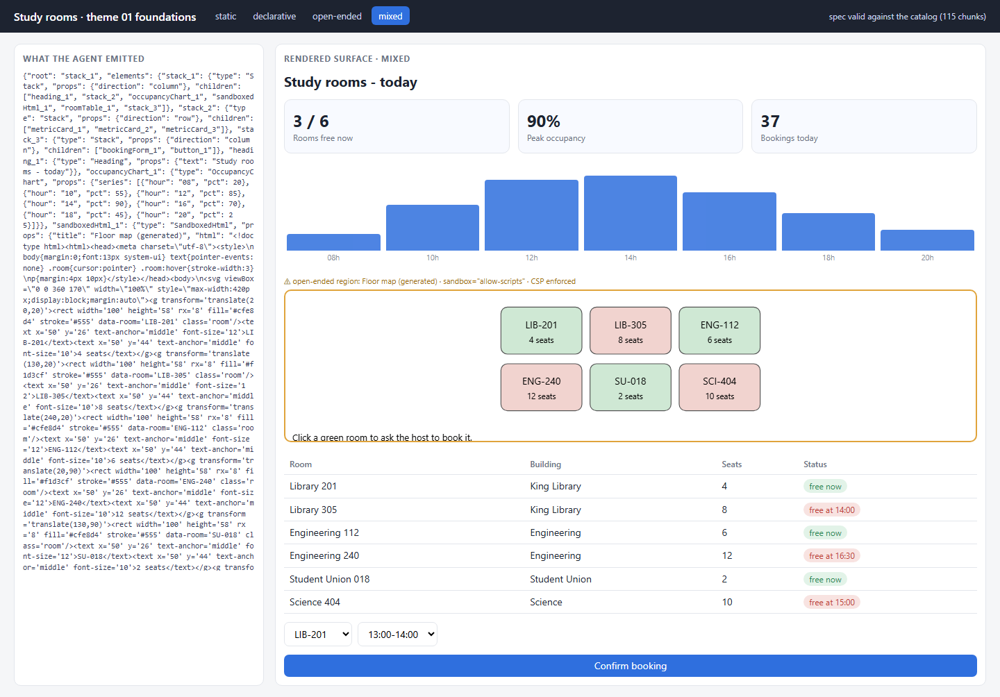

# 01 · Foundations — the four generation modes with no library

**Status: WORKING** · port 8001

The mechanism, before any library hides it. One FastAPI server, one
Server-Sent Events endpoint, one hand-written renderer, and a scripted agent
that emits four different things depending on how much it is allowed to
decide.

**Generation mode** (what the agent emits) is the subject of this theme.
**Transport** is held constant on purpose: every mode rides the same plain SSE
stream, so the only thing that changes between modes is the payload.



## The four modes — what the agent emits in each

| mode | the agent emits | who owns layout | where validation happens |
|---|---|---|---|
| **static** | `{"component": "MetricCard", "props": {...}}`, one event per component; only three components exist (MetricCard, OccupancyChart, RoomTable) | **we do** — the page has three fixed slots; the agent can only fill them | the renderer: an unknown name has no slot |
| **declarative** | a whole layout as a JSON element map, composed from an 8-component catalog, streamed in 40-character chunks | **the agent**, within the catalog | server: JSON Schema generated from the catalog, plus graph checks (root exists, children exist) |
| **open-ended** | a complete HTML document — no catalog, no schema | **the agent**, completely | none on content; the sandbox is the boundary |
| **mixed** | the declarative element map, plus exactly one `SandboxedHtml` element holding agent-written HTML (a floor map the catalog has no component for) | the agent within the catalog, except one region | schema for the map; the sandbox for the region; a rule allowing only one region |

| static | declarative | open-ended | mixed |
|---|---|---|---|
|  |  |  |  |

Each screenshot is from a real run (`tools/shoot.py`), with the raw agent
output on the left and the rendered surface on the right.

## Our addition: when does the layout become known?

`measure_stream.py` serialises the **same dashboard** (same 8 leaf
components, same props) two ways — a nested tree and a flat element map with
ids — streams each in 40-character chunks, and runs every prefix through the
tolerant partial-JSON parser. Measured on this run:

| shape | chars | chunks | first paint | **layout known** | all complete | leaves complete at 25% / 50% / 75% of stream |
|---|---|---|---|---|---|---|
| nested tree | 1779 | 45 | chunk 4 | **chunk 43 (96%)** | chunk 45 | 4 / 5 / 5 of 8 |
| flat element map | 2119 | 53 | chunk 13 | **chunk 11 (21%)** | chunk 53 | 1 / 2 / 3 of 8 |

*First paint* = first chunk at which a leaf is complete and placed. *Layout
known* = first chunk at which every container and its full ordered child
list is final, so every slot exists in its final position. Raw numbers:
[`docs/stream_measurement.json`](docs/stream_measurement.json).

**What this shows, both sides of it:**

- **The flat map fixes the layout five times earlier** (21% of the stream vs
  96%). Ids make emission order independent of nesting, so the emitter sends
  every container with its child-id list first, then the leaves. After chunk
  11 the page never reflows — content only fills slots that already exist.
  A nested tree cannot do that: a sibling's position is unknown until
  everything before it has closed, so the page keeps rearranging until the
  very end.
- **The nested tree paints its first component sooner** (chunk 4 vs 13) and
  is 16% shorter, because it carries no ids. If all you want is "something on
  screen fast", nested wins on this document.
- Ids also let later updates target one element without resending the tree,
  which theme 03 (A2UI) and theme 05 (json-render) depend on. Stable layout
  and addressable updates — not raw time-to-first-pixel — are why both
  formats use the flat shape.

Run `?mode=declarative&shape=nested` to watch the nested version stream
([screenshot](docs/nested_declarative.png)).

## The sandbox — what it prevents, verified

Open-ended HTML and the mixed region are mounted only through
`mountSandbox()` in `page/app.js`:

- `sandbox="allow-scripts"` and nothing else — the token list comes from the
  server. With no `allow-same-origin`, the frame is a unique opaque origin.
  **Verified in a real browser:** running `parent.document.title` inside the
  frame throws `SecurityError`.
- A Content-Security-Policy meta tag is **injected by the server** into the
  generated document, whatever the agent wrote: `default-src 'none'`, inline
  style and script only, `img-src data:`, no forms. The generated page cannot
  fetch, load remote scripts or images, or post a form anywhere.
- One message shape is accepted from the frame — `{type: "book", room, slot}`
  — and only from a frame the page mounted. **Verified:** clicking *Book* in
  the open-ended page and a room in the mixed floor map both produce a real
  booking confirmation through `POST /action`.

What it does **not** prevent: the generated page can still render misleading
content, burn CPU, or send the allowed message with arguments the user did
not intend. The server must validate the action itself (it does: unknown
rooms and slots are refused).

## Run it

```powershell
cd assignment4\01_foundations
py -3.11 -m venv .venv
.\.venv\Scripts\python.exe -m pip install -r requirements.txt
.\.venv\Scripts\python.exe server.py                    # http://127.0.0.1:8001
.\.venv\Scripts\python.exe server.py --mode mixed       # open in a given mode
.\.venv\Scripts\python.exe measure_stream.py            # the nested-vs-flat measurement
.\.venv\Scripts\python.exe -m pytest tests -q
```

Switch modes with the tabs, or `?mode=static|declarative|open_ended|mixed`.

## What to look at in the code

- `agent.py` — the scripted agent: four functions, four kinds of output. `flat()` shows the structure-first ordering.
- `catalog.py` — the catalog, and the JSON Schema **generated** from it (`flat_schema`, `nested_schema`), plus `validate_flat`.
- `partial_json.py` and `parsePartial()` in `app.js` — the same tolerant parser in Python and JS.
- `server.py` — the SSE stream, the CSP injection (`sandboxed()`), and the action endpoint.
- `page/app.js` — `COMPONENTS` (the renderer keyed by name), `mountSandbox()`, and the message listener.

## Tests

`tests/test_foundations.py` — 6 offline tests: the spec validates against
the generated schema; an out-of-catalog component (`Carousel`) is rejected
with its name; `SandboxedHtml` is legal only in mixed mode; sandbox
attributes and the CSP are present; all four modes stream different event
kinds; the partial parser only ever shows a prefix of the final value; the
confirm action round-trips.

## Limits

- The agent is scripted (see the top-level README): the payloads are what a
  model would emit, not a model's output.
- The partial parser drops half-written strings rather than showing them, so
  a long string prop appears all at once. That is a choice, not a limitation
  of streaming.
- Open-ended HTML is mounted only when complete (`srcdoc` of a half-written
  document is unreliable); the measurement covers declarative mode only.
- The measurement is one document at one chunk size. The direction (flat
  fixes layout early, nested paints a first leaf early) follows from the
  shapes; the exact chunk numbers do not generalise.

## Source

Structure and vocabulary from the GenUI course, theme 01:
<https://raw.githubusercontent.com/dlmastery/simple-coding-harness/main/genui/README.md>
(and `genui/01_foundations/README.md`). No code was copied; the domain,
components and implementation are ours.
