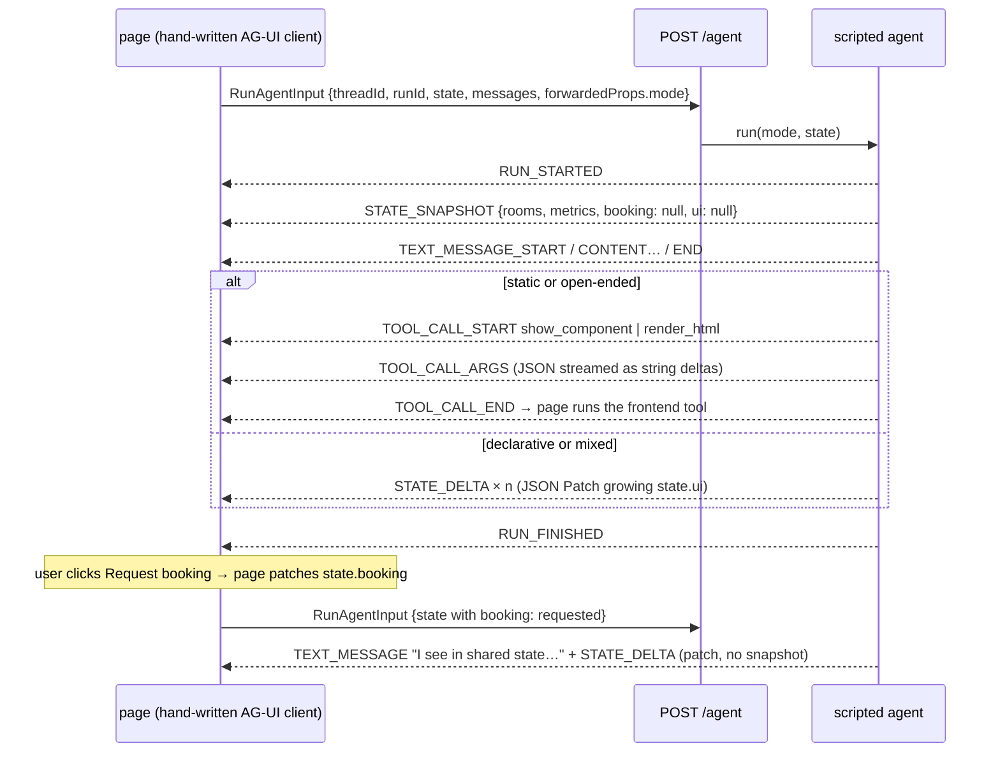
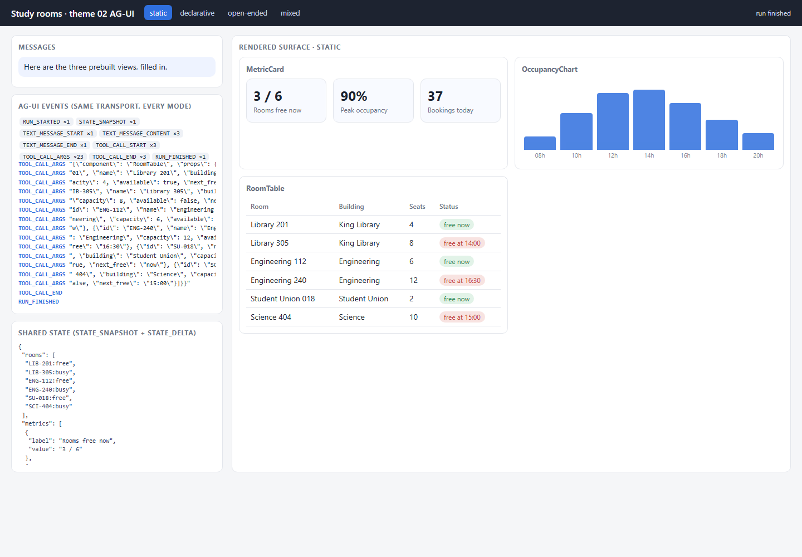
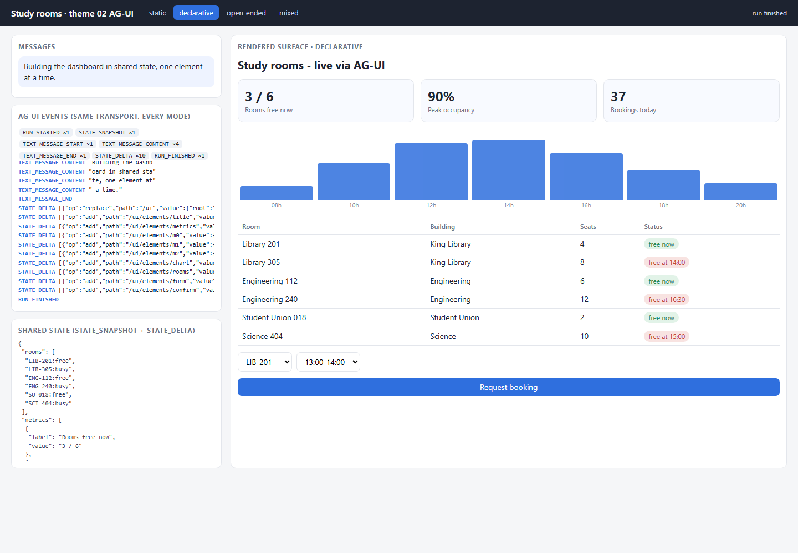
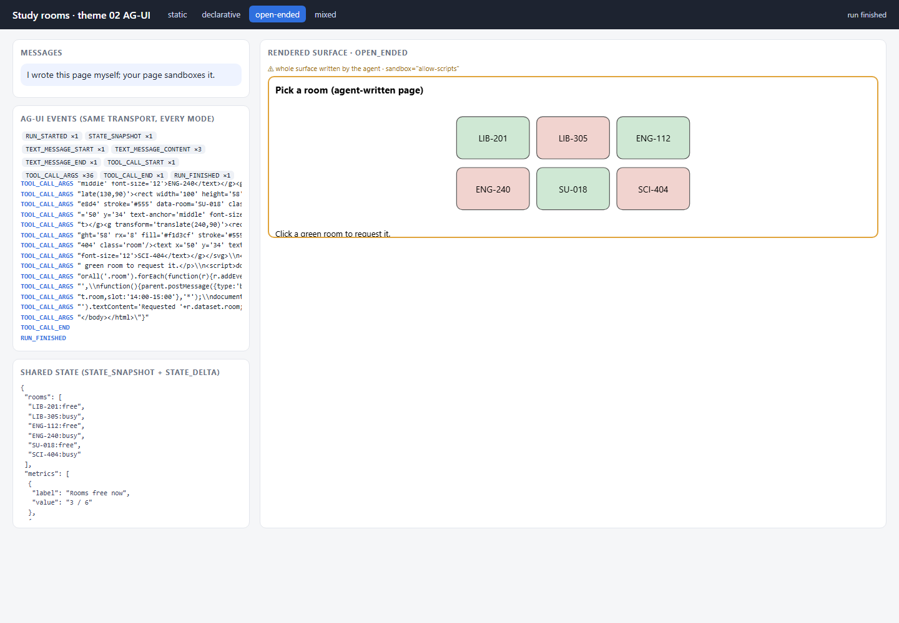
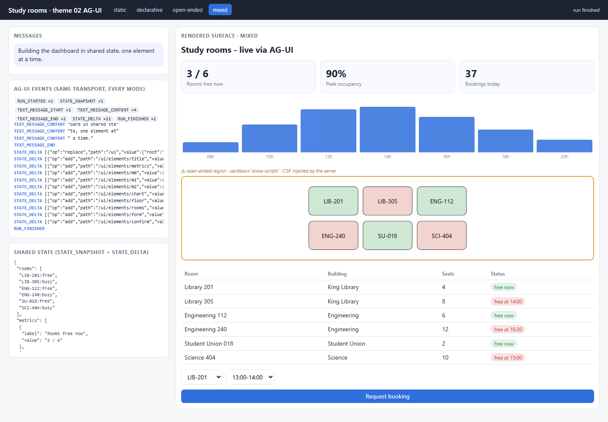
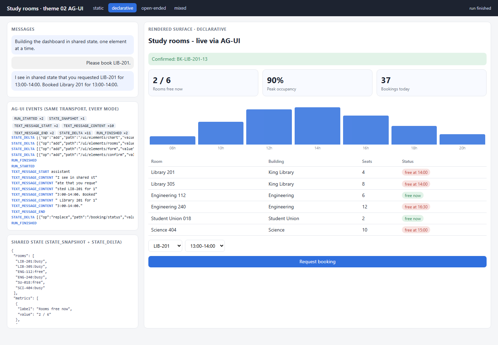
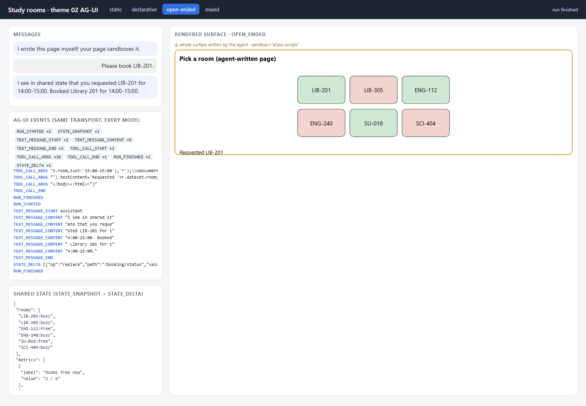

# 02 · AG-UI — one event protocol, four generation modes

**Status: WORKING** · port 8002

This theme is about **transport**. AG-UI is an event stream between an
agent and a frontend: a run is a sequence of typed JSON events. It says
nothing about *what* UI to draw — so every generation mode from theme 01
rides it unchanged, which is the point of this theme.



## The events implemented

Built by hand in [`events.py`](events.py), field names as in the AG-UI spec,
one SSE `data:` line per event with a `type` field:

| group | events |
|---|---|
| run lifecycle | `RUN_STARTED`, `RUN_FINISHED`, `RUN_ERROR` |
| text messages | `TEXT_MESSAGE_START`, `TEXT_MESSAGE_CONTENT`, `TEXT_MESSAGE_END` |
| tool calls | `TOOL_CALL_START`, `TOOL_CALL_ARGS`, `TOOL_CALL_END` |
| shared state | `STATE_SNAPSHOT`, `STATE_DELTA` (RFC 6902 JSON Patch: add / replace / remove) |

The client in [`page/app.js`](page/app.js) reads the stream with `fetch` and a
stream reader (an `EventSource` cannot `POST` a `RunAgentInput`).

## The four modes — same transport, different payload

| mode | what the agent emits, in AG-UI terms | where the UI lives |
|---|---|---|
| **static** | `TOOL_CALL show_component {component, props}` × 3 — a **frontend tool** the page executes; only three components exist | in tool-call arguments; the page owns the layout |
| **declarative** | `STATE_SNAPSHOT` with `ui: null`, then one `STATE_DELTA` per element — each delta adds an element, then links it into its parent | **in shared state** (`state.ui`, a flat element map) |
| **open-ended** | `TOOL_CALL render_html {html}` — HTML streamed as tool arguments, CSP already injected by the server | in tool-call arguments, mounted in a sandbox |
| **mixed** | the declarative deltas, one of which adds a `SandboxedHtml` element (a floor map) | shared state, with one sandboxed region |

| static | declarative | open-ended | mixed |
|---|---|---|---|
|  |  |  |  |

The event-type counter on the left of each screenshot is the evidence: all
four use the same event types; only which ones carry the UI differs.

## The state patch demo — a user action the agent sees

1. The page clicks *Request booking* (or a room inside the sandboxed page) and
   applies a JSON Patch to its own copy of shared state:
   `{"op":"replace","path":"/booking","value":{"room":"LIB-201","slot":…,"status":"requested"}}`
2. It starts a new run, sending that state as `RunAgentInput.state`.
3. The agent reads the booking **from the state the user wrote**, books it,
   and replies with text plus one `STATE_DELTA` — booking confirmed, the room
   marked busy, the metric updated, and (when a surface exists) a
   confirmation element inserted into the existing `state.ui`.

No `STATE_SNAPSHOT` is sent on the second run: the surface is patched, not
replaced. Real runs:

| declarative: patched surface | open-ended: request from inside the sandbox |
|---|---|
|  |  |

Agent reply in both runs: *"I see in shared state that you requested LIB-201
for … Booked Library 201 for …"*.

## Run it

```powershell
cd assignment4\02_ag_ui
py -3.11 -m venv .venv
.\.venv\Scripts\python.exe -m pip install -r requirements.txt
.\.venv\Scripts\python.exe server.py                 # http://127.0.0.1:8002
.\.venv\Scripts\python.exe server.py --mode mixed
.\.venv\Scripts\python.exe -m pytest tests -q
```

## What to look at in the code

- `events.py` — the event builders, their required fields, `tool_call()` streaming arguments as string deltas, and `apply_patch()`.
- `agent.py` — `run()` (the four modes as four event shapes), `build_ui()` (deltas that keep every intermediate state valid), `confirm_booking()` (the agent reading user-written state).
- `security.py` — the CSP injected into generated HTML before it is put into tool arguments.
- `page/app.js` — `runAgent()` (the client), `handle()` (one switch over event types), `frontendTool()`, `applyPatch()`, `requestBooking()`.

## Tests

`tests/test_ag_ui.py` — 5 offline tests: every event carries the spec's
required fields and the final `state.ui` validates against the catalog; an
out-of-catalog component produces `RUN_ERROR` and **no** `STATE_DELTA`; the
CSP is inside the streamed `render_html` arguments and the sandbox token is
`allow-scripts`; the four modes use only AG-UI event types but different
carriers; a user-written booking is read by the agent and patched in.

## Limits

- A subset of AG-UI: no `MESSAGES_SNAPSHOT`, `STEP_*`, `CUSTOM` or raw events, and no official SDK — the point is to see the frames.
- JSON Patch supports `add`, `replace`, `remove` only (no `move`, `copy`, `test`).
- Catalog validation runs once on the whole planned surface before the first delta; a real model's deltas would need validating as they arrive.
- The agent is scripted; the shared-state logic is real.

## Source

Structure and vocabulary from the GenUI course, theme 02:
<https://raw.githubusercontent.com/dlmastery/simple-coding-harness/main/genui/README.md>
(and `genui/02_ag_ui/README.md`), and the AG-UI event and state documentation
(<https://docs.ag-ui.com/concepts/state>). No code was copied.
