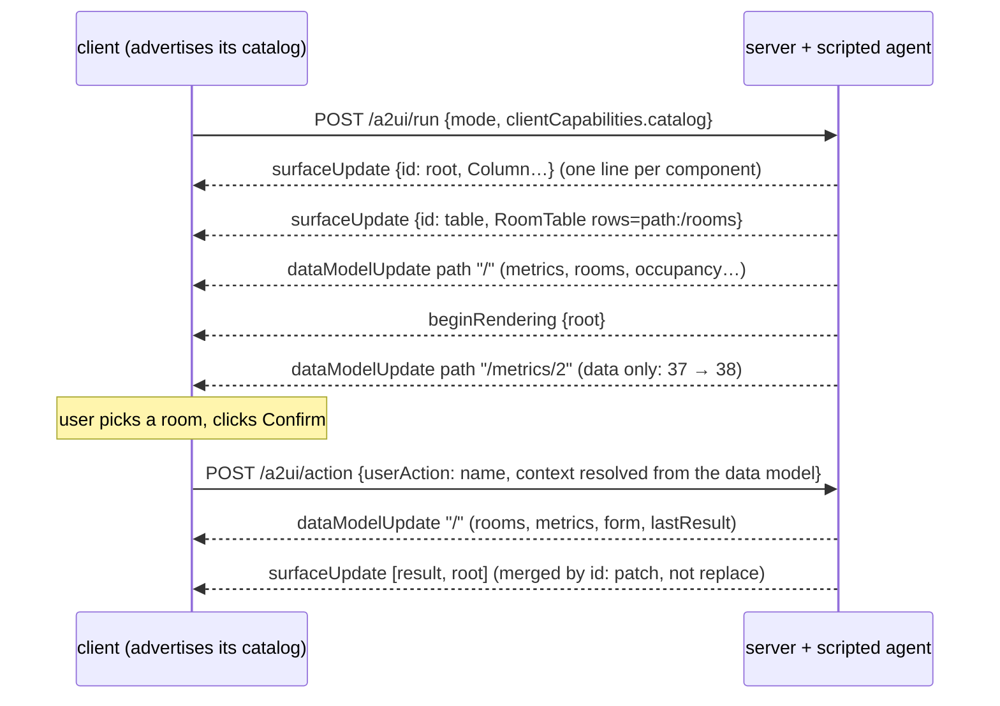
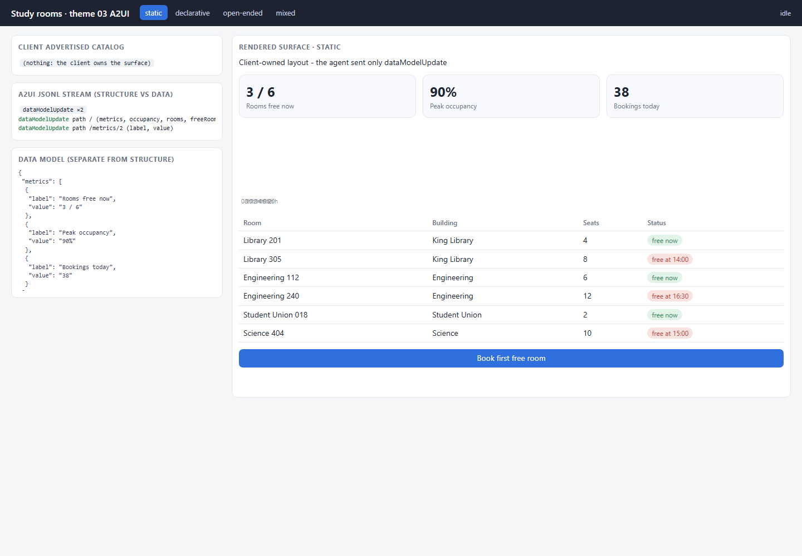
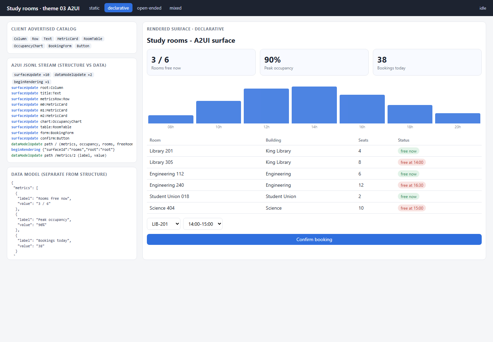
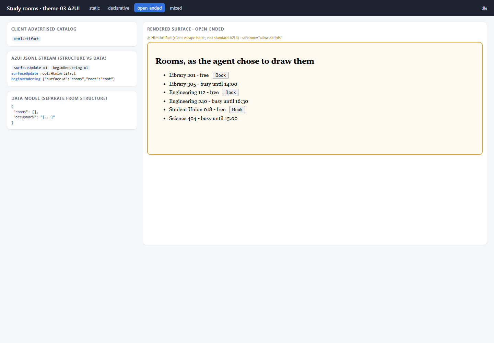
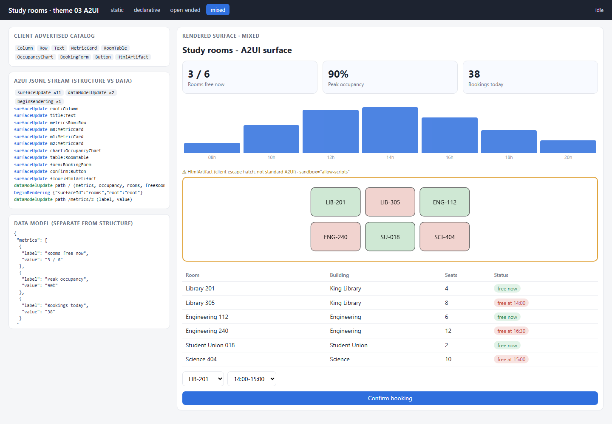
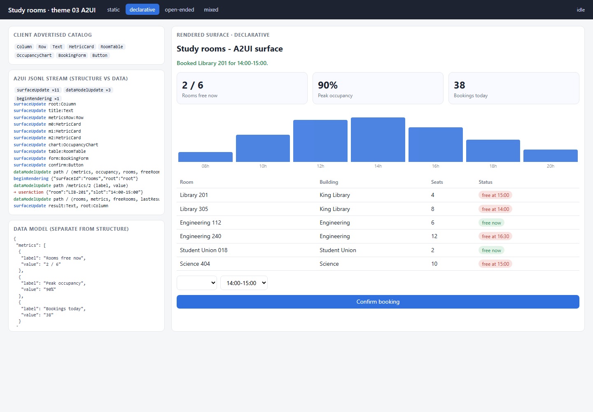
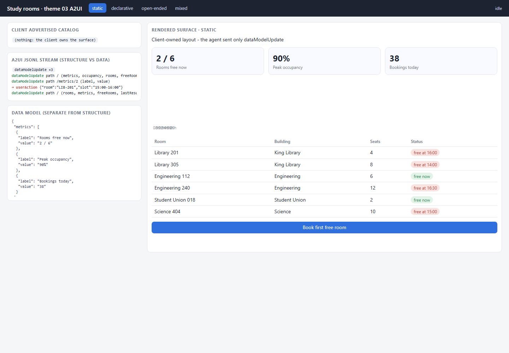

# 03 · A2UI — structure and data as two streams

**Status: WORKING** · port 8003

A2UI is a **UI description format**, not a transport. Here it travels as
JSON Lines over a plain HTTP response; the same messages could ride AG-UI or
anything else. What A2UI adds over theme 01's element map is a strict split:
**structure** (`surfaceUpdate`: a flat list of components with ids) and
**data** (`dataModelUpdate`: a separate data model) are separate messages,
and components point at data through bound paths. Either can change without
the other.



## What is implemented

Envelopes named as in A2UI v0.8, written by hand in [`a2ui.py`](a2ui.py):
`surfaceUpdate`, `dataModelUpdate`, `beginRendering`, `deleteSurface`, and
the client's `userAction`. Props are BoundValues — `{"literalString": …}` or
`{"path": "/rooms"}`. Data-model contents use typed entries
(`valueString`/`valueNumber`/`valueBoolean`/`valueMap`); arrays are
index-keyed maps.

- **The client advertises its catalog.** `page/app.js` sends
  `clientCapabilities.catalog` with every request. The server validates every
  component against **what the client advertised** and drops (and reports)
  anything else — the client never receives a component it cannot render.
- **Flat element map with ids.** Children are `{"explicitList": [ids]}`.
- **Separate data model.** The data panel in each screenshot is the client's
  data model; the stream panel colours structure and data lines differently.
- **JSONL streaming.** One message per line; each component arrives on its
  own line, and the page renders as soon as `beginRendering` lands.

## The four modes — honest mappings

A2UI is declarative by design. Two modes are a natural fit and two are not:

| mode | what the agent emits | fit |
|---|---|---|
| **declarative** | `surfaceUpdate` lines (8-component catalog, bound to data paths), one `dataModelUpdate`, `beginRendering`, then a data-only `dataModelUpdate` | **native** — this is what A2UI is for |
| **static** | **only `dataModelUpdate`.** The client owns a fixed surface template (`STATIC_SURFACE` in `app.js`) and advertises *no* components, so the agent cannot send structure at all | honest closest thing: in A2UI "static" means *client-owned structure, agent-supplied data* — the split makes this clean |
| **open-ended** | one `surfaceUpdate` whose only component is `HtmlArtifact` carrying agent-written HTML | **awkward.** A2UI's standard catalog has no raw-HTML component; its premise is that UI arrives as data, not code. `HtmlArtifact` is our client-side escape hatch, usable **only** because the client advertised it, rendered in a sandbox with a server-injected CSP. On a user action the agent can only re-send the whole HTML — no data binding, no partial patch |
| **mixed** | the declarative surface plus one `HtmlArtifact` (a floor map) | works, with the same caveat for the one region |

| static | declarative | open-ended | mixed |
|---|---|---|---|
|  |  |  |  |

## A user action, and the agent patching the surface

The *Confirm booking* button's action carries a context bound to the data
model (`/form/room`, `/form/slot`, which the form writes to). The client
resolves those paths and posts a `userAction`. The agent answers with:

1. one `dataModelUpdate` — rooms, metrics, the form's next free room, and a
   result message;
2. one `surfaceUpdate` containing **only** the new `result` Text component and
   the `root` Column with its updated child list.

The client merges components by id. There is no second `beginRendering` and
no `deleteSurface` — the existing surface is patched. Real runs:

| declarative: patched surface | static: data-only reply |
|---|---|
|  |  |

The static run shows the split doing real work: the agent changed what is on
screen (2 / 6 rooms free) without ever sending a component.

A bug found by that run and fixed: the agent's earlier live update (bookings
37 → 38) had not been applied to its own model, so the action's data merge
briefly overwrote it with 37. A test now pins it.

## Run it

```powershell
cd assignment4\03_a2ui
py -3.11 -m venv .venv
.\.venv\Scripts\python.exe -m pip install -r requirements.txt
.\.venv\Scripts\python.exe server.py                 # http://127.0.0.1:8003
.\.venv\Scripts\python.exe server.py --mode declarative
.\.venv\Scripts\python.exe -m pytest tests -q
```

## What to look at in the code

- `a2ui.py` — envelopes, the catalog, `ADVERTISED`, `validate_component`, `to_contents`/`from_contents`.
- `agent.py` — `run()` per mode, and `act()`: the patch that sends only what changed.
- `server.py` — `advertised()` (validation against the client's catalog), JSONL streaming.
- `page/app.js` — `ADVERTISE`, `handle()` (merge by id, data merge), `bound()`, `STATIC_SURFACE`, `sendAction()`.

## Tests

`tests/test_a2ui.py` — 5 offline tests: every message has one envelope and
validates, and children reference existing ids; a component outside the
advertised catalog is rejected and never sent; the CSP is inside the
`HtmlArtifact` HTML and `HtmlArtifact` is absent from the declarative
catalog; static mode is data-only and declarative updates data without
structure; a user action patches (no `beginRendering`, only `result` and
`root` re-sent, the earlier live update preserved).

## Limits

- No official A2UI SDK or renderer; a hand-written subset of v0.8 message shapes. Styles, `catalogUri` negotiation and component weights are not implemented.
- The array-as-index-keyed-map encoding and the shallow merge at a path are our reading of the data model contract.
- Server-side agent state is a single in-process dict (one user at a time).

## Source

Structure and vocabulary from the GenUI course, theme 03:
<https://raw.githubusercontent.com/dlmastery/simple-coding-harness/main/genui/README.md>
(and `genui/03_a2ui/README.md`), and the A2UI documentation
(<https://a2ui.org/>). No code was copied.
