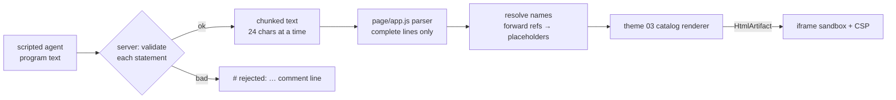
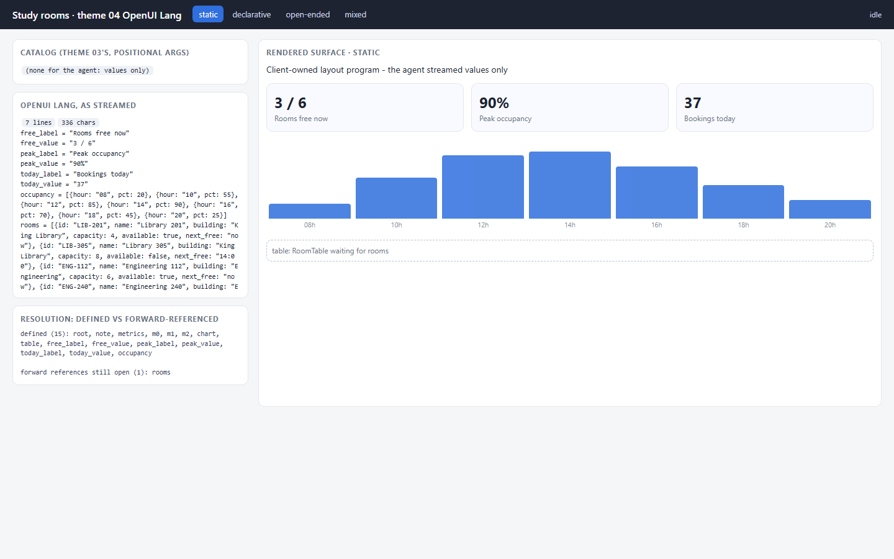
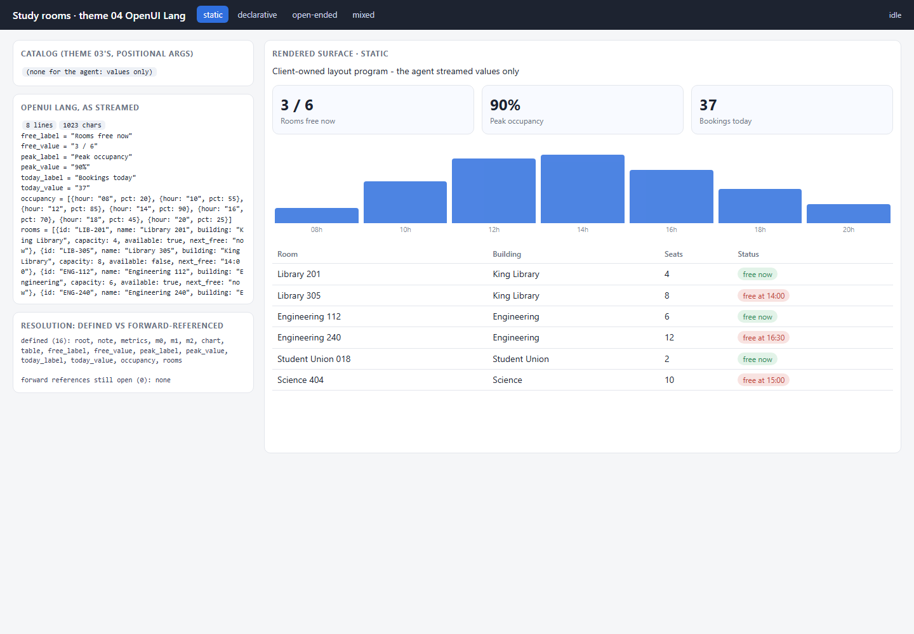
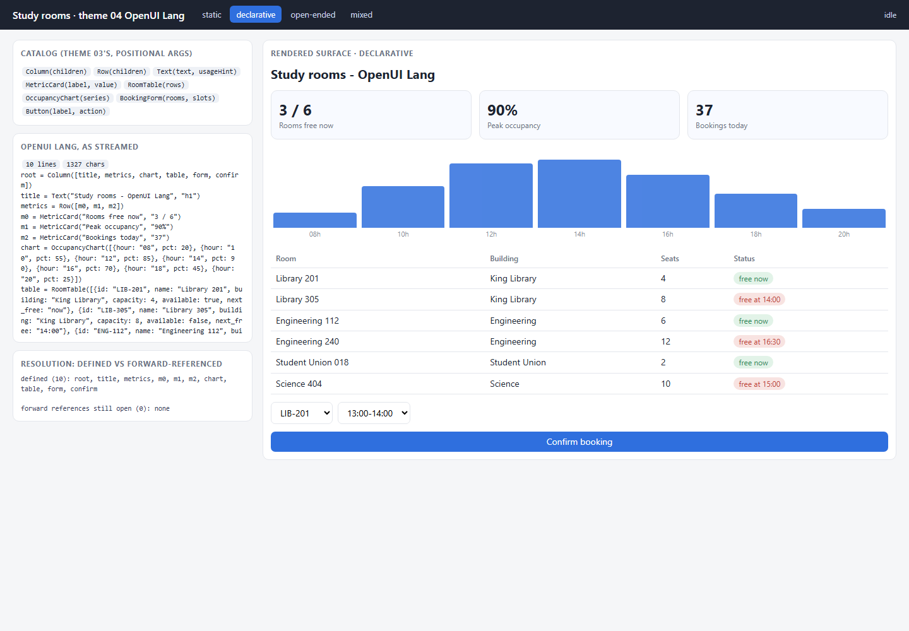
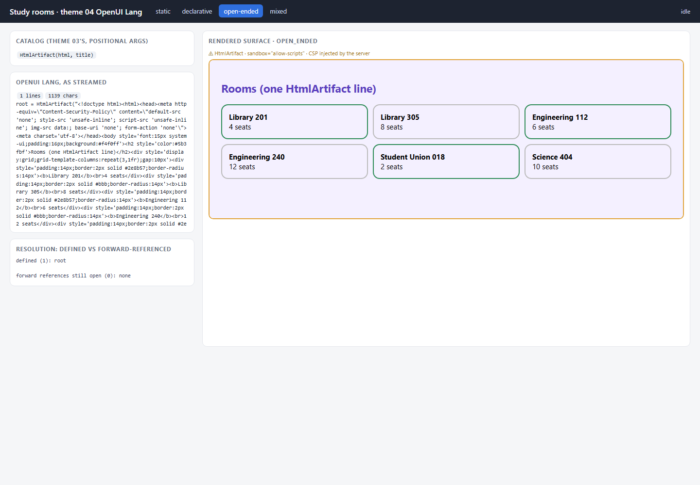
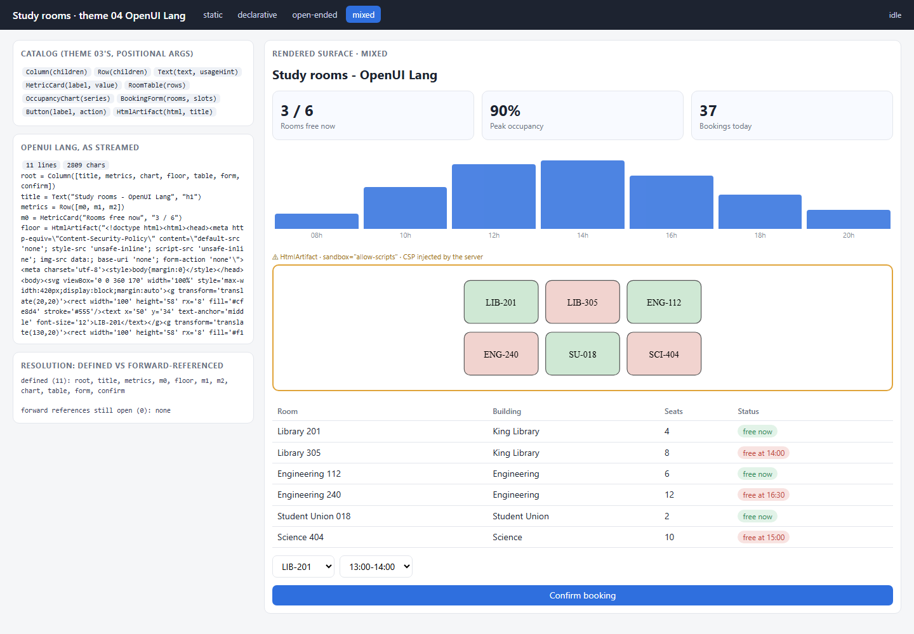

# 04 · OpenUI Lang — a compact, streaming-first UI language

**Status: WORKING** · port 8004

OpenUI Lang is a **UI description format**: a line-oriented language where
each line binds a name to a component call. This theme writes our own parser
for that style of syntax, renders it with **theme 03's catalog**, and then
measures what the compactness actually buys, in tokens, against A2UI JSON and
json-render JSON. Transport here is a plain chunked text response; the
language is independent of it.

```
root = Column([title, metrics, chart, table, form, confirm])
title = Text("Study rooms - OpenUI Lang", "h1")
metrics = Row([m0, m1, m2])
m0 = MetricCard("Rooms free now", "3 / 6")
chart = OccupancyChart([{hour: "08", pct: 20}, ...])
...
```



## The parser

[`lang.py`](lang.py) (and the same grammar in `page/app.js`):

- **`identifier = Component(args)`**, one statement per line, plus strings,
  numbers, booleans, `null`, arrays and `{key: value}` objects.
- **Positional arguments.** The catalog gives each component's prop order —
  `MetricCard(label, value)`, `BookingForm(rooms, slots)` — so a statement
  carries no prop names. That is most of the compactness.
- **Forward references.** `root` can list `chart` before `chart` is defined.
  Resolution is lazy: an undefined name is a placeholder, not an error, until
  the program is complete.
- **Streaming-first.** The parser only reads complete lines; the text after
  the last newline is still arriving and is left alone. A test feeds every
  7-character prefix of the program and checks there is never an error and
  statements only accumulate.

Mid-stream, static mode — the layout is drawn and the table waits for its data:


## The four modes

| mode | what the agent emits | fit |
|---|---|---|
| **static** | **values only** — `free_value = "3 / 6"`, `occupancy = [...]`, `rooms = [...]`. The client owns a layout program (`STATIC_LAYOUT` in `app.js`) that references those names before they exist; the server rejects any component statement from the agent | honest, and natural: forward references make "the agent supplies props, we own layout" a property of the language |
| **declarative** | a whole program composed from theme 03's catalog | **native** |
| **open-ended** | one statement: `root = HtmlArtifact("<!doctype html>…", "Agent-written page")` | works, but the compactness is gone: the line is one big HTML string |
| **mixed** | the declarative program plus one `HtmlArtifact` statement (a floor map) | works — the reference course's OpenUI html-artifact step uses the same idea |

| static | declarative | open-ended | mixed |
|---|---|---|---|
|  |  |  |  |

## The token measurement — ours, with the method

`measure_tokens.py` encodes **the same interface** three ways
([`formats.py`](formats.py)): 1 heading, 3 metrics, 7 chart points, 6 rooms ×
6 fields, a form with 3 rooms and 4 slots, and one button. Identical content,
different encoding.

- **Tokenizers:** tiktoken `cl100k_base` and `o200k_base`, loaded from BPE
  files vendored in `tokenizer/` so the measurement runs offline.
- **JSON counted twice:** compact (no whitespace) and pretty (`indent=2`),
  because a model may emit either.
- **A2UI** = `surfaceUpdate` with path-bound components + `dataModelUpdate`
  (typed entries) + `beginRendering`, as in theme 03.

| format | chars | cl100k_base tokens | o200k_base tokens | × OpenUI Lang (cl100k) |
|---|---|---|---|---|
| **OpenUI Lang** | 1327 | **460** | **459** | 1.00× |
| json-render JSON (compact) | 1706 | 499 | 495 | 1.08× |
| json-render JSON (pretty) | 3415 | 908 | 900 | 1.97× |
| A2UI JSONL (compact) | 4199 | 1132 | 1167 | 2.46× |
| A2UI JSONL (pretty) | 11045 | 2311 | 2303 | 5.02× |

Raw results: [`docs/token_measurement.json`](docs/token_measurement.json).

**What we measured, plainly:**

- Against **compact json-render**, OpenUI Lang is only **8% smaller** on this
  interface (460 vs 499 tokens). The payload is dominated by data — six room
  records — and Lang's object literals still spell out every key.
- The large gaps come from two other things: **A2UI's typed data-model
  entries** (`{"key":…,"valueString":…}` around every value) cost 2.46× even
  compact, and **pretty-printing** roughly doubles any JSON.
- So "how much smaller" depends on what you compare against and how the JSON
  is formatted. For a structure-heavy interface with little data the gap over
  compact JSON would be larger; for this data-heavy one it is small.

The test suite pins these exact counts, so a change to any format shows up.

## Run it

```powershell
cd assignment4\04_openui_lang
py -3.11 -m venv .venv
.\.venv\Scripts\python.exe -m pip install -r requirements.txt
.\.venv\Scripts\python.exe server.py                 # http://127.0.0.1:8004
.\.venv\Scripts\python.exe measure_tokens.py         # the table above
.\.venv\Scripts\python.exe -m pytest tests -q
```

## What to look at in the code

- `lang.py` — `TOKEN`, `_Parser.value()` (the grammar), `parse(complete=False)` (streaming), `validate()`, `to_components()`.
- `formats.py` — the same interface as Lang, A2UI JSONL and json-render JSON.
- `measure_tokens.py` — the method in the docstring, and the table.
- `server.py` — `checked()`: per-statement validation, the static values-only rule.
- `page/app.js` — `parseLine()`, `resolve()`, `drawName()` (placeholders for forward references), `STATIC_LAYOUT`.

## Tests

`tests/test_openui_lang.py` — 5 offline tests: the program parses, validates
and resolves to theme 03's component shape; an out-of-catalog component is
rejected (and the server turns it into a comment line), a component statement
is rejected in static mode, and arity is checked; the CSP is inside the
`HtmlArtifact` string; every streaming prefix parses without error and
forward references resolve once defined; the token counts are reproduced
offline.

## Limits

- Our own grammar in the OpenUI Lang *style* — not the official parser or its full syntax.
- Token counts are not latency: no generation speed is modelled here.
- One interface, two tokenizers; other tokenizers will give different absolute numbers.
- Buttons render but do not call back (theme 05 covers actions).

## Source

Structure and vocabulary from the GenUI course, theme 04:
<https://raw.githubusercontent.com/dlmastery/simple-coding-harness/main/genui/README.md>
(and `genui/04_openui_lang/README.md`). No code was copied, and no published
compression figure is quoted — the numbers above are our own measurement.
