# 05 · json-render — catalog, spec, patches, actions, two renderers

**Status: WORKING** · port 8005

json-render is a **UI description format**: a flat element map validated
against a catalog of components, each with its own prop schema. This theme
adds three things to the earlier ones: the spec is never sent whole — it is
**built and changed by RFC 6902 patches**; **actions** call back into the
server and come back as more patches; and **one catalog drives two
renderers**, a browser page and a terminal (rich), from the same spec.

Transport is a plain JSON Lines HTTP response. The format would ride AG-UI
or anything else unchanged.

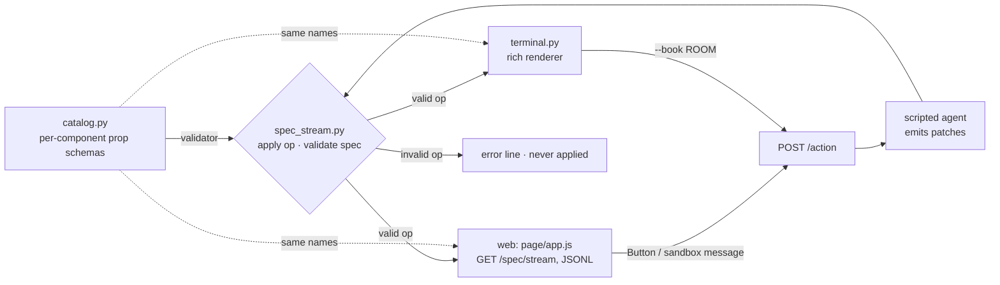

## The catalog: one definition, three uses

[`catalog.py`](catalog.py) defines 8 components (Stack, Heading, Text,
Metric, RoomTable, BarChart, BookingForm, Button) plus an `HtmlArtifact`
escape hatch, each as a JSON Schema for its props — `BarChart` bars must be
0–100, a `Button` action must name a known action, and so on. That one table
is the validator (`validate_spec`), what the agent is allowed to emit, and
the registry both renderers implement (`REGISTRY` in `terminal.py`, `REGISTRY`
in `app.js`). A test checks both renderers cover every catalog name.

## Patches, validated one at a time

[`spec_stream.py`](spec_stream.py) applies each patch to a server-side copy of
the spec and validates the result against the mode's catalog **before**
forwarding it. An invalid patch becomes an `{"error": …}` line and is never
applied by anyone. The web page and the terminal consume the same generator,
so they see the same spec op for op.

## The four modes — four patch vocabularies

| mode | what the agent emits | catalog | fit |
|---|---|---|---|
| **static** | only `replace` ops on `/elements/<id>/props` of a skeleton the client owns (3 metrics, a chart, a room table) — `add` is refused | Stack, Metric, BarChart, RoomTable | honest closest thing: json-render has no "named prebuilt widget" call, so static = *the client fixes the element map, the agent may only fill props*; the server enforces it |
| **declarative** | `add` an element, then `add` its id to a parent's children — repeated until the dashboard exists | the 8 components | **native** |
| **open-ended** | one `HtmlArtifact` under a bare Stack | Stack + HtmlArtifact | **awkward.** json-render is catalog-only by design; raw HTML is an escape hatch we added. A booking cannot patch structure that does not exist, so the agent **re-sends the whole HTML prop** (`replace /elements/html/props/html`) |
| **mixed** | the declarative build plus one `HtmlArtifact` (floor map) | 8 + HtmlArtifact | works; the region is the one part a terminal cannot draw |

| static | declarative | open-ended | mixed |
|---|---|---|---|
| 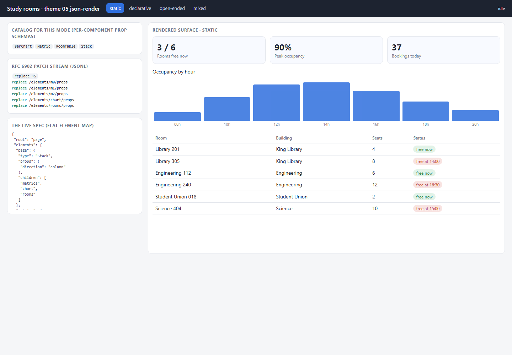 | 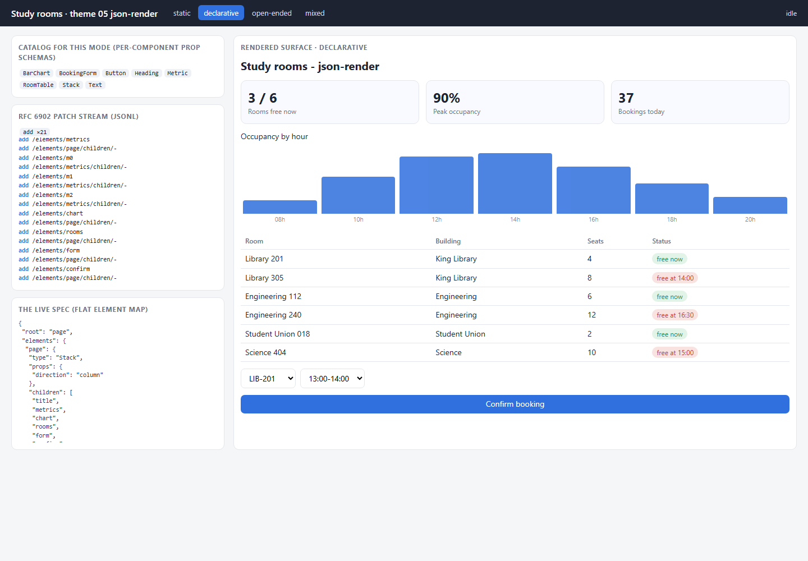 | 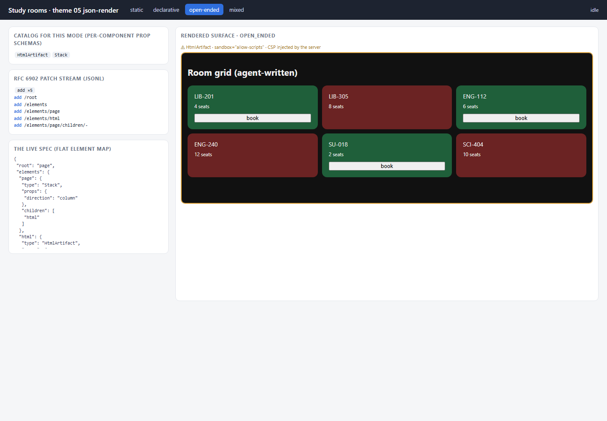 | 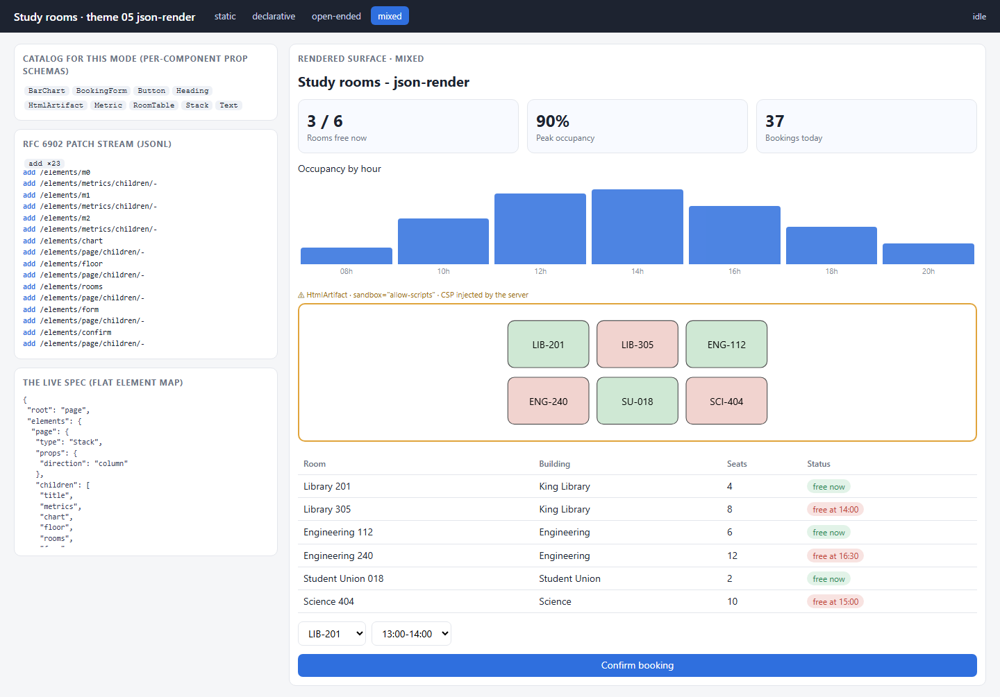 |

## One catalog, two renderers

The same specs, drawn by `terminal.py` (frames saved from real runs with
rich's SVG export, rasterised):

| static | declarative | open-ended | mixed |
|---|---|---|---|
| 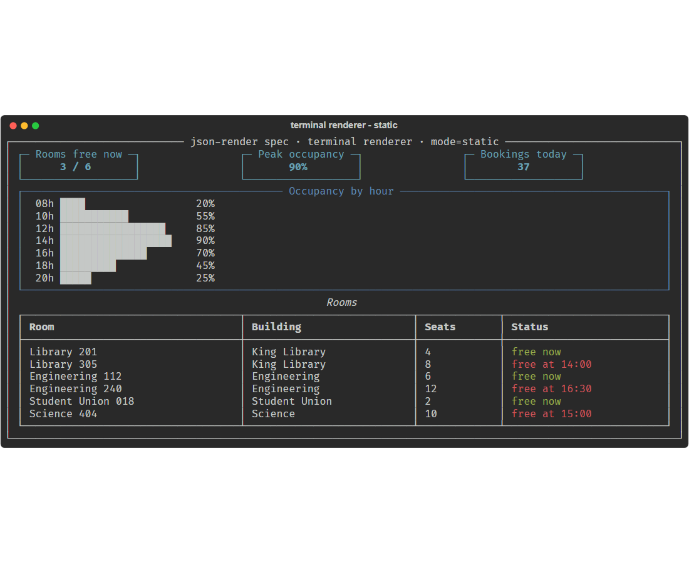 | 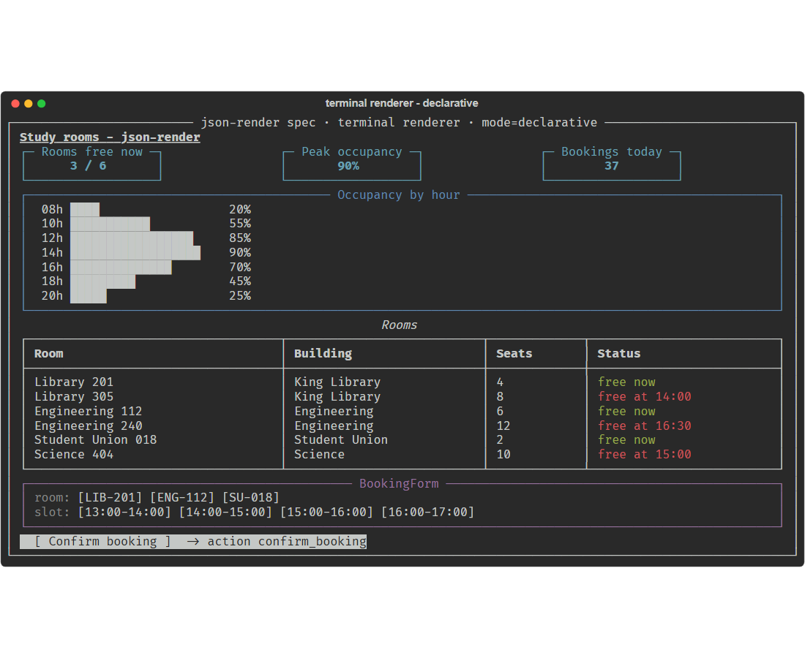 | 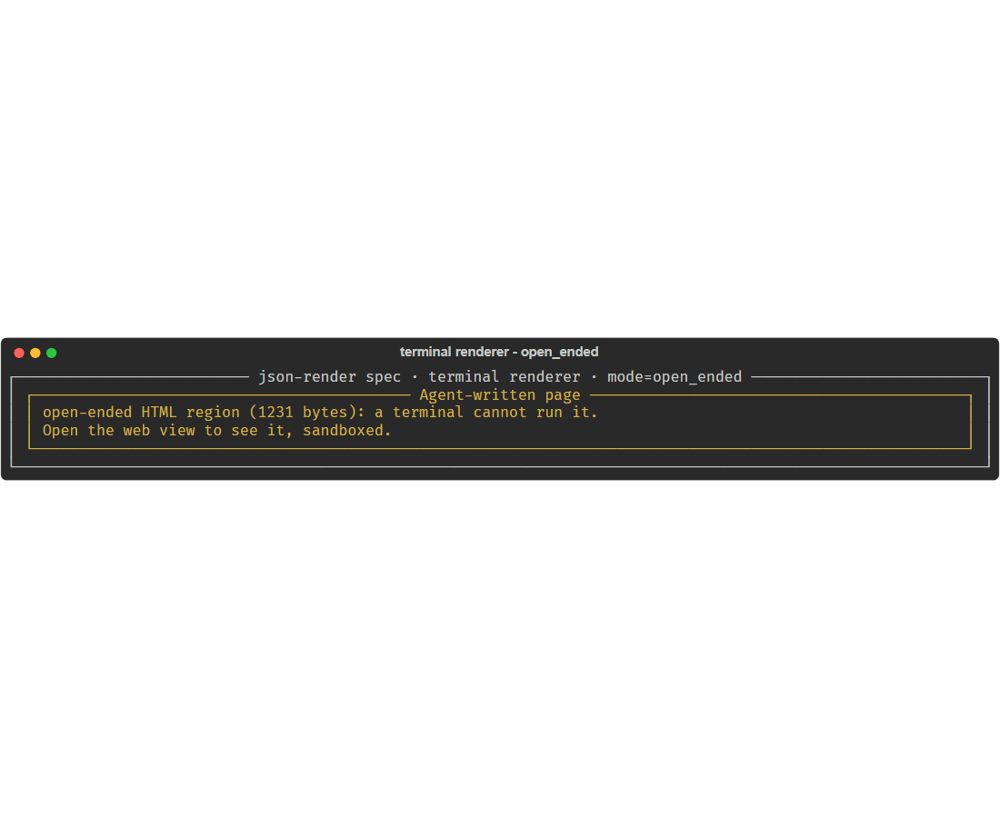 | 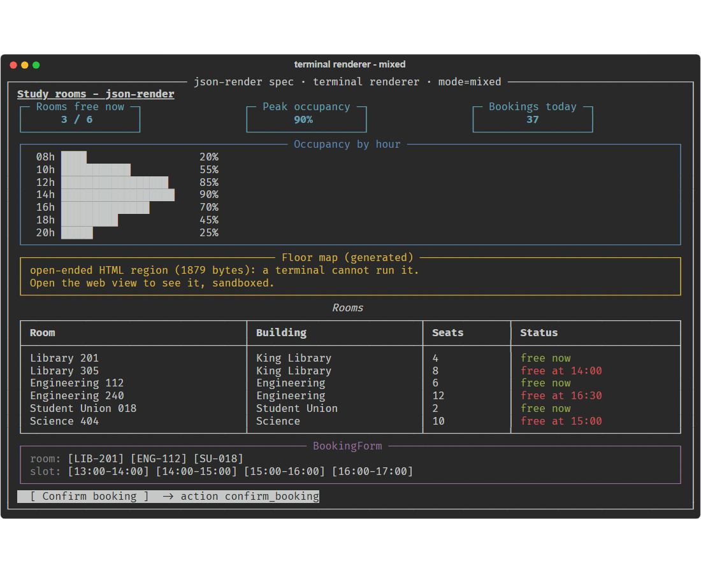 |

**Where "two renderers" breaks down:** open-ended HTML. A terminal cannot run
it, so `HtmlArtifact` renders as an honest placeholder giving the byte count
and pointing at the web view. In open-ended mode the terminal shows *nothing
but* that placeholder. One catalog serves several renderers only as long as
every component means something on every target — generated HTML does not.

## Actions call back into the server

- **Web:** *Confirm booking* posts `{mode, name: "confirm_booking", params: {room, slot}}`
  to `/action`; a click inside a sandboxed region posts the same action.
- **Terminal:** `terminal.py --book ENG-112` sends the same action through the same code path.

Either way the agent answers with patches to the live spec — the room marked
busy, the metric updated, the form's room list narrowed, a result `Text`
inserted. Nothing is replaced wholesale (a test checks the element ids before
and after).

| web, after an action | terminal, after `--book ENG-112` | open-ended, after a click in the sandbox |
|---|---|---|
| 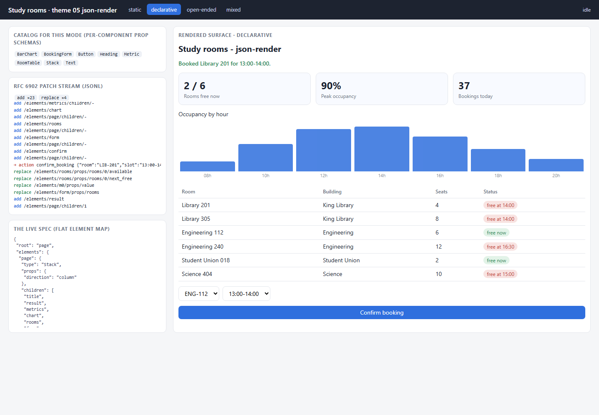 | 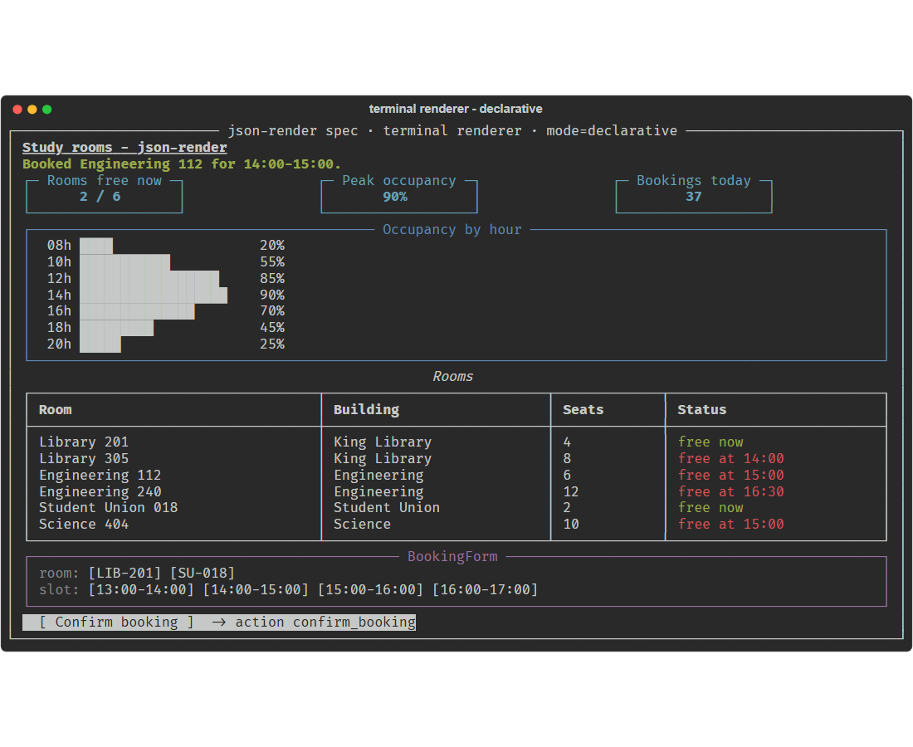 | 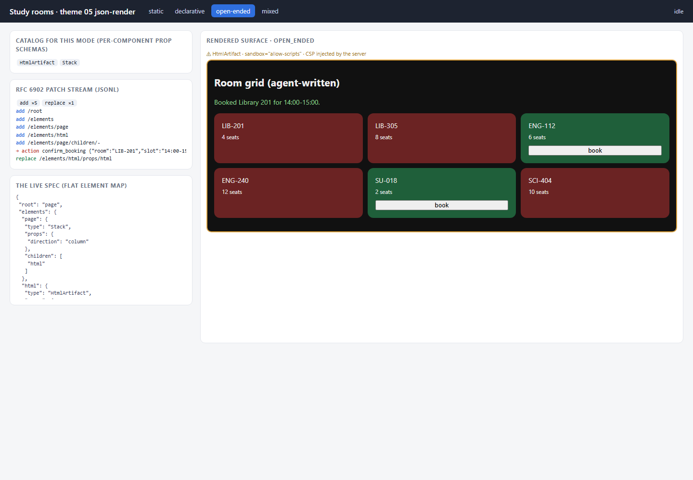 |

## Run it

```powershell
cd assignment4\05_json_render
py -3.11 -m venv .venv
.\.venv\Scripts\python.exe -m pip install -r requirements.txt
.\.venv\Scripts\python.exe server.py                                # http://127.0.0.1:8005
.\.venv\Scripts\python.exe terminal.py --mode declarative           # same spec, in the terminal
.\.venv\Scripts\python.exe terminal.py --mode declarative --book ENG-112
.\.venv\Scripts\python.exe -m pytest tests -q
```

## What to look at in the code

- `catalog.py` — the per-component prop schemas, `MODE_CATALOG`, `validate_spec`.
- `agent.py` — `build()` (four patch vocabularies) and `act()` (patches for an action; the open-ended branch re-sends HTML).
- `spec_stream.py` — `check()` (the static rule, apply, validate) and `run_ops()`.
- `terminal.py` — `REGISTRY` and `render()`: the same spec, in rich.
- `page/app.js` — `REGISTRY`, `apply()` (RFC 6902 in place), `runAction()`.

## Tests

`tests/test_json_render.py` — 7 offline tests: every mode's built spec
validates and a schema violation inside props is caught; an out-of-catalog
component (and `HtmlArtifact` in declarative mode) is rejected and never
applied; the CSP is in the generated HTML and the sandbox token is
`allow-scripts`; static mode is replace-only and `add` is refused; an action
patches the live spec in place; one spec renders in the terminal and both
registries cover the catalog; an open-ended action can only re-send the whole
region.

## Limits

- Not the json-render library itself (that is a TypeScript/React package); a Python + vanilla JS rendition of its catalog/spec/patch model.
- RFC 6902 subset: add, replace, remove.
- Server-side spec state is one dict per mode (one user at a time).
- The terminal renderer is display-only; actions come from flags, not keystrokes.

## Source

Structure and vocabulary from the GenUI course, theme 05:
<https://raw.githubusercontent.com/dlmastery/simple-coding-harness/main/genui/README.md>
(its `05_json_render/README.md` did not resolve at fetch time; the course
index's theme 05 rows were used). No code was copied.
