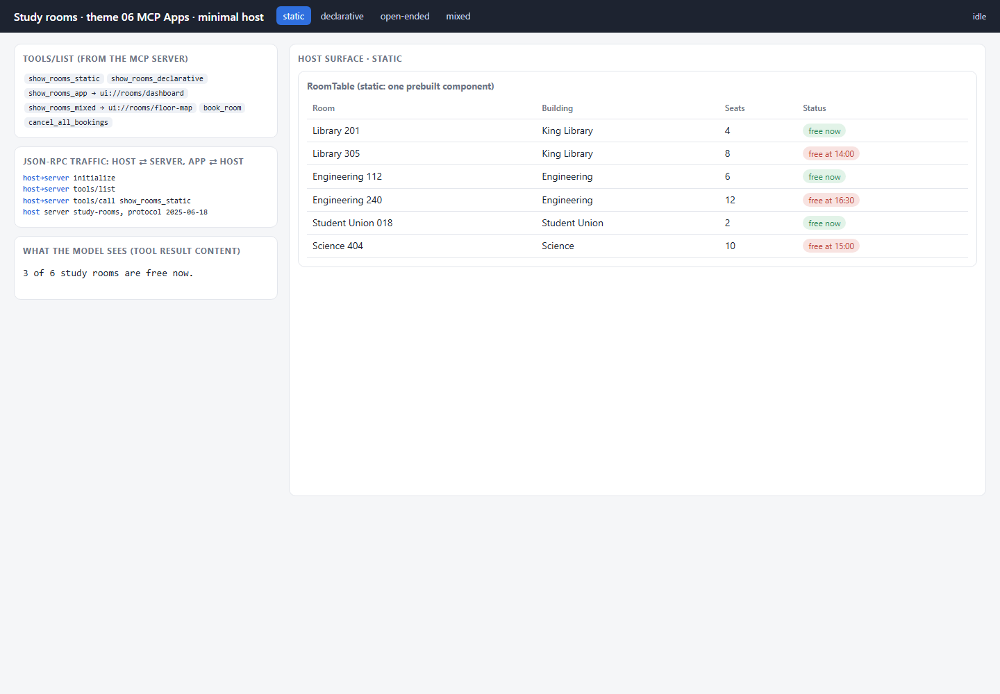
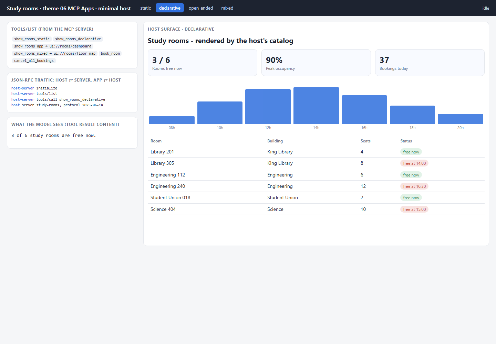
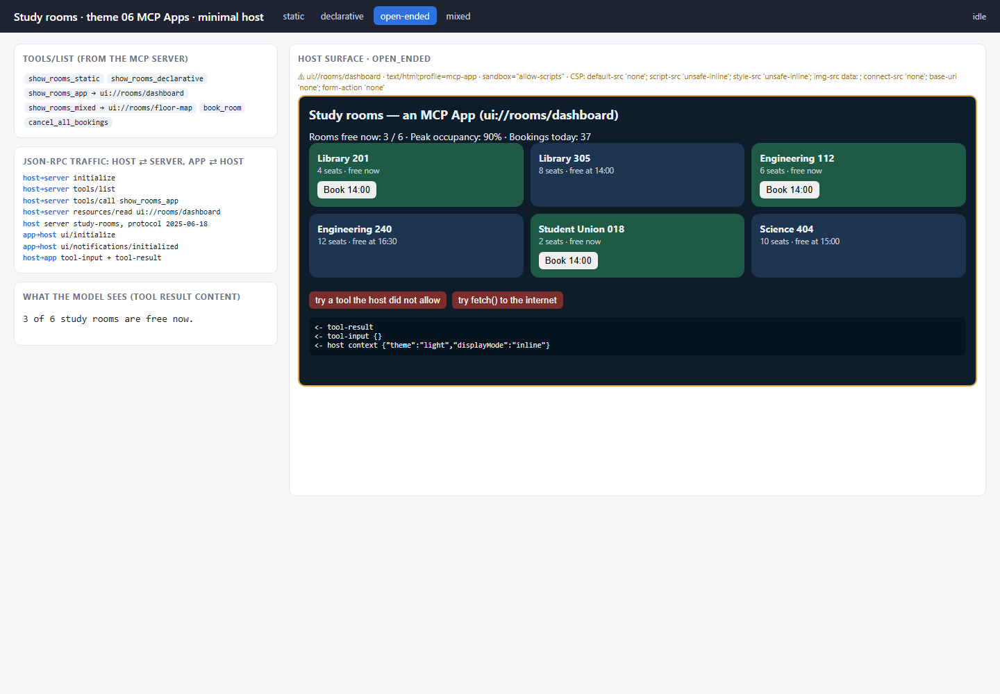
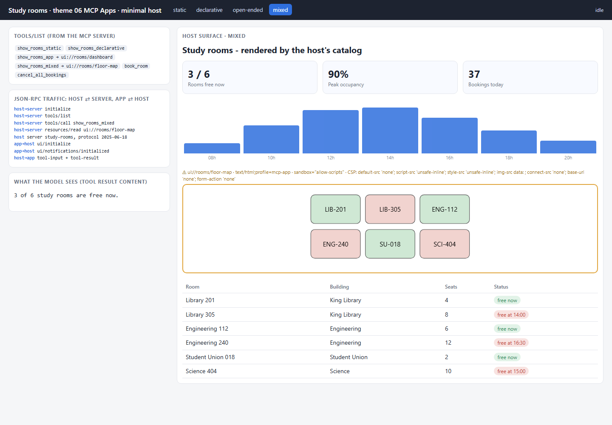
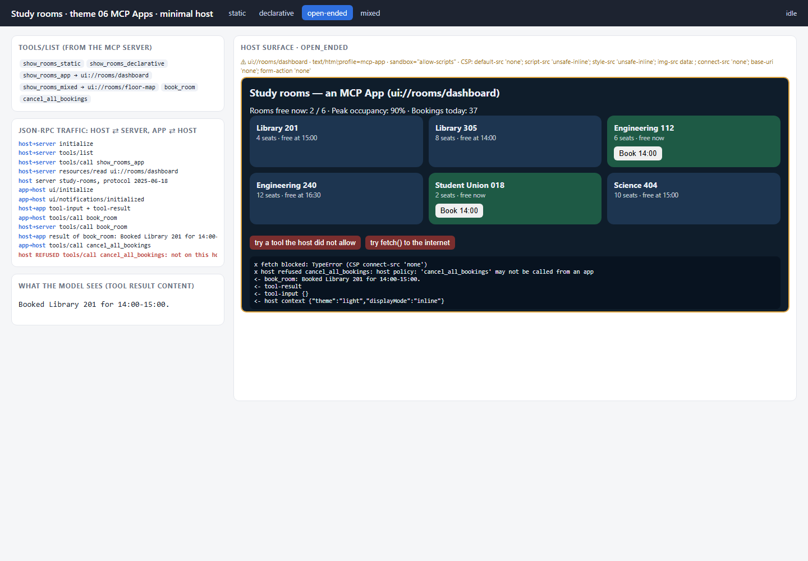

# 06 · MCP Apps — a different host owns the surface

**Status: WORKING** · port 8006

MCP Apps is a **transport**: a tool result points at a `ui://` resource,
and a **host application** — a chat client you do not control — fetches that
HTML and mounts it in a sandboxed iframe, then relays JSON-RPC between the
app and the server. In every earlier theme *we* owned the page. Here the
host owns it, and the app is a guest that can only do what the host allows.

This theme has three roles, kept apart even though they share one process:
an **MCP server** (`POST /mcp`, JSON-RPC 2.0, written by hand), a **minimal
host** (`page/app.js`) that talks to it exactly as a chat client would, and
the **app** (`ui://rooms/dashboard`, HTML running inside the host's sandbox).

```mermaid
sequenceDiagram
    participant H as host page (owns the surface)
    participant S as MCP server /mcp
    participant A as app in sandboxed iframe
    H->>S: initialize, tools/list
    S-->>H: show_rooms_app  _meta.ui.resourceUri = ui://rooms/dashboard
    H->>S: tools/call show_rooms_app
    S-->>H: content (for the model) + structuredContent (for the app)
    H->>S: resources/read ui://rooms/dashboard
    S-->>H: text/html;profile=mcp-app + _meta.ui.csp {connectDomains: []}
    Note over H: build CSP from _meta.ui.csp · mount sandbox="allow-scripts"
    A->>H: ui/initialize            (postMessage, JSON-RPC)
    H-->>A: hostContext
    A->>H: ui/notifications/initialized
    H-->>A: ui/notifications/tool-input, tool-result   (data IN)
    A->>H: tools/call book_room                         (call OUT)
    H->>S: tools/call book_room   (allowlisted: forwarded)
    S-->>H: result
    H-->>A: result
    A->>H: tools/call cancel_all_bookings
    H-->>A: error -32001  (not on the host's allowlist)
```

## What is implemented

- **MCP server** ([`mcp_server.py`](mcp_server.py)): `initialize`, `tools/list`,
  `tools/call`, `resources/list`, `resources/read`, and notifications (202, no
  body). The tool `show_rooms_app` declares `_meta.ui.resourceUri =
  "ui://rooms/dashboard"`; the resource is served as
  `text/html;profile=mcp-app` with `_meta.ui.csp` declaring that it needs **no**
  network origins.
- **Host** ([`page/app.js`](page/app.js)): an MCP client over HTTP;
  `mountApp()` reads the resource, **builds the Content-Security-Policy itself
  from `_meta.ui.csp`** and mounts the HTML with `sandbox="allow-scripts"`.
- **Bridge, both directions** over `postMessage` (JSON-RPC 2.0): the host
  answers `ui/initialize`, pushes `ui/notifications/tool-input` and
  `ui/notifications/tool-result` **in**, and handles `tools/call` coming **out**
  — forwarding it to the server only if the tool is on the host's allowlist
  (`ALLOWED_FROM_APP = {"book_room"}`).

## The four modes

MCP Apps is **open-ended by construction**: the host mounts whatever HTML the
resource contains. MCP Apps does not define a catalog or a declarative
format. So for the other three modes the same host renders a
catalog-constrained payload carried in `structuredContent.render` with its
**own** renderer. That payload convention is ours, not part of MCP Apps; any
real host would need its own.

| mode | tool | what arrives | who renders |
|---|---|---|---|
| **static** | `show_rooms_static` | `{kind: "static", component: "RoomTable", props}` — one prebuilt component | the host's catalog; no iframe |
| **declarative** | `show_rooms_declarative` | an element map from the host's 6-component catalog, validated by the server before it is returned | the host's catalog; no iframe |
| **open-ended** | `show_rooms_app` | `_meta.ui.resourceUri` → a complete HTML app | the app, inside the host's sandbox |
| **mixed** | `show_rooms_mixed` | a catalog element map with one `AppRegion` pointing at `ui://rooms/floor-map` | the host draws the catalog; the region is a nested MCP App |

| static | declarative | open-ended | mixed |
|---|---|---|---|
|  |  |  |  |

**Why the non-open-ended modes are awkward here:** a catalog only works if
host and server agree on it, and MCP Apps gives them no way to negotiate one.
Our server and host share a convention because we wrote both. A third-party
host would ignore `structuredContent.render` and show only the text
`content` — which is exactly the right fallback, and why every tool result
still carries text for the model.

## The bridge in action — a real run

In open-ended mode the app has a *Book* button on each free room, and two
deliberately hostile buttons. Clicking all three in a real browser
([screenshot](docs/bridge_in_action.png)) logged, inside the app:

```
<- book_room: Booked Library 201 for 14:00-15:00.
x host refused cancel_all_bookings: host policy: 'cancel_all_bookings' may not be called from an app
x fetch blocked: TypeError (CSP connect-src 'none')
```

and in the host: `REFUSED tools/call cancel_all_bookings: not on this host's
allowlist`. The model received *"Booked Library 201 for 14:00-15:00."* as the
tool result.



## What the sandbox actually prevents — and what it does not

**Prevents** (by `sandbox="allow-scripts"` without `allow-same-origin`, plus
the host-built CSP):

- **Reading or changing the host page.** The app runs in an opaque origin: no
  access to the host's DOM, cookies, `localStorage` or session.
- **Network exfiltration.** `connect-src 'none'` (the resource asked for no
  origins) blocks `fetch`/XHR/WebSocket — verified above. `default-src 'none'`
  also blocks remote scripts, styles, frames and images; only inline code and
  `data:` images run.
- **Navigating the host, opening popups, or submitting forms** — none of
  those sandbox tokens are granted, and `form-action 'none'` is set.
- **Calling tools on its own.** The app cannot reach the MCP server at all;
  every `tools/call` goes through the host, which forwards only allowlisted
  tools — verified above for `cancel_all_bookings`, a tool the **server**
  would happily run.

**Does not prevent:**

- **Calling an allowed tool with arguments the user did not intend.** The
  app can book any free room it likes. The host should confirm
  consequential actions with the user, and the server must validate
  (ours rejects an unavailable room).
- **Misleading content.** The app can draw anything inside its rectangle,
  including a fake "login" form. The sandbox limits *reach*, not *honesty*.
- **Seeing what the host passes in.** Everything in `structuredContent` is
  readable by the app — never put data there the app should not have.
- **Wasting resources** — an infinite loop or a flood of `postMessage` calls
  still runs; the host would need rate limits.
- **A weak host.** The CSP and the allowlist are the host's choices. A host
  that granted `allow-same-origin`, or copied `connectDomains` without
  checking them, would undo all of the above.

## Run it

```powershell
cd assignment4\06_mcp_apps
py -3.11 -m venv .venv
.\.venv\Scripts\python.exe -m pip install -r requirements.txt
.\.venv\Scripts\python.exe server.py                    # host page: http://127.0.0.1:8006
.\.venv\Scripts\python.exe server.py --mode declarative
.\.venv\Scripts\python.exe -m pytest tests -q
```

## What to look at in the code

- `mcp_server.py` — `TOOLS` (the `_meta.ui.resourceUri` link), `RESOURCES` (`_meta.ui.csp`), `handle()` (JSON-RPC), and the server-side catalog check in `call_tool()`.
- `agent.py` — `BRIDGE_JS` (the app's half of the bridge), `app_html()`, the payloads, `validate_payload()`.
- `page/app.js` — `cspFor()`, `mountApp()`, the `message` listener (the host's half of the bridge and its allowlist), `renderPayload()`.

## Tests

`tests/test_mcp_apps.py` — 5 offline tests: the tool links to a `ui://`
resource served as `text/html;profile=mcp-app` with a CSP declaration; the
catalog payload validates and an out-of-catalog component makes the tool
return `isError` with no payload; the sandbox token and CSP construction are
present; the host allowlist admits only `book_room` (while the server does
expose the admin tool); `book_room` round-trips, a second booking of the same
room fails, an unknown method returns `-32601`, and a notification gets 202.

## Limits

- A hand-written subset of MCP and of the MCP Apps bridge (SEP-1865): no streamable-HTTP sessions or SSE, no `ui/message`, `ui/open-link`, size-change or teardown notifications, no tool-visibility metadata.
- **State is split in mixed mode.** A booking made inside the embedded floor-map app updates the app, but the host-rendered table beside it does not change until the host calls the tool again. When two renderers share a surface, someone has to own the state; here nobody does, and the README says so rather than hiding it.
- The host and server are ours, so the catalog convention works; a real third-party host would show only the text content for the non-open-ended modes.

## Source

Structure and vocabulary from the GenUI course, theme 06:
<https://raw.githubusercontent.com/dlmastery/simple-coding-harness/main/genui/README.md>
(and `genui/06_mcp_apps/README.md`), and the MCP Apps overview
(<https://modelcontextprotocol.io/extensions/apps/overview>). No code was copied.
