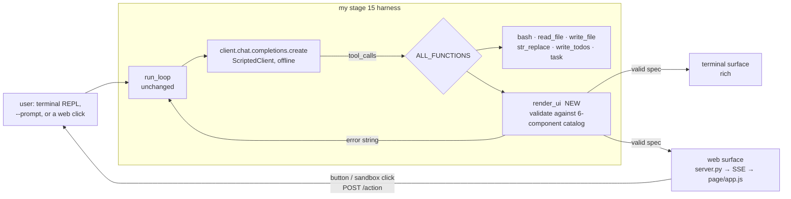
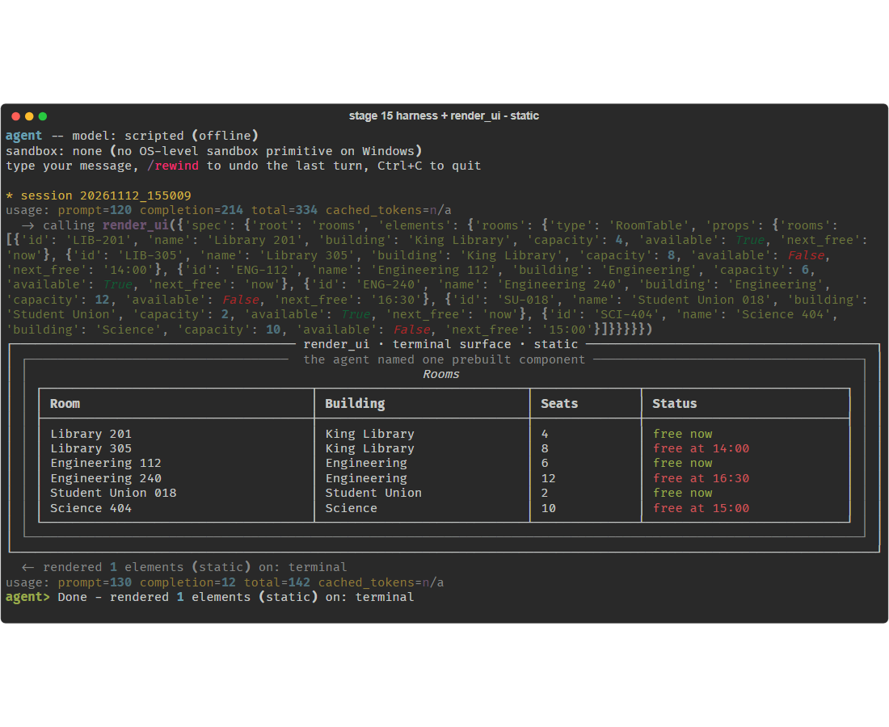
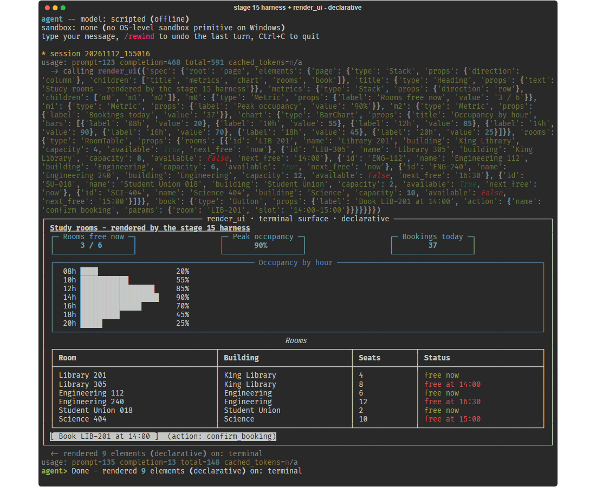
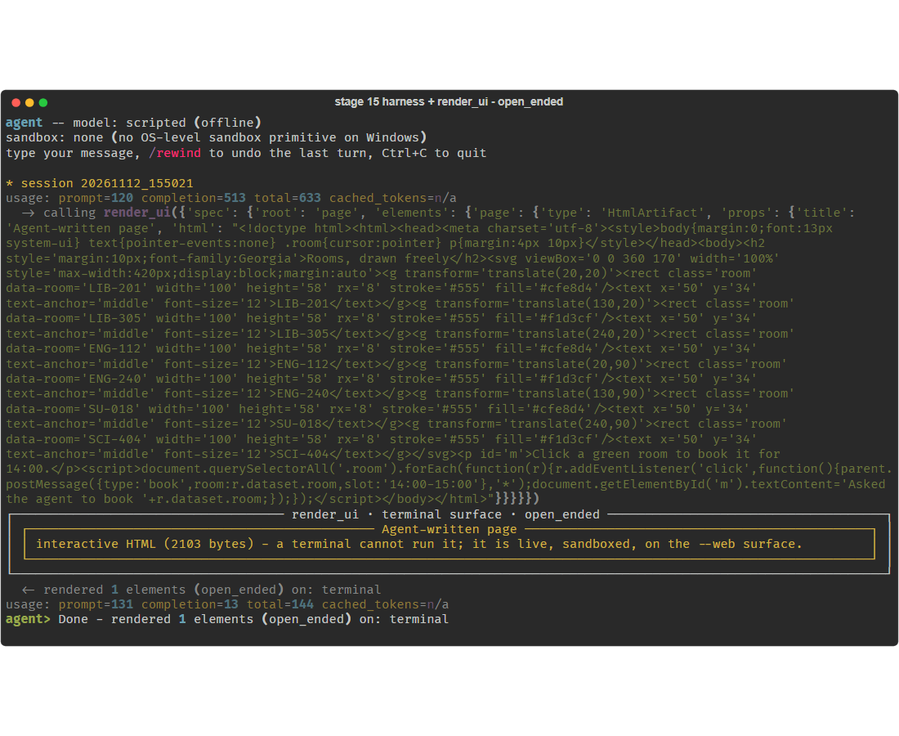
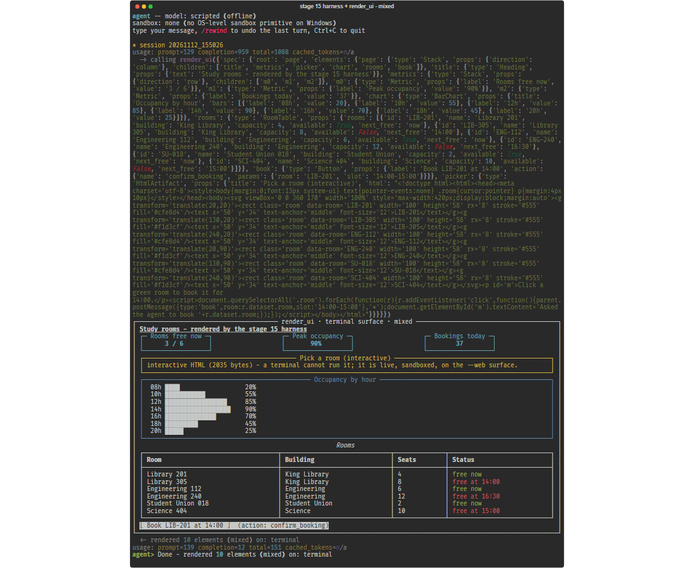
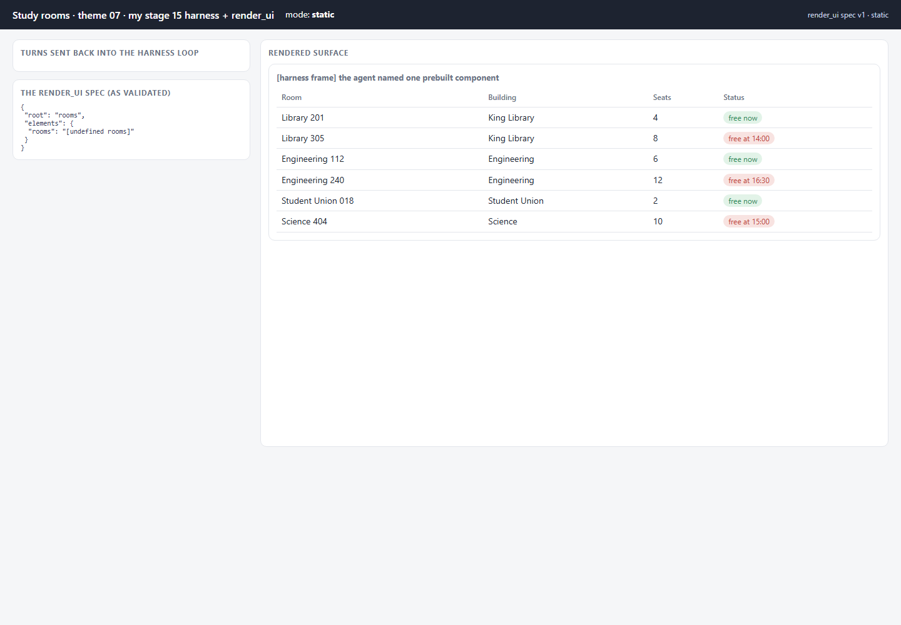
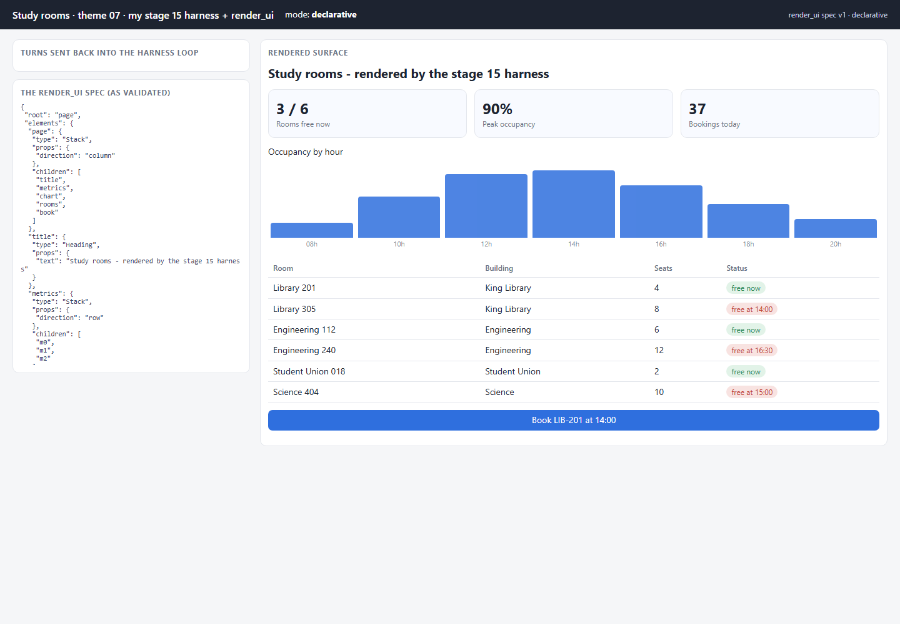
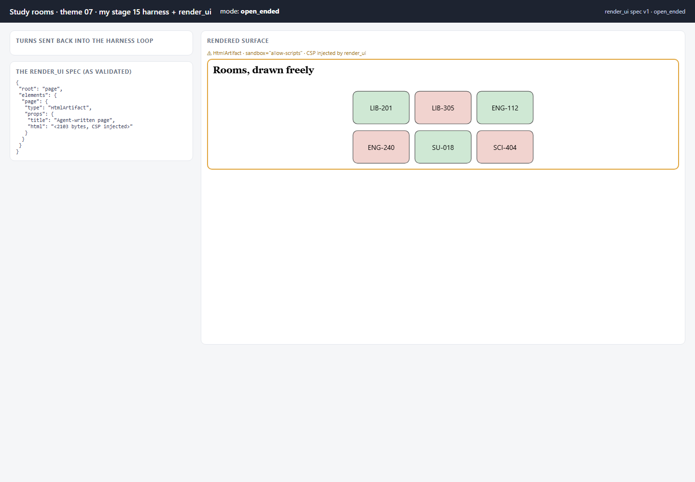
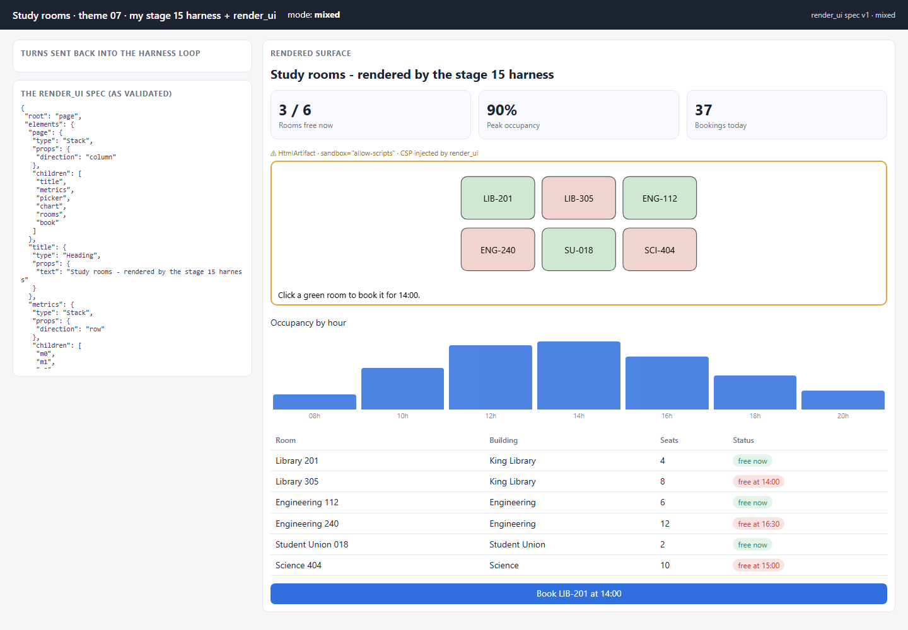
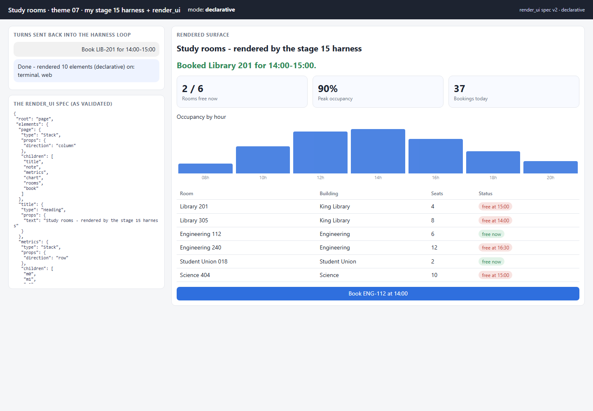

# 07 · Harness GenUI — a render_ui tool on my own harness

**Status: WORKING** · port 8007

**This harness is my own, from assignment 2.** It is the coding agent built
stage by stage in [`assignment2/partA`](../../assignment2/partA/), and the
stage being extended is **stage 15, subagents**
([`assignment2/partA/stage_15_subagents`](../../assignment2/partA/stage_15_subagents/)):
the loop with the bash/read/write/edit/todo tools, sessions, compaction,
late-injected reminders, and the `task` subagent tool. It was copied into
[`harness/`](harness/) at commit `5aafb54` and extended there; the original
in `assignment2` is untouched.

What this theme adds is a **rendering surface**. The agent gets one new tool,
`render_ui(spec)`, and the spec it emits is drawn on **two surfaces from one
agent**: the terminal (rich, on the same console stage 13's `ui.py` already
uses) and, with `--web`, a browser page fed over SSE.



## Exactly what changed in the harness

| file | change |
|---|---|
| `main.py` | **modified** — `render_ui` added to `ALL_TOOLS`/`ALL_FUNCTIONS`; `--mode`, `--web`, `--prompt` flags; `make_client()` returns the scripted client unless `HARNESS_SCRIPTED=0`; the REPL's turn steps moved into `run_turn()` so web clicks reuse them. Every added line is marked `# [A4]`. |
| `render_ui.py` | **new** — the tool, its schema, the catalog, the validator, the mixed-mode rule |
| `terminal_surface.py` | **new** — rich renderer for a spec |
| `scripted_client.py` | **new** — a stand-in for the OpenAI client (see the top-level README on scripted agents) |
| `data.py` | **new** — the study-room data |
| everything else | **byte-for-byte unchanged** — `run_loop`, tools, subagents, sessions, compaction, ui |

The full diff of `main.py` against my stage 15 is in
[docs/harness_diff.md](docs/harness_diff.md). `run_loop()` itself was not
touched: `render_ui` is dispatched exactly like `bash` or `task` — one name,
one args dict, one string result.

## The tool

[`harness/render_ui.py`](harness/render_ui.py). The spec is a json-render
style flat element map — `{root, elements: {id: {type, props, children?}}}` —
validated against a **six-component catalog** with a JSON Schema per
component: `Stack`, `Heading`, `Metric`, `RoomTable`, `BarChart`, `Button`.

**Validation errors are results.** An invalid spec is not an exception; the
tool returns `error: spec rejected -- …` and the loop feeds that back to the
model like any other tool result. A real run, recorded from the harness
([`terminal_correction.png`](docs/terminal_correction.png)):

```
  -> calling render_ui({'spec': {... 'photos': {'type': 'Carousel', ...}}})
  <- error: spec rejected -- element 'photos': 'Carousel' is not in the declarative catalog
  -> calling render_ui({'spec': {... (no Carousel) ...}})
  <- rendered 9 elements (declarative) on: terminal
agent> Done - rendered 9 elements (declarative) on: terminal
```

## The four modes

| mode | what the agent emits through `render_ui` | enforced by the tool |
|---|---|---|
| **static** | exactly one prebuilt component (`RoomTable`, `Metric` or `BarChart`) with props; the harness draws it inside **its own fixed frame** | one element, no composition, static types only |
| **declarative** | a full element map over the six components | the catalog and per-component prop schemas |
| **open-ended** | a single `HtmlArtifact` with agent-written HTML | only `HtmlArtifact` is in the catalog; CSP injected before any surface sees it |
| **mixed** | the six components **plus at most one `HtmlArtifact`, and only when the user asks for something interactive** | the tool checks the current user request (`interactive`, `click`, `pick`, `map`, …); an artifact in answer to "show me the dashboard" is rejected |

The mixed rule is enforced in code, not left to the model:
`validate(spec, "mixed", "Show me the dashboard")` fails with *"HtmlArtifact
is only allowed when the user asks for something interactive"*, and the same
spec passes for "Give me an interactive room picker". One consequence, by
design: after a booking made *from* the picker, the follow-up turn ("Book
LIB-201…") is not an interactive request, so the agent re-renders without
the artifact.

### Terminal surface (real runs, recorded from the harness)

| static | declarative | open-ended | mixed |
|---|---|---|---|
|  |  |  |  |

A terminal cannot run HTML, so in open-ended and mixed modes the artifact is
an explicit placeholder pointing at the web surface.

### Web surface (`--web`, same agent, same spec)

| static | declarative | open-ended | mixed |
|---|---|---|---|
|  |  |  |  |

## One agent, two surfaces — and clicks back into the loop

`render_ui` hands every accepted spec to each registered surface; with `--web`
the result string says so (`… on: terminal, web`). A click on the web surface —
the *Book* button, or a room inside the sandboxed picker — is posted to
`/action` and becomes **the next user turn of the same harness loop**, under a
lock so turns never interleave. Real runs:

| button click (declarative) | click inside the sandboxed picker (mixed) |
|---|---|
|  |  |

Both runs logged the turn `Book LIB-201 for 14:00-15:00` and the agent's reply
`Done - rendered 10 elements (…) on: terminal, web` — the same turn drew on
both surfaces.

## Security of the HtmlArtifact

- `render_ui` injects a Content-Security-Policy (`default-src 'none'`, inline
  only, no forms) into the HTML **before** any surface receives the spec.
- The web surface mounts it with `sandbox="allow-scripts"` and nothing else,
  so the HTML runs in an opaque origin with no access to the page, cookies or
  storage, and no network.
- One message shape is accepted from the frame (`{type: "book", room}`), only
  from a frame the page mounted; it becomes a user turn, and the agent decides
  what to do with it.

## Run it

```powershell
cd assignment4\07_harness_genui
py -3.11 -m venv .venv
.\.venv\Scripts\python.exe -m pip install -r requirements.txt

# the harness REPL, as in assignment 2, now with render_ui
.\.venv\Scripts\python.exe harness\main.py --mode declarative
# the same, plus the browser surface on http://127.0.0.1:8007
.\.venv\Scripts\python.exe harness\main.py --mode mixed --web
# one non-interactive turn, browser surface kept open
.\.venv\Scripts\python.exe server.py --mode mixed --prompt "Show me the dashboard with an interactive room picker"
# record a terminal run to SVG
.\.venv\Scripts\python.exe record_terminal.py --mode declarative --prompt "Show me the study-room dashboard" --svg docs\run.svg

.\.venv\Scripts\python.exe -m pytest tests -q
```

Set `$env:HARNESS_SCRIPTED = "0"` and `$env:OPENROUTER_API_KEY` to run the
original OpenRouter client from assignment 2 instead of the scripted one; the
tool and surfaces are the same either way. That path was not exercised for
this submission.

## What to look at in the code

- `harness/main.py` — search for `[A4]`: the whole integration is those lines.
- `harness/render_ui.py` — `RENDER_UI_SCHEMA`, `CATALOG`, `validate()` (static rule, mixed rule), `render_ui()`.
- `harness/terminal_surface.py` — `REGISTRY`, `TerminalSurface.show()`.
- `harness/scripted_client.py` — the OpenAI-shaped responses, and the carousel correction.
- `server.py` — `WebSurface`, `attach()`, `/events`, `/action` → `run_turn`.

## Tests

`tests/test_harness_genui.py` — 7 offline tests: `render_ui` is registered
alongside stage 15's own tools and a real `main.main(--prompt)` turn calls it;
a spec validates and an out-of-catalog component is rejected — in the real loop
the error comes back as a tool result and the agent corrects; the CSP is
injected and the sandbox token is `allow-scripts`; mixed mode allows an
`HtmlArtifact` only for interactive requests; static mode refuses composition
and open-ended renders one artifact; one spec reaches both surfaces and the
SSE stream carries it; a web action becomes a harness turn.

## Limits

- The agent is scripted (see the top-level README). The harness, the loop and the tool are real; the model's decisions are fixed.
- The "interactive request" check is a keyword rule. It is enforced, which is the point, but a model-facing policy would be better phrased as part of the system prompt *and* checked here.
- The web surface shows the latest spec only (no history) and serves one harness session.
- `ui.print_tool_call` from stage 13 prints the whole spec argument, which is long; it was left unchanged on purpose.

## Source

Structure and vocabulary from the GenUI course, theme 07:
<https://raw.githubusercontent.com/dlmastery/simple-coding-harness/main/genui/README.md>
(and `genui/07_harness_genui/README.md`). The harness is my own from
assignment 2; no code was copied from the course.
