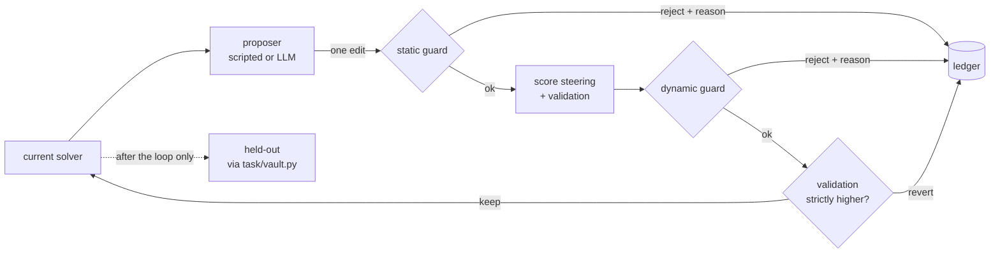

# 00 · Naive RSI — the control

Every method in this assignment is measured against this loop. It is the
simplest thing that can be called recursive self-improvement on a fixed
task: propose one edit to the solver, score it, keep it if validation went
up, revert it otherwise.



## The mechanism

There is no paper for this one; it is the "Naive RSI" every October 2026
paper compares against (SO-RSI calls it exactly that). It has:

- **no memory** beyond the current solver: an edit that failed five minutes
  ago can be proposed again in the same situation
- **no diagnosis**: it sees which steering questions fail, never *why*
- **a strict keep rule**: validation accuracy must go up. Ties revert.

The keep rule is shared by every method (`core/loop.py::Harness.judge`), so
differences between methods come from *what* they propose, never from how
leniently they accept.

## What the improver sees

| Split | Access |
|---|---|
| steering (40) | full: questions, gold SQL, gold rows, per-question results, which handler fired |
| validation (40) | one number per candidate (`ImproverView.validation_score`) |
| held-out (40) | nothing. Sealed while `improvement_phase()` is active; read once afterwards through `task/vault.py`, audited in `docs/ledgers/heldout_access.jsonl` |

## Run it

```powershell
cd assignment5
.\.venv\Scripts\python.exe 00_baseline\run.py                     # 5 seeds x 20 iterations, scripted
.\.venv\Scripts\python.exe 00_baseline\run.py --seeds 0 --verbose  # one seed, every decision printed
$env:GEMINI_API_KEY = "<your key>"
.\.venv\Scripts\python.exe 00_baseline\run.py --proposer llm --seeds 0 --iterations 8
.\.venv\Scripts\python.exe -m pytest 00_baseline\tests
```

A scripted run takes under 2 seconds per seed.

## Result — scripted proposer, 5 seeds × 20 iterations

Ledgers: [`docs/ledgers/00_baseline_scripted_seed{0..4}.jsonl`](../docs/ledgers/).
Summary: [`docs/results/00_baseline_scripted.json`](../docs/results/00_baseline_scripted.json).

| seed | held-out start | held-out final | kept | repeated fixes | blind repeats | oscillations | zero-progress | guard rejections |
|---|---|---|---|---|---|---|---|---|
| 0 | 0.250 | 0.550 | 8 | 6 | 1 | 0 | 8 | hardcoded ×3, heldout_access ×1 |
| 1 | 0.250 | 0.750 | 12 | 3 | 1 | 2 | 6 | — |
| 2 | 0.250 | 0.325 | 3 | 7 | 5 | 2 | 14 | narrowing ×1 |
| 3 | 0.250 | 0.475 | 6 | 7 | 2 | 1 | 12 | hardcoded ×1 |
| 4 | 0.250 | 0.500 | 7 | 4 | 2 | 0 | 12 | hardcoded ×1 |
| **mean** | **0.250** | **0.520 ± 0.154** | 7.2 | 5.4 | 2.2 | 1.0 | **10.4 / 20** | 7 total |

Validation final equalled held-out final on every seed — the three splits
hold the same 20 families, one A and one B phrasing each, so a family-level
fix moves all three together.

**What the thrashing looks like.** Seed 2 is the clearest case. Its
proposer appended handlers for O1 (twice), O2 (twice), Q1 (three times), Q2
and J2; every one sat behind `generic_list` under first-match dispatch,
never fired, scored zero, and was reverted. At iterations 17 and 18 it
proposed `dispatch_priority` twice in a row — the one change that would
have unblocked all of them — and it scored zero both times, because by then
none of the blocked handlers were left in the solver to unblock. Five of its
retries happened with nothing kept in between, the exact situation in which
the edit had already failed. 14 of 20 iterations moved validation by
nothing. It finished at 32.5%.

**What only one seed found.** `COUNT_DISTINCT` was proposed 11 times across
four seeds and never kept. It only pays off once a counting handler that
uses `count_expr` is already in place, and that handler only pays off once
`COUNT_DISTINCT` is on — each is useless without the other, and a
one-edit-at-a-time loop with a strict keep rule cannot cross that gap except
by luck. Seed 4 proposed the A4 counting handler three times and reverted it
three times for exactly this reason. Only seed 0 got round it, by drawing
the hand-written `fix_A2_distinct` variant, which fixes one family.

Definitions of every behavioural count are in [`core/metrics.py`](../core/metrics.py).

## Result — live LLM proposer (gemini-3.5-flash), 1 seed × 8 iterations

This is the run that proves the LLM integration. Ledger:
[`docs/ledgers/00_baseline_llm.jsonl`](../docs/ledgers/00_baseline_llm.jsonl);
every prompt and reply verbatim:
[`docs/ledgers/00_baseline_llm_transcript.jsonl`](../docs/ledgers/00_baseline_llm_transcript.jsonl).

| it | proposal | position | decision | validation |
|---|---|---|---|---|
| 1 | `llm_s4_section_capacity` | prepend | keep | 0.250 → 0.300 |
| 2 | `llm_j3_instructor_course_term` | append | keep | 0.300 → 0.325 |
| 3 | `llm_a3_avg_grade` | prepend | keep | 0.325 → 0.375 |
| 4 | — | — | **proposer_error**: HTTP 503, model under high demand | — |
| 5 | `llm_j4_student_course_term` | prepend | keep | 0.375 → 0.425 |
| 6 | `llm_j1_department_courses` | prepend | keep | 0.425 → 0.525 |
| 7 | — | — | **proposer_error**: HTTP 503 | — |
| 8 | `llm_j2_student_department` | prepend | keep | 0.525 → 0.575 |

**Held-out 0.250 → 0.575** in 8 calls (6 answered), zero repeats, zero
oscillations. Wall clock 280 s, almost all of it waiting on the API.

Two things to read from it:

- **The 503s were logged, not papered over.** Each failed call is a
  `proposer_error` entry; the loop did not fall back to the scripted
  proposer. `test_a_failing_proposer_is_logged_not_replaced` pins that.
- **The LLM routed around shadowing in-context.** It is shown the complete
  solver source, saw `generic_list`, and placed five of six handlers at the
  front of the dispatch list. The scripted proposer prepends only a quarter
  of the time. This is one run on one seed, so it is an observation, not a
  measured effect.

## Limits

- The scripted proposer is a designed mutator, not a model. Its thrashing is
  a consequence of its selection rule (symptom-weighted, memoryless) on a
  testbed with interacting root causes, which is the regime the SO-RSI paper
  describes — but it is ours, not theirs.
- The LLM result is n = 1. It is evidence the integration works, not a
  comparison between proposers.
- 40 questions per split means one question is 2.5 points. The seed spread
  (32.5% to 75%) is larger than most differences you might want to read off
  a single run, which is why every number above is reported per seed.

## References

- Course map, section 10: <https://raw.githubusercontent.com/dlmastery/simple-coding-harness/main/COURSE-MAP.md>
- Research studio: <https://raw.githubusercontent.com/dlmastery/simple-coding-harness/main/10_research_studio/README.md>
- Paper summaries: <https://raw.githubusercontent.com/dlmastery/simple-coding-harness/main/12_october_2026_papers/PAPER_SUMMARIES.md>
- Guard and ledger lineage: [`assignment2/partC`](../../assignment2/partC/)
