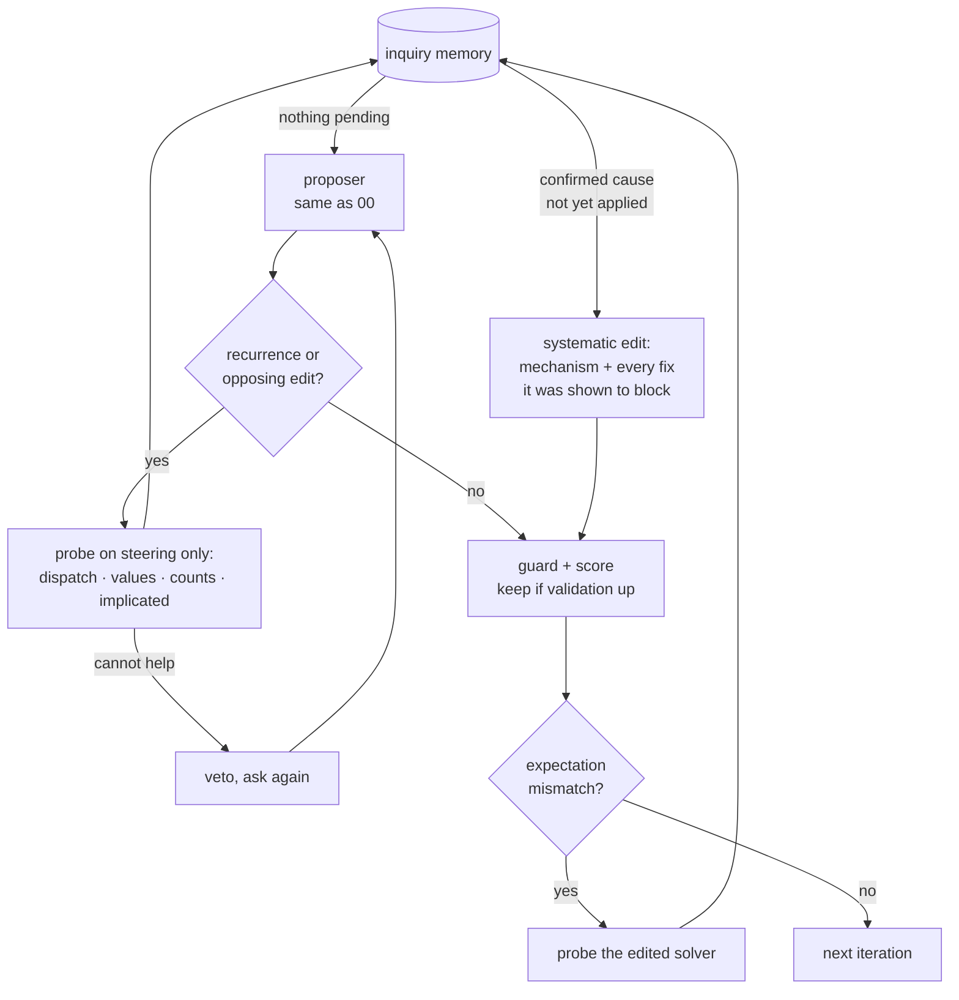

# 01 · SO-RSI — Second-Order RSI

**Changed object: the diagnostic strategy.** The proposer, the guard, the
keep rule and the evaluation budget are identical to [00_baseline](../00_baseline/).
What SO-RSI adds is a layer that asks *why* a fix failed before deciding
what to try next.



## SOURCE CLAIM — arXiv 2610.05701

Jiang, Vempaty, Jagmohan, *Second-Order Problem Solving for Recursive
Self-Improvement in Formal Verification* (Oct 2026). From the abstract:
standard RSI "operates as a first-order optimizer: it repeatedly patches
surface-level parameters in response to immediate failure symptoms, often
leading to trial-and-error thrashing". SO-RSI "passively monitors execution
traces for three structural anomalies (recurrence, opposing edits, and
expectation mismatch) to trigger targeted mechanism investigations", runs
"lightweight diagnostic probes", and keeps "persistent inquiry memory across
RSI rounds". Reported result: **+21.8 and +25.8 percentage points** held-out
pass rate over Naive RSI on Lean 4 proof generation and Verus verifiable code
generation, under matched 24-hour search budgets; behaviourally, it
"substantially suppresses failure recurrence and eliminates unproductive
zero-progress optimization loops".

## OUR LAPTOP ADAPTATION

| Paper component | Ours | File |
|---|---|---|
| structural anomaly detection | recurrence = this exact edit already failed in this exact solver; opposing = would undo a kept change; mismatch = fixed under half of what the edit predicted, or broke something | [`so_anomalies.py`](so_anomalies.py) |
| lightweight diagnostic probes | four interventions on steering questions only: **dispatch** (was the handler ever reached? does priority dispatch reach it?), **values** (are SQL literals stored values? does entity linking fix it?), **counts** (does COUNT(DISTINCT) fix it?), **implicated** (does undoing the kept change fix any failure?) | [`so_probes.py`](so_probes.py) |
| persistent inquiry memory | every finding, confirmed and refuted, with round and evidence; written to `docs/ledgers/*_inquiry.jsonl` | [`so_memory.py`](so_memory.py) |
| systematic edits, not patches | a confirmed cause becomes one bundled edit: the mechanism plus every earlier fix it blocked, judged as a single candidate | [`so_loop.py`](so_loop.py) |

**What we simplified, and how it differs from the paper:**

- **The probes are hand-written, and they cover exactly the three root causes
  the testbed contains.** In the paper the investigation is open-ended and
  model-driven. Ours can only diagnose shadowing, value linking and
  duplicate counting; a cause outside that set would go undiagnosed and
  SO-RSI would fall back to first-order behaviour. This is the single
  biggest reason our effect is larger than the paper's.
- **The proposer is the scripted mutator, not an LLM.** SO-RSI asks it for
  specific things (a mechanism, a re-application) through the same API the
  baseline uses.
- **Budget is matched in iterations and evaluations, not hours.** Both loops
  get 20 iterations. A vetoed proposal costs no evaluation; probes cost a few
  steering SQL executions, reported separately.
- **Probes never see validation.** `test_probes_never_score_validation` pins
  that every validation call is a counted evaluation.

## Run it

```powershell
cd assignment5
.\.venv\Scripts\python.exe 00_baseline\run.py                        # baseline first: the comparison reads it
.\.venv\Scripts\python.exe 01_so_rsi\run.py                          # 5 seeds x 20 iterations
.\.venv\Scripts\python.exe 01_so_rsi\run.py --ablation no_probes     # tabu list only
.\.venv\Scripts\python.exe 01_so_rsi\run.py --ablation no_veto       # diagnosis only
.\.venv\Scripts\python.exe 01_so_rsi\run.py --seeds 2 --verbose      # watch one run decide
.\.venv\Scripts\python.exe -m pytest 01_so_rsi\tests
```

Each run takes 2–3 seconds.

## OBSERVED RESULT — scripted proposer, same 5 seeds and budget as 00

Ledgers: [`docs/ledgers/01_so_rsi_scripted_seed{0..4}.jsonl`](../docs/ledgers/),
inquiry memory: `..._inquiry.jsonl`, summary:
[`docs/results/01_so_rsi_scripted.json`](../docs/results/01_so_rsi_scripted.json).

### Score

| seed | 00 held-out | **01 held-out** | 00 evaluations | 01 evaluations | probe queries | confirmed findings |
|---|---|---|---|---|---|---|
| 0 | 0.550 | **0.750** | 17 | 17 | 33 | 3 of 13 |
| 1 | 0.750 | **1.000** | 21 | 20 | 59 | 3 of 12 |
| 2 | 0.325 | **0.950** | 20 | 19 | 33 | 3 of 11 |
| 3 | 0.475 | **1.000** | 20 | 21 | 33 | 3 of 13 |
| 4 | 0.500 | **1.000** | 20 | 19 | 33 | 2 of 17 |
| **mean** | 0.520 ± 0.154 | **0.940 ± 0.108** | 19.6 | 19.2 | 38 | |

SO-RSI finished higher than the baseline on every seed, at the same number
of evaluations. Probe cost averaged 38 SQL executions per run — about half
of one 80-question scoring pass.

### Behaviour — the paper's actual claim

| per run, mean of 5 | 00 baseline | **01 SO-RSI** |
|---|---|---|
| blind repeats (same edit, same solver, already failed) | 2.2 | **0.0** |
| oscillations (undoing a kept change) | 1.0 | **0.0** |
| zero-progress iterations | 10.4 / 20 | **3.4 / 20** |
| repeated fix attempts (any retry of a failed fix) | 5.4 | 2.4 |

Blind repeats and oscillations went to zero on every seed. Zero-progress
iterations fell by two thirds but did not reach zero, so the paper's
"eliminates" is **not** reproduced — "reduces" is what we saw. The
remaining repeated fixes are SO-RSI re-applying a blocked fix inside a
systematic edit, which is the mechanism working as intended, and our metric
counts it rather than excusing it.

### How it gets there — seed 2, from the ledger

Seed 2 was the baseline's worst run (32.5%). The same seed under SO-RSI:

| it | edit | outcome | what the diagnosis did |
|---|---|---|---|
| 2 | `fix_O1` | revert, predicted 2 fixed 0 | **mismatch** → dispatch probe: both O1 questions were answered by `generic_list`; O1-0 is correct when the handler is called directly; priority dispatch fixes it. **Shadowing confirmed.** Values and counts probes refuted. |
| 3 | systematic: `dispatch_priority` + `fix_O1` | **keep** 0.250 → 0.275 | predicted more than it fixed → values probe: O1-1's SQL compares against `'english'`, not a stored value; linking fixes it. **Value linking confirmed.** |
| 4 | systematic: `link_entities` | **keep** 0.275 → 0.300 | |
| 8 | `fix_A4` | revert, predicted 2 fixed 0 | counts probe: both A4 queries use `COUNT(*)`; DISTINCT fixes both. **Duplicate counting confirmed.** |
| 9 | systematic: `count_distinct` + `fix_A4` | **keep** 0.400 → 0.450 | |
| 10–20 | first-order handlers | 10 kept, +2 validation questions each; the 11th proposal (it 17) was a reward hack the guard rejected | nothing left to diagnose |

The baseline on the same seed proposed `dispatch_priority` at iterations 17
and 18 — the right change — and reverted it both times, because the handlers
it would have unblocked had all been reverted already. SO-RSI applies the
same change bundled with the fix it unblocks, so the pair is judged together.

### Ablation — which component carries the effect

Same seeds, same budget. Ledgers `01_so_rsi_ablation-*_seed*.jsonl`.

| variant | held-out | blind repeats | oscillations | zero-progress |
|---|---|---|---|---|
| 00 baseline | 0.520 ± 0.154 | 2.2 | 1.0 | 10.4 |
| `no_probes` — anomalies veto retries, no diagnosis (a tabu list) | 0.615 ± 0.141 | 0.0 | 0.0 | 8.8 |
| `no_veto` — probes + systematic edits, no screening | 0.900 ± 0.117 | 0.8 | 0.4 | 4.0 |
| **full SO-RSI** | **0.940 ± 0.108** | **0.0** | **0.0** | **3.4** |

**The score comes from diagnosis, not from refusing to repeat.** A plain
tabu list removes blind repeats completely and still leaves 8.8 of 20
iterations doing nothing, because it never learns *what* to do instead.
Probes plus systematic edits deliver almost all of the gain (0.90); the
pre-evaluation screen adds the last few points and removes the remaining
thrash.

## Did we reproduce the paper's direction?

**Yes, on both score and behaviour, with a caveat on magnitude.** Our gain
(+42 points) is larger than the paper's (+22 and +26), and that is a
property of our testbed, not evidence that the method is stronger: we built
three interacting root causes and wrote probes for exactly those three. The
behavioural direction matches — recurrence and opposing edits gone,
zero-progress iterations down by two thirds — but zero-progress was reduced,
not eliminated.

## Limits

- **Probe coverage equals cause coverage, by construction.** This is the
  limit that matters most. The experiment shows that *when the probes can
  name the mechanism*, diagnosis beats patching by a wide margin. It does not
  show that hand-written probes find causes nobody anticipated.
- The proposer is the same scripted mutator as 00, so its thrash-proneness is
  a designed property. The ablation shows the diagnosis layer, not the
  proposer, makes the difference.
- 40 questions per split: one question is 2.5 points.
- Bundled edits give SO-RSI a capability the baseline lacks (judging two
  changes as one). That *is* the paper's "systematic edit", but a reader
  should know the comparison includes it.

## References

- Paper: arXiv [2610.05701](https://arxiv.org/abs/2610.05701)
- Course map, section 10: <https://raw.githubusercontent.com/dlmastery/simple-coding-harness/main/COURSE-MAP.md>
- Research studio, group 02 (Second-Order RSI): <https://raw.githubusercontent.com/dlmastery/simple-coding-harness/main/10_research_studio/README.md>
- Paper summaries, §2: <https://raw.githubusercontent.com/dlmastery/simple-coding-harness/main/12_october_2026_papers/PAPER_SUMMARIES.md>
