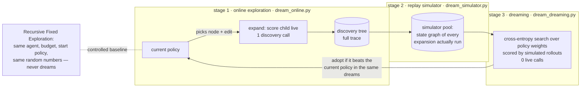
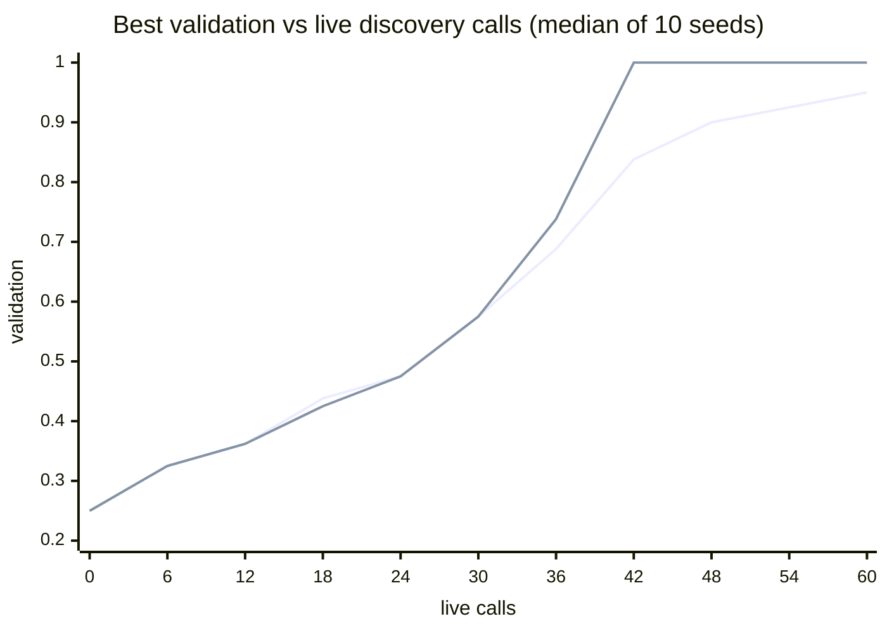

# 02 · Dream-RSI — improving the exploration policy in a replay simulator

**Changed object: the exploration policy.** The base agent — which edits
exist at a solver, and how an expansion is scored — never changes. What
changes is the policy that decides which expansion to spend the next live
discovery call on.



## SOURCE CLAIM — arXiv 2609.14858

Zheng et al., *Dream-RSI: Recursive Self-Improvement through Evolving Worlds*
(Sep 2026, v2 Oct 2026). From the abstract: fixed exploration strategies
"fail to adapt as search spaces scale", while online policy optimisation
faces "delayed, expensive feedback". The key insight is that "accumulated
discovery history can act as a replay simulator over the realized search
space"; dreaming in it gives "immediate, low-cost off-policy feedback to
evaluate and refine exploration policies without repeated, expensive online
evaluation", and the improved policy is redeployed, "continuously expanding
the simulator pool". Reported result: across 9 tasks in 4 domains it
"achieves **competitive quality** and **improves discovery efficiency in
several settings**". The controlled baseline, Recursive Fixed Exploration,
comes from the assignment brief; the abstract does not name it.

Note that the paper's own claim is hedged — efficiency gains "in several
settings", quality "competitive". That is the bar this run is judged against.

## OUR LAPTOP ADAPTATION

| Paper | Ours |
|---|---|
| base agent, unchanged | the ScriptedProposer's legitimate edit pool at each solver (handlers, mechanisms, undos — no reward hacks); identical in both arms |
| a discovery call | applying one edit to one node of the tree and scoring the child live (steering + validation): the expensive step |
| exploration policy | linear over 7 expansion features — node value, family failures, is-mechanism, novelty, depth, is-prepend, is-undo — through a softmax ([`dream_policy.py`](dream_policy.py)) |
| replay simulator over the realised search space | a graph keyed by solver content hash; edges are expansions that were actually run, with their recorded outcomes. Trees from different rounds merge where they reached the same solver |
| dreaming-based policy improvement | 3 iterations × 24 candidates of cross-entropy search over the weights; each candidate scored by 4 simulated rollouts from every root in the pool; adopted only if it beats the current policy in the same dreams |
| redeploy, grow the pool | each round explores from the best solver found so far and adds its tree to the pool |
| Recursive Fixed Exploration | the same function with `arm="fixed"`: same agent, budget, start policy and random numbers; records the pool, never dreams |

**What we simplified:** a 7-weight linear policy instead of a programmable
orchestration layer; one task instead of nine; 10 rounds × 6 live calls per
arm; cost counted in scoring passes, not GPU hours. Dreaming cost is
reported separately — about 75,000 simulated steps per run, 3–7 s of wall
clock, zero live calls.

## Run it

```powershell
cd assignment5
.\.venv\Scripts\python.exe 02_dream_rsi\run.py                       # 10 seeds x 4 arms, 10 rounds x 6 calls
.\.venv\Scripts\python.exe 02_dream_rsi\run.py --seeds 0 --rounds 8
.\.venv\Scripts\python.exe -m pytest 02_dream_rsi\tests
```

The full run took **470 s** (10 seeds × 4 arms).

## OBSERVED RESULT — scripted base agent, 10 seeds, 10 rounds × 6 calls

Ledgers: `docs/ledgers/02_dream_rsi_{dream,fixed,dream_context,dream_support}_scripted_seed{0..9}.jsonl`
(every live call, plus a `round_end` record with the policy and the dream
outcome). Summary: [`docs/results/02_dream_rsi_scripted.json`](../docs/results/02_dream_rsi_scripted.json).

### Downstream metric against cumulative discovery cost

Best validation accuracy found so far, after N live calls (mean / median
over 10 seeds):

| live calls | fixed exploration | **Dream-RSI** |
|---|---|---|
| 0 | 0.250 / 0.250 | 0.250 / 0.250 |
| 6 | 0.320 / 0.325 | 0.320 / 0.325 |
| 12 | 0.367 / 0.362 | 0.367 / 0.362 |
| 18 | 0.450 / 0.438 | 0.435 / 0.425 |
| 24 | 0.492 / 0.475 | 0.492 / 0.475 |
| 30 | 0.605 / 0.575 | 0.620 / 0.575 |
| 36 | 0.682 / 0.688 | **0.740 / 0.738** |
| 42 | 0.795 / 0.838 | **0.823 / 1.000** |
| 48 | 0.838 / 0.900 | 0.828 / 1.000 |
| 54 | **0.907** / 0.925 | 0.828 / 1.000 |
| 60 | **0.930** / 0.950 | 0.863 / 1.000 |


*(lower line: fixed exploration; upper line: Dream-RSI)*

Round 1 is identical by construction — same policy, same random numbers.
Most seeds adopt their first dreamed policy after round 1; the curves
differ on 2 seeds by 12 calls and on 5 by 18, and the means only pull
apart from about 30 calls on.

### Calls saved at equal performance

For each seed: the live calls fixed exploration needed to reach **its own
final** validation level, minus the calls Dream-RSI needed to reach the same
level.

| seed | fixed final | calls fixed needed | Dream final | Dream calls to same level | **calls saved** |
|---|---|---|---|---|---|
| 0 | 0.95 | 48 | 0.625 | never | — |
| 1 | 0.90 | 41 | 1.00 | 37 | 4 |
| 2 | 1.00 | 51 | 0.425 | never | — |
| 3 | 0.95 | 39 | 1.00 | 34 | 5 |
| 4 | 1.00 | 38 | 1.00 | 32 | 6 |
| 5 | 0.95 | 51 | 1.00 | 38 | 13 |
| 6 | 0.95 | 56 | 1.00 | 56 | 0 |
| 7 | 0.95 | 55 | 1.00 | 39 | 16 |
| 8 | 0.65 | 51 | 0.575 | never | — |
| 9 | 1.00 | 57 | 1.00 | 41 | 16 |

**On 7 of 10 seeds Dream-RSI reached fixed exploration's final level with
8.6 ± 6.4 fewer live calls** — about 18% of the 48.7 calls fixed
exploration needed. **On 3 of 10 it never got there.** Final held-out:
fixed **0.930 ± 0.103**, Dream-RSI **0.863 ± 0.227**.

## Did we reproduce the paper's direction?

**Half of it.** *Discovery efficiency*: yes, in the typical seed — the
median Dream-RSI run reaches 100% validation by 42 calls, where median fixed
exploration is at 84%, and to reach 90% Dream needs a median 37 calls
against 46. *Competitive quality*: no, not on average — three runs collapsed,
which pulls mean held-out below the fixed baseline and more than doubles the
spread. The paper's hedged "in several settings" fits what we saw better
than an unconditional claim would.

### Why three runs collapsed

Each failing run stopped exploring something it needed. Reading the ledgers
showed three different ways that happened:

| run | what the ledger shows | mechanism |
|---|---|---|
| designed, seeds 0 and 2 | **zero** mechanism edits ever expanded; final mechanism weight −2.7 and −1.1 | *drift without evidence.* No mechanism was in the pool, so no dream score depended on that weight; the search let it drift, it drifted negative, and the redeployed policy stopped producing the data that could correct it |
| support variant, seed 7 | one mechanism tried in round 1 — with zero handlers present, so it scored zero — then weight −4.56 | *learning from stale evidence.* A mechanism's value depends on how many handlers exist; the pool remembered its round-1 value forever |
| designed seed 8, support seed 1 | 13 and 22 undo edits; undo weight +2.4 and +1.9 | *a spurious preference* learned from a small pool, which then spent the budget |

The common thread is not a bug in one place. **A replay simulator can only
replay what the current policy chose to do.** Once a dreamed policy stops
trying something, nothing it later observes can tell it to start again.
Fixed exploration is protected precisely because its randomness never
changes. This is the bias the paper itself names when it restricts dreaming
to "the realized search space"; on our task it decided the outcome in 30% of
runs.

### Post-hoc variants (reported separately, not part of the designed result)

After the designed arm failed on seed 0 I tested two diagnoses. Both were
added *after* seeing results, and neither changes the numbers above.

| variant | idea | reached fixed's final | calls saved where reached | held-out |
|---|---|---|---|---|
| `dream_context` | add a feature *is-mechanism × handlers present*, so a mechanism's value can depend on the solver | 8/10 | 9.6 ± 4.2 | 0.915 ± 0.180 |
| `dream_support` | search only weights the pool has evidence about; leave the rest alone | 7/10 | 5.4 ± 13.6 (two seeds negative) | 0.870 ± 0.215 |

`dream_context` tested my first diagnosis ("it learned from early zeros").
The ledger then showed seed 0 had **never** tried a mechanism, so that
diagnosis was wrong for seed 0, and unsurprisingly the variant did not fix
seed 0. `dream_support` tested the corrected diagnosis (drift without
evidence). It did hold the mechanism weight at 0 — and still failed on three
seeds, by the *other* two routes in the table above. Fixing one way to stop
exploring left the others open. I stopped adding variants at that point.

## Limits

- **One task, one base agent, a linear policy.** The collapse modes may be
  milder with a richer policy or a simulator that can generalise beyond the
  recorded edges; ours cannot by design.
- **10 seeds and a noisy metric.** Changing only the random stream of the
  policy search moved per-seed calls saved by up to 12 during development,
  which is why 10 seeds are reported and every seed is shown.
- **Budget.** 60 live calls is enough for fixed exploration to reach ~95%
  validation, so the comparison is about *speed* to a high level, not about
  what is reachable at all.
- Dreaming has a real cost the "calls" metric ignores: ~1.7× the wall clock
  of a fixed-exploration run here. That is cheap only because a live call is
  cheap on this task; the paper's setting has expensive live calls.

## References

- Paper: arXiv [2609.14858](https://arxiv.org/abs/2609.14858)
- Course map, section 10: <https://raw.githubusercontent.com/dlmastery/simple-coding-harness/main/COURSE-MAP.md>
- Research studio: <https://raw.githubusercontent.com/dlmastery/simple-coding-harness/main/10_research_studio/README.md>
- Paper summaries (does not cover this paper; source claim is from the arXiv abstract): <https://raw.githubusercontent.com/dlmastery/simple-coding-harness/main/12_october_2026_papers/PAPER_SUMMARIES.md>
