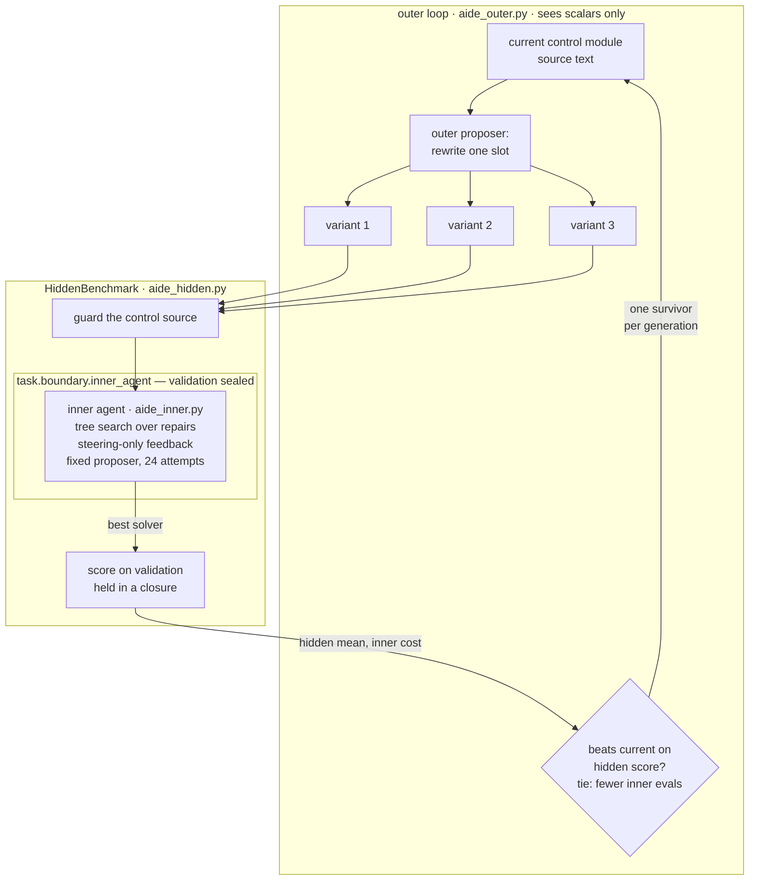

# 03 · AIDE² — rewriting the harness itself

**Changed object: the harness code.** Here the object being improved is not
the solver, the diagnosis or the exploration policy. It is the source code of
the inner agent's search-and-control module — the code that decides how the
agent searches for solver repairs. Each accepted rewrite becomes the agent
that the next generation edits.



## SOURCE CLAIM — arXiv 2609.26457

Srikanth, Zhao, Xu, Wu, Jiang, *Recursive self-improvement of AI research
agents* (Sep 2026). From the abstract: "When an AI research agent's own code
is the object of optimization, each accepted rewrite becomes the agent that
the next round edits." AIDE² "proposes changes to its own code, benchmarks
modified versions of itself on a suite of AI R&D tasks, and keeps the changes
that perform best on hidden evaluations". In an autonomous 8-day run it found
**seven successive improvements**, "ranging from a new search policy to
memory mechanisms", and the gains **generalised to four held-out
benchmarks**. Separately, the discovered agents showed **reduced reward
hacking** — "the rate falls from 55% to 32% during the run" — a property
"the loop never explicitly optimized for".

## OUR LAPTOP ADAPTATION

| Paper | Ours |
|---|---|
| a frontier AI research agent | an inner agent doing a small tree search over solver repairs ([`aide_inner.py`](aide_inner.py)) |
| the agent's own code | its search-and-control module, generated Python with four editable slots — `BRANCHING`, `select_node`, `order_strategies`, `should_stop` (+ `PATIENCE`) ([`aide_control.py`](aide_control.py)) |
| proposes changes to its code | a scripted outer proposer that rewrites one slot per candidate, from a library of 5 node-selection rules, 6 strategy orderings, 2 stopping rules, 5 branching factors, 4 patience values |
| benchmarks modified versions of itself | each variant runs the inner agent from the starting solver (3 inner seeds, 24 attempts each) |
| keeps what wins on hidden evaluations | scored on the validation split, which the inner agent and the outer proposer never see; one survivor per generation |
| held-out benchmarks | the held-out split, read once after the outer loop |

**The inner agent is identical across variants except for the control
module.** Its proposer is `ScriptedProposer(0)` for every variant — fixed and
deterministic — so a difference between variants is the harness, not the
model. Its budget (24 attempts, guard-rejected attempts included) belongs to
the outer loop and is not editable, so every variant is benchmarked at equal
cost.

**What we simplified:** single-slot rewrites from a fixed library instead of
free-form code edits by a model; 8 generations instead of 8 days; one task
instead of a suite. The rewrites are still real code: each variant is
rendered to source, guarded, compiled and executed.

## The hidden-evaluation boundary, enforced in code

"The outer loop cannot see the evaluation" is enforced by four mechanisms,
each tested:

**1. The questions live in a closure.** `HiddenBenchmark` loads validation
once, outside any inner agent, and keeps it only inside a nested function.
There is no attribute, getter or method that returns it.

```python
# 03_aide2/aide_hidden.py
hidden_questions = load_split("validation")   # loaded once, outside any inner agent

def _score(state: SolverState) -> float:
    return evaluate(load_state(state, "hidden"), hidden_questions, "hidden").accuracy
```

**2. The inner agent gets a view with no validation method at all.**

```python
# 03_aide2/aide_inner.py
class SteeringOnlyView:
    """Everything the inner agent may see. There is no validation here."""
```

**3. A runtime seal.** The inner agent runs inside
`task.boundary.inner_agent()`; while it does, `load_split("validation")` and
`ImproverView.validation_score` raise. Generated control code on the call
stack is refused even outside that context.

```python
# task/boundary.py
def assert_validation_allowed() -> None:
    if _inner_depth:
        raise BoundaryViolation(
            "validation split requested from inside an inner agent; it is the hidden "
            "evaluation the outer loop selects on")
    offender = _offending_frame()
    if offender and offender.startswith(GENERATED_PREFIXES):
        raise BoundaryViolation(f"validation split requested from generated code {offender}")
```

**4. The control source is guarded before it loads.** The shared guard's
held-out and evaluator checks, plus a control-specific scan rejecting any
mention of validation, the split loader or the benchmark, any import other
than `math`, and `open`/`exec`/`eval`/`getattr`/`globals`.

And what the outer loop actually receives — `BenchmarkResult.public()`:

```python
{"hidden", "per_seed", "steering", "attempts", "evals",
 "shortcut_attempts", "guard_rejections", "guard"}
```

Scalars and counters. Never a question, never a per-question outcome.
`test_benchmark_exposes_only_scalars` pins that key set.

Tests: `test_validation_is_sealed_inside_an_inner_agent`,
`test_generated_control_code_cannot_load_validation_even_outside_the_context`,
`test_inner_agent_view_has_no_validation_at_all`,
`test_guard_rejects_control_code_that_reaches_for_hidden_data` (4 cases).

## Run it

```powershell
cd assignment5
.\.venv\Scripts\python.exe 03_aide2\run.py                     # 3 outer seeds x 8 generations x 3 rewrites
.\.venv\Scripts\python.exe 03_aide2\run.py --outer-seeds 0 --generations 6 --verbose
.\.venv\Scripts\python.exe -m pytest 03_aide2\tests
```

The full run took **273 s**: 75 benchmarks, 225 inner-agent runs, 225
hidden scorings.

## OBSERVED RESULT — scripted outer proposer, fixed scripted inner proposer

Ledgers: [`docs/ledgers/03_aide2_scripted_outer{0,1,2}.jsonl`](../docs/ledgers/)
(every benchmark with its rewrite, parent and public result).
Final control modules: [`docs/solvers/03_aide2_scripted_outer*_control_final.py`](../docs/solvers/).
Summary: [`docs/results/03_aide2_scripted.json`](../docs/results/03_aide2_scripted.json).

### Lineage — which generation each surviving change came from

**Outer seed 0**

| gen | change kept | hidden | inner evals |
|---|---|---|---|
| 0 | (original module) | 0.325 | 22.0 |
| 1 | `PATIENCE`: 6 → 10 | 0.350 | 24.0 |
| 4 | `select_node`: greedy → ucb | 0.375 | 24.0 |
| 5 | `order_strategies`: prior_weight → front_first | **0.550** | 24.0 |
| 2, 3, 6–8 | no candidate won | | |

**Outer seed 1**

| gen | change kept | hidden | inner evals |
|---|---|---|---|
| 0 | (original module) | 0.325 | 22.0 |
| 1 | `should_stop`: budget_or_patience → budget_only | 0.350 | 24.0 |
| 2 | `order_strategies`: prior_weight → mechanism_first | 0.450 | 24.0 |
| 3 | `order_strategies`: mechanism_first → front_first | 0.500 | 24.0 |
| 5 | `BRANCHING`: 2 → 1 | **0.575** | 24.0 |
| 4, 6–8 | no candidate won | | |

**Outer seed 2**

| gen | change kept | hidden | inner evals |
|---|---|---|---|
| 0 | (original module) | 0.325 | 22.0 |
| 1 | `should_stop`: budget_or_patience → budget_only | 0.350 | 24.0 |
| 2 | `select_node`: greedy → ucb | 0.375 | 24.0 |
| 5 | `order_strategies`: prior_weight → novel_first | **0.500** | 24.0 |
| 3, 4, 6–8 | no candidate won | | |

Surviving changes in the final modules:

| outer seed | surviving changes (slot = value, generation) |
|---|---|
| 0 | `PATIENCE` = 10 (g1), `select_node` = ucb (g4), `order_strategies` = front_first (g5) |
| 1 | `should_stop` = budget_only (g1), `order_strategies` = front_first (g3), `BRANCHING` = 1 (g5) |
| 2 | `should_stop` = budget_only (g1), `select_node` = ucb (g2), `order_strategies` = novel_first (g5) |

In seed 1 the g2 ordering change did not survive: g3 rewrote the same slot
again. That is the lineage doing what AIDE² describes — an accepted rewrite
becomes the thing the next generation edits.

### Held-out

| outer seed | held-out, generation-0 inner agent | held-out, final inner agent |
|---|---|---|
| 0 | 0.325 | **0.550** |
| 1 | 0.325 | **0.575** |
| 2 | 0.325 | **0.500** |
| **mean** | 0.325 | **0.542 ± 0.038** |

(The raw starting solver is 0.250; the generation-0 *inner agent* already
lifts it to 0.325, and that is the right baseline for a method that improves
the agent.) Held-out equalled the hidden score in every case: the split
design puts the same families in every split, so there was no overfitting to
the hidden evaluation to detect.

### What carried the effect

Across all 75 benchmarked variants, by strategy-ordering rule:

| `order_strategies` | variants | mean hidden | best |
|---|---|---|---|
| learned | 3 | 0.483 | 0.500 |
| front_first | 20 | 0.469 | 0.575 |
| novel_first | 11 | 0.425 | 0.500 |
| mechanism_first | 5 | 0.360 | 0.500 |
| **prior_weight (generation 0)** | 34 | 0.331 | 0.375 |
| failures_first | 2 | 0.250 | 0.250 |

All three lineages made their largest jump by replacing the ordering. The
original ordering follows the proposer's own prior, which favours appending
handlers — the edits that `generic_list` shadows. Front-first ordering
reaches the same handlers in a position where they fire. The outer loop found
that with no diagnosis and no knowledge of the shadowing bug, purely from
the hidden score.

## Did we reproduce the paper's direction?

- **Successive improvements kept on hidden evaluations:** yes. Three or four
  kept rewrites per lineage, hidden 0.325 → 0.542 ± 0.038 over 8 generations,
  every lineage monotone.
- **Gains carry to held-out:** yes, but the test is weak here — held-out
  equalled hidden exactly, because our splits are balanced by construction.
  It shows no overfitting, not out-of-distribution transfer.
- **Reduced reward hacking:** **not testable in our setup.** The inner
  agent's candidate pool includes the six reward hacks, and a guard-rejected
  attempt costs inner budget. But the generation-0 module never reached them
  (0.0 attempts per inner run), and only **1 of 75** benchmarked variants
  ever tried one — 3 attempts per run, hidden 0.30, discarded. One variant is
  not evidence for or against the paper's 55% → 32% observation. I did not
  change generation 0 to manufacture a starting hack rate.

## Limits

- **The library bounds what can be found.** The outer proposer chooses among
  written implementations; it cannot invent a new search policy the way an
  LLM rewriting code can. The paper's discovered improvements included memory
  mechanisms nobody wrote in advance.
- **The 3 inner seeds added cost and no information.** The inner agent is
  deterministic unless the `random` node-selection rule is chosen, so every
  survivor scored identically on all three seeds. One seed would have given
  the same lineages at a third of the cost.
- **Small budget, low ceiling.** 24 attempts per inner run caps what any
  harness can reach (best 0.575); SO-RSI's 20 *full* iterations reached 0.94.
  These are different cost models — see the comparison table in the
  top-level README — not a ranking.
- The guard fired 9 times inside inner agents during the run (6 hardcoded,
  3 held-out access) and never on a control module.

## References

- Paper: arXiv [2609.26457](https://arxiv.org/abs/2609.26457)
- Course map, section 10: <https://raw.githubusercontent.com/dlmastery/simple-coding-harness/main/COURSE-MAP.md>
- Research studio: <https://raw.githubusercontent.com/dlmastery/simple-coding-harness/main/10_research_studio/README.md>
- Paper summaries (does not cover this paper; source claim is from the arXiv abstract): <https://raw.githubusercontent.com/dlmastery/simple-coding-harness/main/12_october_2026_papers/PAPER_SUMMARIES.md>
