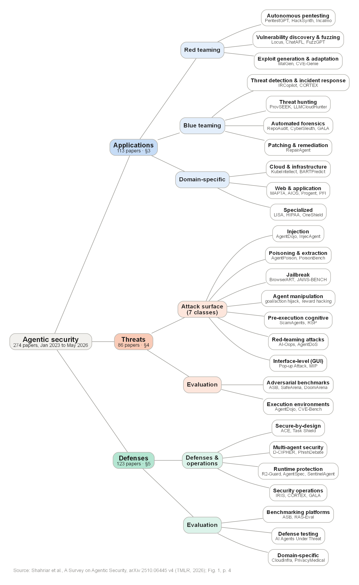
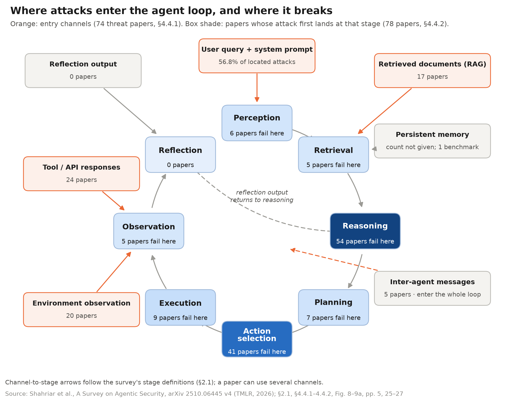
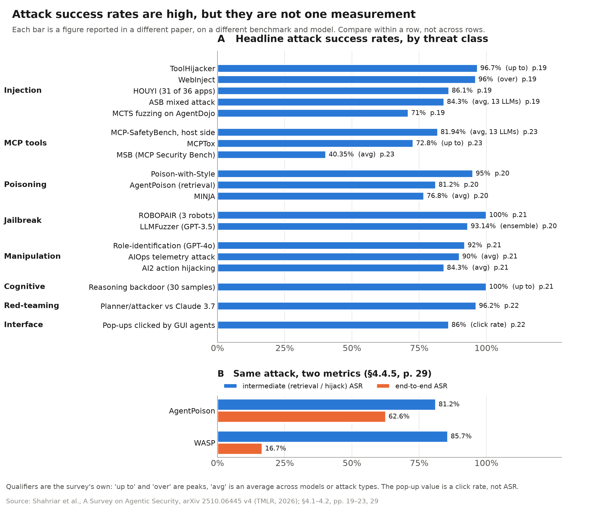
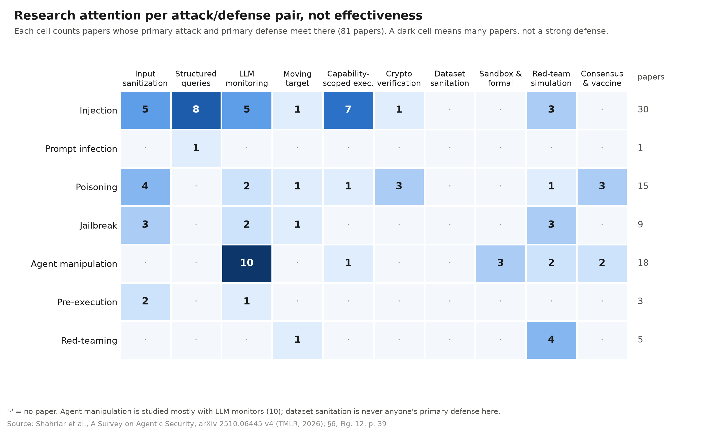
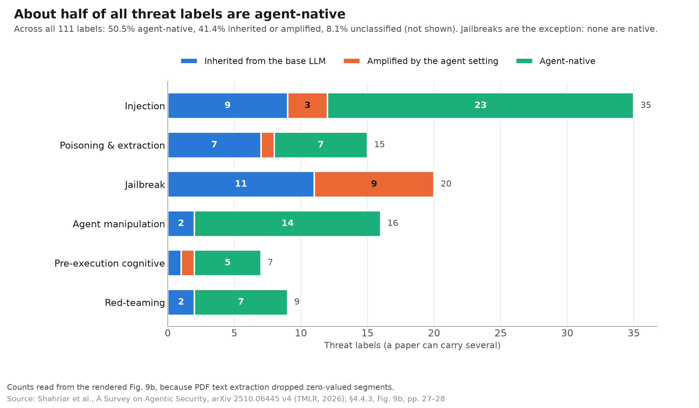
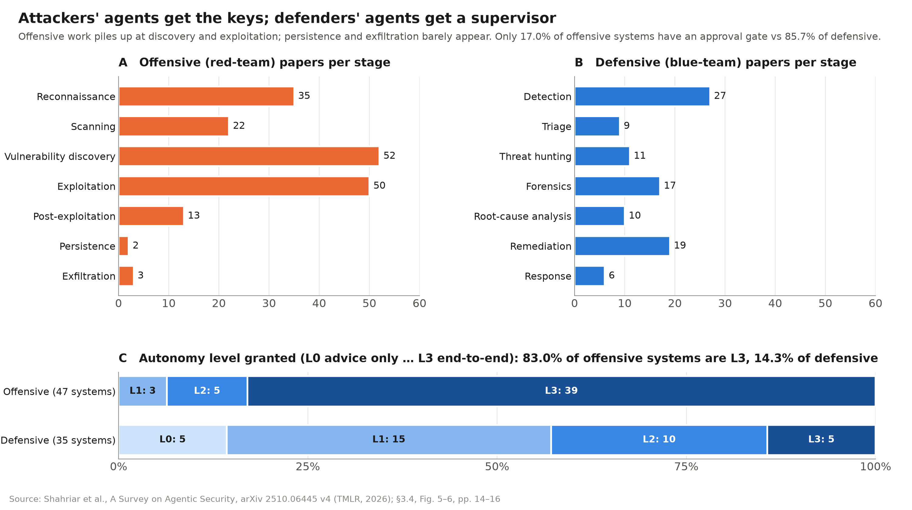
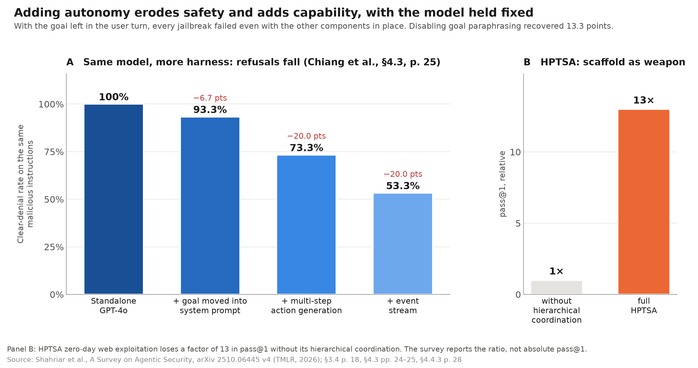
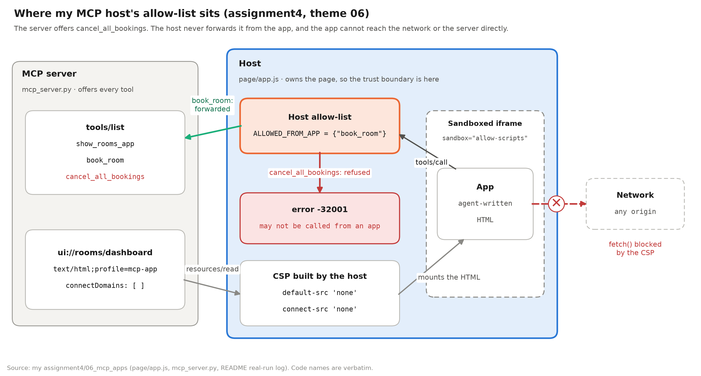
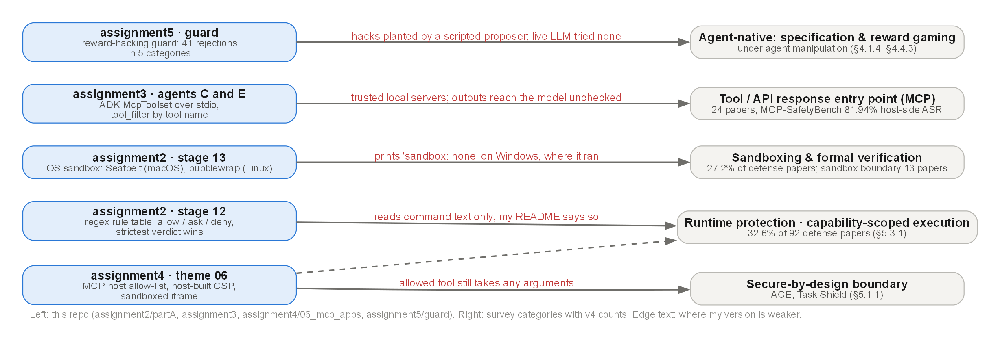
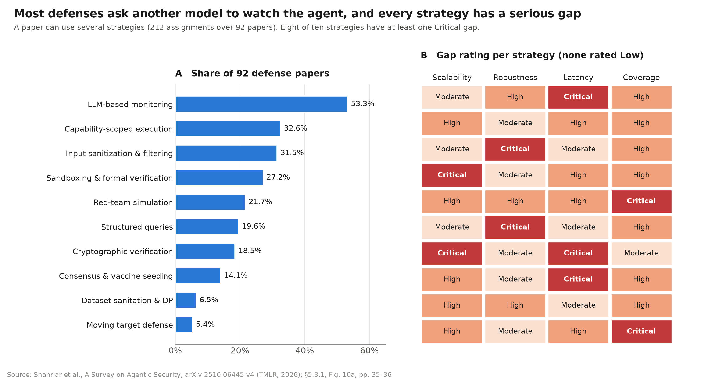

# Short story: agentic security

My CMPE 297 short story on **"A Survey on Agentic Security: Applications, Threats and Defenses"** by Shahriar, Rahman, Ahmed, Sadeque and Parvez (TMLR 2026, [arXiv 2510.06445](https://arxiv.org/abs/2510.06445), version 4). It includes a Medium article, a 26-slide deck, ten figures and my reading notes.

The survey sorts 274 papers from January 2023 to May 2026 into three pillars: what agents can do for security, how they get attacked, and how they get defended. Its most useful result for me was a harness ablation (§4.3). GPT-4o refuses every malicious request in a test set on its own, and refuses only 53.3% once the same model runs inside an agent with a system-prompt goal, multi-step actions and an event stream. Next to that is MCP-SafetyBench, where adding safety prompts moved host-side attack success by a statistically insignificant 1.22%. The article walks through the taxonomy and the reported numbers. It then argues that attack success rates don't compare cleanly across papers, maps five pieces of my own coursework onto the survey's categories, and ends on the one loop stage no paper has attacked, reflection.

## Links

| | |
|---|---|
| Medium article | MEDIUM_ARTICLE_LINK |
| Slides on SlideShare | SLIDESHARE_LINK |
| Video | YOUTUBE_VIDEO_LINK |
| Deck PDF | [deck/slides.pdf](deck/slides.pdf) (also in [video/slides.pdf](video/slides.pdf)) |

## What is in this folder

```
article/article.md          the article, with relative links (repo version)
article/article-medium.md   the same article with absolute GitHub links and an image upload order
article/figures/            the ten figures (PNG) and their captions
deck/slides.pptx, .pdf      26 slides with speaker notes
video/                      the recording goes here; slides.pdf is copied alongside it
research/paper_notes.md     my notes on the survey, with section and page for every number
research/sources.md         every paper and system cited
scripts/                    make_figures.py, make_deck.py, make_medium.py
DECISIONS.md, PROMPTS.md    judgement calls, and every prompt for this assignment
```

Rebuild everything from this folder (Windows PowerShell):

```powershell
py -3.11 -m venv .venv
.\.venv\Scripts\python.exe -m pip install -r requirements.txt
.\.venv\Scripts\python.exe scripts\make_figures.py   # needs Graphviz: winget install Graphviz.Graphviz
.\.venv\Scripts\python.exe scripts\make_medium.py
.\.venv\Scripts\python.exe scripts\make_deck.py
```

## The taxonomy

| Pillar | Branches | Sub-categories |
|---|---|---|
| **Applications** (113 papers, §3) | Red teaming | autonomous pentesting; vulnerability discovery and fuzzing; exploit generation |
| | Blue teaming | threat detection and incident response; threat hunting; automated forensics; patching and remediation |
| | Domain-specific | cloud and infrastructure; web and application; specialised (healthcare, blockchain, privacy) |
| **Threats** (86 papers, §4) | Attack surface | injection; poisoning and extraction; jailbreak; agent manipulation; pre-execution cognitive; red-teaming attacks; interface-level |
| | Evaluation | adversarial benchmarks; execution environments |
| **Defenses** (123 papers, §5) | Defenses and operations | secure-by-design; multi-agent security; runtime protection; security operations |
| | Evaluation | benchmarking platforms; defense testing; domain-specific |

Pillar counts overlap because some papers belong to more than one. The structure follows the survey's Fig. 1 (p. 4).

## Figures

All survey numbers come from arXiv 2510.06445 v4, with the section and page printed on each figure.


*Figure 1. The three pillars and their sub-categories, with two or three systems the survey names under each leaf (Fig. 1, p. 4).*


*Figure 2. Where attacks enter the agent loop (74 papers, §4.4.1) and the stage where they first take effect (78 papers, §4.4.2). Reflection is zero on both counts.*


*Figure 3. A: headline attack success rates the survey reports, grouped by threat class. Compare within a row only. B: the same attack measured two ways (§4.4.5, p. 29).*


*Figure 4. Papers per primary-attack and primary-defense pair, 81 papers in total (Fig. 12, p. 39). This counts research attention, not how well a defense works.*


*Figure 5. Threat labels by origin (Fig. 9b, p. 27). Across all 111 labels, 50.5% are agent-native. Jailbreaks have none.*


*Figure 6. Application papers per lifecycle stage, and the autonomy each side is given: 83.0% of offensive systems run at Level 3, against 14.3% of defensive systems (§3.4, pp. 14–16).*


*Figure 7. The harness ablation, where GPT-4o's clear-denial rate falls from 100% to 53.3% as agent components are added (§4.3, p. 25), and HPTSA losing a factor of 13 in pass@1 without its coordination layer (§3.4, p. 18).*


*Figure 8. My assignment4 MCP host. The server offers `cancel_all_bookings`, and the host's allow-list forwards only `book_room`.*


*Figure 9. Work from this repo mapped to survey categories. Each edge label says where my version is weaker.*


*Figure 10. How often each defense strategy appears in 92 papers, and the survey's gap rating for each. No strategy is rated Low on any axis (Fig. 10a, p. 36).*

## How this connects to the rest of the repo

The article's two-cents section and closing are built on my earlier assignments:

- [assignment2 stage 12](../assignment2/partA/stage_12_permissions/) is a regex permission table (allow, ask, deny). It maps to the survey's capability-scoped execution category, and my README for it says it isn't real security.
- [assignment2 stage 13](../assignment2/partA/stage_13_sandbox/) is an OS sandbox (Seatbelt, bubblewrap). It prints `sandbox: none` on the Windows machine it was built on.
- [assignment2 stage 14](../assignment2/partA/stage_14_compaction/) writes a handoff note that comes back as a user message. The article uses it as an example of the reflection surface nobody has attacked.
- [assignment3](../assignment3/): ADK agents wired to MCP servers through `McpToolset`, with tools filtered by name only. This is the tool-response channel that MCPTox and MCP-SafetyBench attack.
- [assignment4 theme 06](../assignment4/06_mcp_apps/): an MCP host whose allow-list refuses `cancel_all_bookings` and whose CSP blocks `fetch()`. This is the secure-by-design boundary in Figure 8.
- [assignment5](../assignment5/): the [reward-hacking guard](../assignment5/guard/) (41 rejections, all from a scripted proposer that planted the hacks) and the [SO-RSI](../assignment5/01_so_rsi/) inquiry memory, the second reflection example.

## Sources

- Shahriar, A., Rahman, M. N., Ahmed, S., Sadeque, F., Parvez, M. R. *A Survey on Agentic Security: Applications, Threats and Defenses.* TMLR 2026. [arXiv 2510.06445](https://arxiv.org/abs/2510.06445) (v4 used).
- Yehudai, A., et al. *A Survey on Evaluation of LLM-based Agents.* [arXiv 2503.16416](https://arxiv.org/abs/2503.16416).
- Guo, J., et al. *From Question Answering to Task Completion: A Survey on Agent System and Harness Design.* [arXiv 2606.20683](https://arxiv.org/abs/2606.20683).
- Du, P. *Memory for Autonomous LLM Agents: Mechanisms, Evaluation, and Emerging Frontiers.* [arXiv 2603.07670](https://arxiv.org/abs/2603.07670).

Systems cited through the survey are listed with their section and page in [research/sources.md](research/sources.md).

## Originality

The article, notes and speaker notes are my own writing about the survey. They are not a reproduction of it. Every sentence is paraphrased, and every number is attributed to the section and page it came from. The figures are redrawn from the survey's reported numbers or from my own code.
