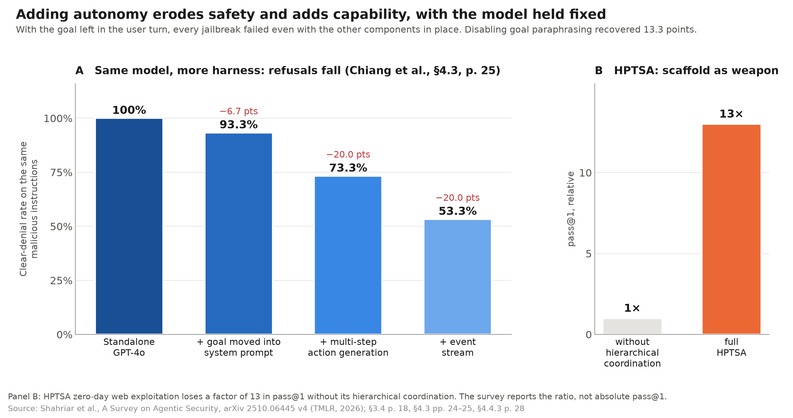
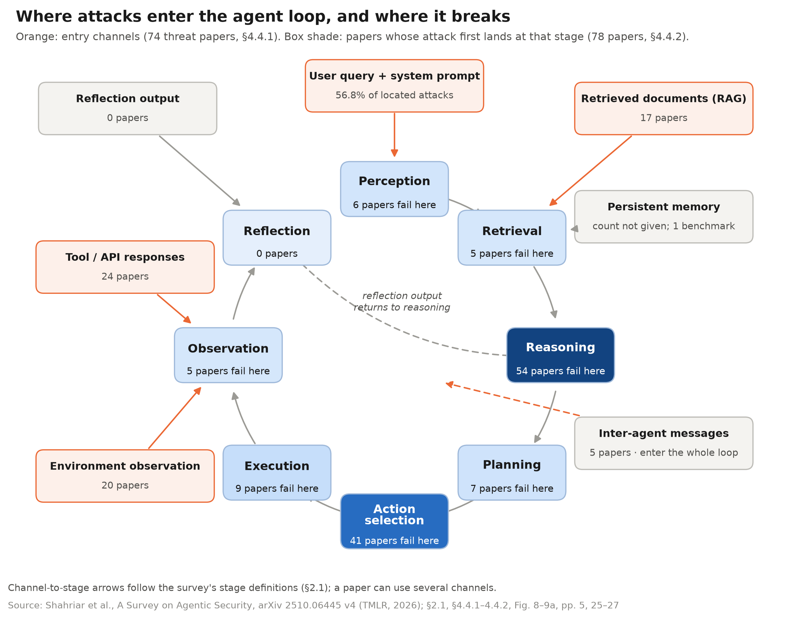
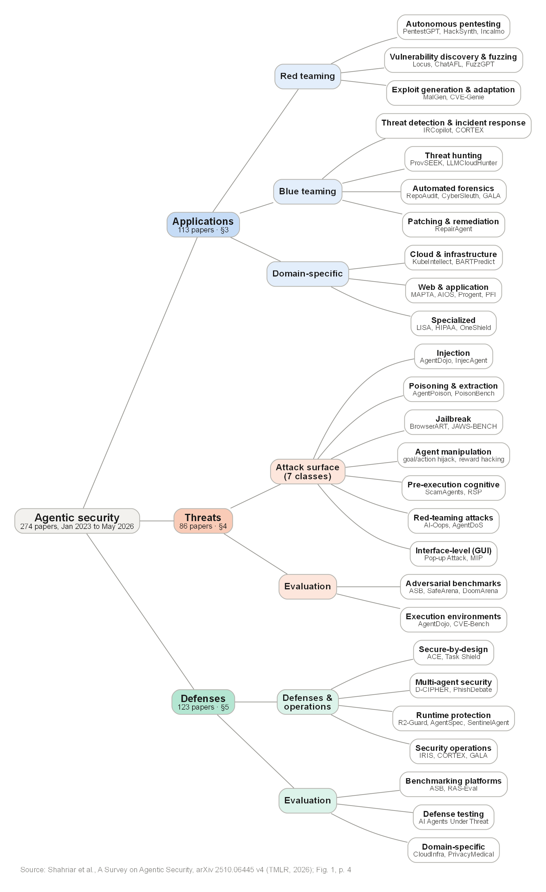
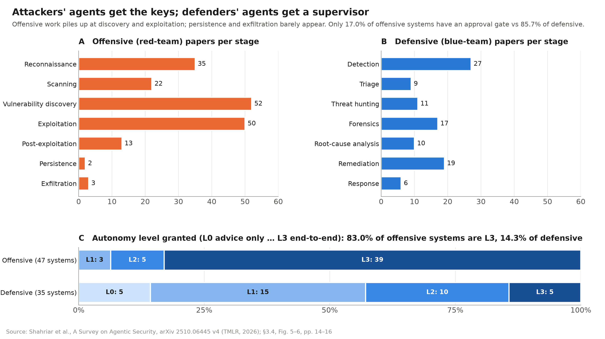
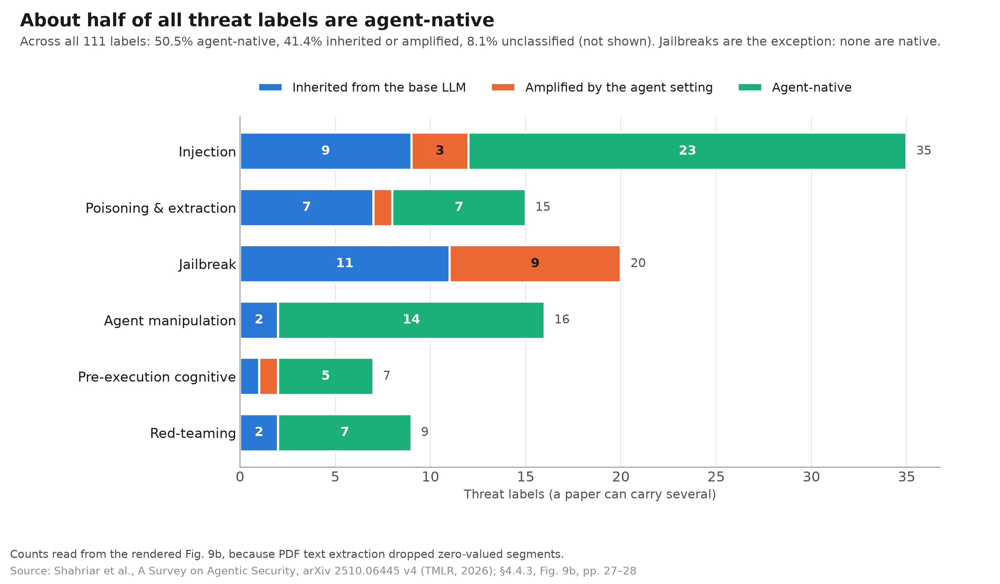
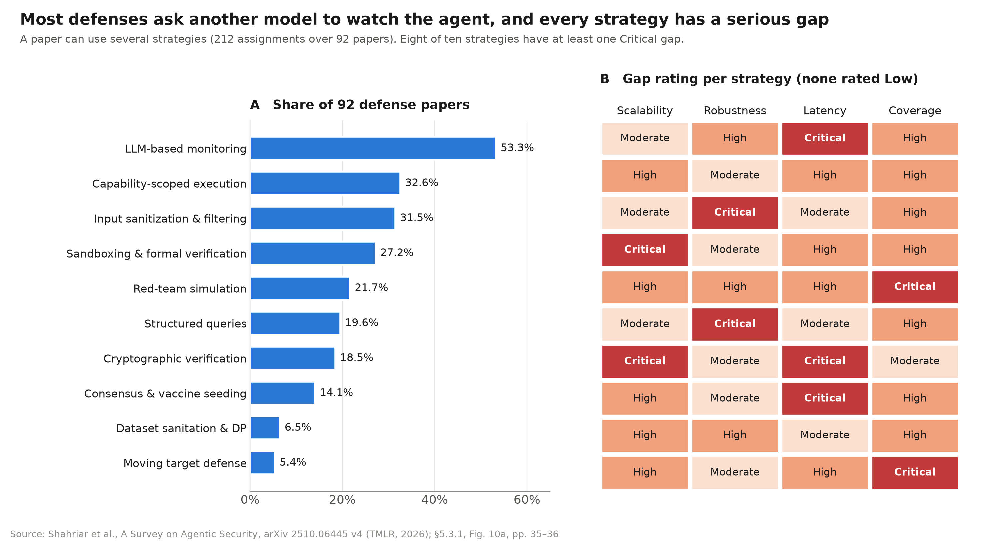
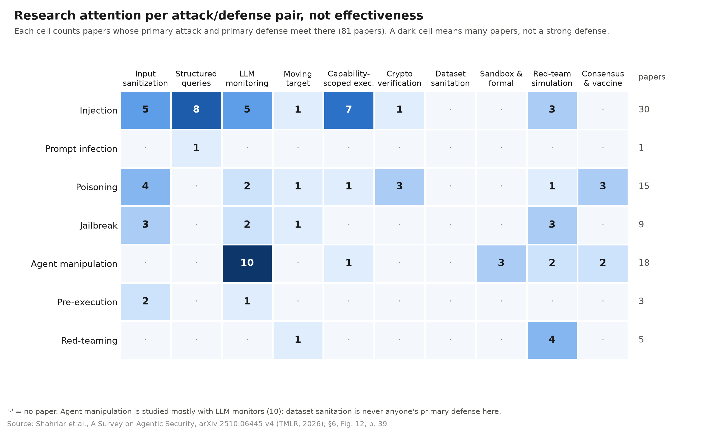
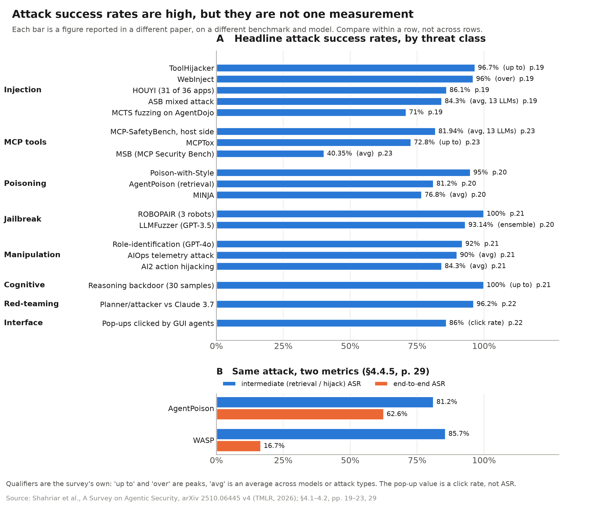
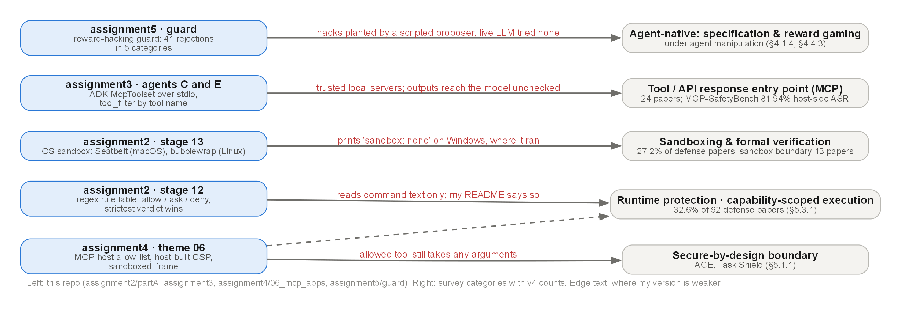
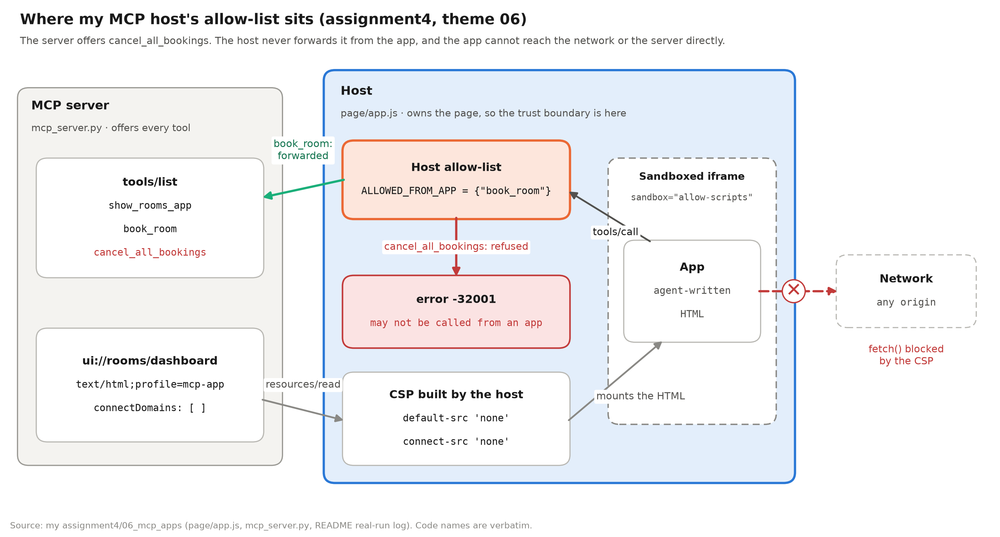

# Same Model, More Harness: Reading a 274-Paper Survey on Agentic Security

*Notes on Shahriar et al., "A Survey on Agentic Security: Applications, Threats and Defenses" (arXiv 2510.06445, v4, TMLR 2026), checked against things I built for CMPE 297.*

---

## GPT-4o refuses every request, until you wrap it in an agent

One experiment in this survey changed how I think about agent safety. Chiang et al. took GPT-4o and a fixed set of malicious instructions. They then added agent components one at a time and measured the clear-denial rate, meaning the share of requests the model refuses outright. On its own, GPT-4o refused all of them. When the user's goal was moved into the system prompt, clear denial dropped to 93.3%. Adding multi-step action generation took it to 73.3%. Adding an event stream (the running log of actions and observations an agent keeps) took it to 53.3% (§4.3, p. 25).

The model was the same throughout. The only thing that changed was the scaffolding around it.

The survey explains the first drop as a trust problem. Models are trained to defer more to the system prompt than to the user. An orchestration layer that rewrites the user's goal into the system prompt therefore promotes it to a higher level of trust before the model has judged it. With the goal left in the user turn, every jailbreak in the study failed, even with the other components in place. Multi-step generation was 20 points more permissive than planning up front, because each step gets checked alone and the combined intent never does (§4.3, p. 25).

*Figure 7. Left: the harness ablation. The model never changes, and clear denial falls by almost half. Right: the offensive system HPTSA loses a factor of 13 in pass@1 without its coordination layer (§3.4, p. 18); the survey gives only the ratio. The scaffold that weakens refusals also produces the offensive capability.*

The obvious fix is to tell the model to be careful. MCP-SafetyBench tested that. MCP, the Model Context Protocol, is the now-common standard for connecting an agent to external tool servers. Across 245 tasks and 13 models, attacks on the host side of MCP succeeded 81.94% of the time on average. Adding safety prompts lowered that by 1.22%, a change the benchmark's authors found statistically insignificant (§4.2.1, p. 23).

Taken together, the two results mean safety drops as autonomy goes up, and prompting the model to be safe barely moves the number. The rest of the survey helps explain why.

## Which survey I read

The arXiv entry has been revised several times. The assignment brief pointed me to v3 (June 2026). The version arXiv now serves is v4 (31 October 2026), the one published in TMLR. I used v4 for every number in this article. The two versions differ in ways that matter if you cite them:

- v3 described its corpus as "over 260" papers. v4 counts 274.
- The share of attacks entering through the user prompt or system prompt is 55% in v3 and 56.8% in v4.
- v3 counts 108 distinct benchmarks. v4 counts 124.
- v3's conclusion names perception and action selection as the most-attacked stages. v4 names reasoning and action selection.

The last change is the one I would flag. The survey's headline finding about where agents break moved between revisions. Anyone citing v3 today is citing a conclusion the authors have since replaced. The paper does not say why it changed, and I won't guess. I'd treat any living survey's arXiv version number the way I'd treat a library version: pin it.

## Why agent security is a different problem

A chatbot takes text in and sends text out. An agent runs a loop. The survey models it as eight stages: perception (reading the task), retrieval (pulling documents or memories), reasoning, planning, action selection, execution, observation (reading back what happened), and reflection (checking its own work before continuing) (§2.1, p. 5). Memory, the tool interface and, in multi-agent systems, messages from other agents all sit outside the loop and feed into it.

That gives an attacker many more ways in than a chat window does. The survey separates the entry point (where malicious content arrives) from the failure stage (where it first causes damage). In practice those are usually different places.

*Figure 2. Orange boxes: where attacks enter, from 74 papers that identify an entry channel (§4.4.1). Box shading: where the attack first takes effect, from 78 papers (§4.4.2). Most attacks enter through the prompt, but they take effect in reasoning (54 papers) and action selection (41). Reflection scores zero on both.*

Most attacks still come in through the front door. The user query and system prompt account for 56.8% of attacks with an identified entry point. The authors suggest part of the reason is convenience, since that surface needs no tools or memory to study. Among the channels only agents have, tool and API responses lead with 24 papers, then environment observations (20) and retrieved documents (17) (§4.4.1, pp. 25–26).

The threat model is just as striking. Of 77 papers that state the attacker's access, 51.9% assume black-box access and 27.3% assume no model access at all. The typical attacker is an outsider who plants text somewhere the agent will read it (§4.4.4, p. 28). That is the basis for the survey's claim that agents are fragile by default: attacks succeed without special privileges.

## The taxonomy: three pillars

The survey sorts 274 papers, published between January 2023 and May 2026, into three pillars: what agents can do for security, how they get attacked, and how to defend them. The counts overlap (113 Applications, 86 Threats, 123 Defenses) because some papers belong to more than one (App. B, p. 68).

*Figure 1. The three pillars and their sub-categories, with two or three systems the survey names under each leaf (Fig. 1, p. 4). The threat pillar has seven attack classes, two more than the five I expected going in.*

### Applications: agents as attackers and defenders

The Applications pillar has three branches. Red teaming covers autonomous penetration testing, vulnerability discovery and exploit generation. Blue teaming covers detection, threat hunting, forensics and patching. The third branch is domain-specific: cloud, web and specialised settings like healthcare.

The lifecycle counts are lopsided. Offensive work piles up at vulnerability discovery (52 papers) and exploitation (50). Persistence and exfiltration have 2 and 3 papers (§3.4.1, Fig. 5, pp. 14–15).

The dual-use numbers are where I slowed down. Of 113 application systems, 60 (53.1%) carry offensive or dual-use capability (§3.4.3, p. 17). Fang et al.'s agent exploits 87% of one-day CVEs at about $8.80 per exploit. CVE-Genie reproduces 428 of 841 CVEs at $2.77 each. ARTEMIS outperformed 9 of 10 human penetration testers in a live enterprise test, at roughly $18 an hour against $60 (p. 18).

*Figure 6. A and B: application papers per lifecycle stage. C: how much autonomy each side's systems are given. 83.0% of offensive systems run end to end at Level 3. 14.3% of defensive systems do (§3.4.2, Fig. 6, p. 16).*

Figures 6 and 7 tell one story when you put them side by side. The ablation shows safety behaviour degrading as autonomy is added. The autonomy split shows that offensive systems get full autonomy 83.0% of the time and defensive systems 14.3%. Only 17.0% of offensive systems keep a human approval gate, against 85.7% of defensive ones. So the capability that most weakens a model's refusals is the one handed most freely to attack tools, and least to the defensive tools meant to counter them. These are two separate results from different parts of the survey, measured on different systems, so this is a pattern I noticed, not a controlled comparison. Still, I find it hard to look at both figures and not connect them.

### Threats: seven ways in

The survey lists seven attack classes (§4.1, pp. 19–23):

- Injection: instructions hidden in content the agent reads.
- Poisoning and extraction: corrupting memory, retrieval stores or training data.
- Jailbreaks: getting past the model's safety training.
- Agent manipulation: hijacking goals or actions, reward hacking, and resource exhaustion.
- Pre-execution cognitive attacks: bending the agent's reasoning or plans before any tool runs.
- Red-teaming attacks: automated attack generation aimed at agents.
- Interface-level attacks on agents that operate a GUI.

The most useful analysis in the paper splits threats by origin. An inherited threat already worked on the bare model and works the same way in the agent. An amplified threat existed before but gets worse with a scaffold. An agent-native threat could not exist without a scaffold component such as memory, a tool interface, a planning loop or an inter-agent channel (App. B, p. 68).

*Figure 5. Threat labels by origin (Fig. 9b, p. 27). Jailbreaks are entirely inherited or amplified. Agent manipulation is almost entirely agent-native. Across all 111 labels, 50.5% are native.*

Half the labels are agent-native (50.5%), 41.4% are inherited or amplified, and 8.1% couldn't be classified (§4.4.3, pp. 27–28). The authors name five native mechanisms: poisoning persistent state, compromising other agents, poisoning tools and protocols (mostly MCP), hijacking plans and actions, and gaming the specification or reward. That last one matters for my assignment 5 work below.

### Defenses: mostly another model watching

The Defenses pillar has four groups (§5.1). Secure-by-design isolates untrusted data at the architecture level. Multi-agent security covers consensus and debate between agents. Runtime protection means guardrails that intercept behaviour during execution. Security operations covers formal verification, auditing and incident response.

Of the 92 defense papers the authors analyse in detail, 53.3% use an LLM-based monitor, meaning a second model that reviews the first (§5.3.1, p. 34). By primary trust boundary, an external monitor is the most common choice (34 papers) and a human in the loop the least (2) (§5.3.2, Fig. 10b).

*Figure 10. A: how often each strategy appears in the 92 defense papers. B: the survey's gap rating for each strategy (Fig. 10a, p. 36). No strategy is rated Low on any axis. Eight of the ten have at least one Critical gap.*

Figure 4 shows which defenses get studied against which attacks.

*Figure 4. Papers per primary-attack and primary-defense pair, 81 papers in total (Fig. 12, p. 39). This counts research attention, not how well a defense works.*

A dark cell means many papers studied that pairing. It says nothing about whether the pairing holds up. The survey says this about its own figure (§6.1), and it's worth keeping in mind: ten papers defending against agent manipulation with LLM monitors is a measure of popularity, not proof. The empty column for dataset sanitation and the single paper on prompt infection (a worm-like injection that spreads between agents) tell you where nobody has looked yet.

## The numbers behind the leaderboards

The survey doesn't have a single leaderboard. It reports results paper by paper. Figure 3 collects the headline attack success rates (ASR, the share of attempts in which the attacker gets what it wanted).

*Figure 3. A: headline attack success rates the survey reports, grouped by threat class, each with its qualifier and page. They come from different papers, benchmarks and models, so compare within a row only. B: the same attack measured two ways (§4.4.5, p. 29).*

A few results stand out because of what they beat. ToolHijacker reaches up to 96.7% ASR against GPT-4o on MetaTool, and it gets past three published injection defenses (StruQ, SecAlign and DataSentinel) to do it. Zhan et al. bypassed all eight defenses they evaluated using adaptive attacks (§4.1.1, p. 19). MINJA poisons an agent's memory to 76.8% average ASR using only ordinary queries, with no write access to the memory at all (§4.1.2, p. 20). BrowserART shows amplification directly: GPT-4o carries out 12% of harmful behaviours as a chatbot and 74% as a browser agent (p. 20).

MCP results get their own row because they cover the surface I've worked with. Besides MCP-SafetyBench, MCPTox poisoned tool descriptions on 45 real MCP servers and reached up to 72.8% ASR. Even the best-refusing model, Claude 3.7 Sonnet, refused under 3% of the time. In both MCPTox and MSB (the MCP Security Bench), stronger models were more vulnerable, because a model that follows tool instructions well also follows malicious ones well (§4.2.1, p. 23).

Defenses don't get a ranking either. The survey's Table 3 puts six defenses side by side, each on its own task and hardware, and the authors say plainly that it's not a ranking. The trade-offs are still worth seeing. IPIGuard holds ASR under 1%, but costs about 13.88 seconds and 14,605 tokens per task, and keeps 67.7% utility (p. 37). Only 18 of the 92 defense papers report cost fully, and 36 report it only qualitatively (§5.3.3).

## Where the field is weak

The evaluation problem goes deeper than a lack of numbers. The 25 benchmark papers in the threat pillar instrument tool responses (14) and user queries (9). Persistent memory gets 1 benchmark, and inter-agent messages and reflection get none (§4.4.5, p. 29). Of the 86 threat papers, 66 report a headline ASR or harm score, but only 19 also report whether the agent still does its job under attack, and only 14 report cost (p. 29).

The evaluation survey by Yehudai et al. (arXiv 2503.16416) reaches the same conclusion from the capability side. It names safety, robustness and cost-efficiency as the under-measured dimensions of agent benchmarks. It also asks for experiments that vary the harness while holding the model fixed. The §4.3 ablation that opens this article is exactly that kind of experiment.

## My two cents

### The numbers do not agree with each other

Panel B of Figure 3 is the part of this survey I keep returning to. AgentPoison reports 81.2% ASR at the retrieval step and 62.6% end to end, for the same attack (§4.1.2, p. 20). WASP reports 85.7% when measured at the point of hijack and 16.7% when the attacker's goal has to complete end to end (§4.4.5, p. 29). The WASP authors call the gap "security by incompetence": the agent was taken over, but it was too clumsy to finish the attacker's job.

The same instability appears inside the survey. MSB's peak ASR is 76.5% for out-of-scope-parameter attacks in §4.2.1 (p. 23) and "75.8%" in §4.4.1 (p. 26). AgentPoison's poison rate is "under 0.1%" of entries in §4.1.2 (p. 20) and "under 1%" in §4.4.1 (p. 26). Both statements are true of the same result, but one is ten times looser. Two different systems, ASB and AI2, each report an "84.30% average ASR", and the two numbers measure different events (p. 29). The corpus uses 124 distinct benchmarks, and 93 of them (75.0%) appear in exactly one paper (§4.4.5, p. 29).

I don't read any of this as carelessness by the authors. They identify benchmark fragmentation as a problem themselves, and they propose fixes: state the success condition, report end-to-end ASR next to any intermediate rate, and report utility and cost under the same attack (p. 29). My point is about the literature. An attack success rate isn't a stable quantity from one paper to the next, so lining papers up in a table makes comparisons look stronger than they are. When I quote an ASR now, I try to say where it was measured.

### What I built, and where it is weaker

Five pieces of work in this repo map onto the survey's categories. Figure 9 shows the mapping.

*Figure 9. Work from this repo on the left, survey categories on the right. Each edge label says where my version is weaker than what the survey describes.*

In [assignment2 stage 12](../../assignment2/partA/stage_12_permissions/) I built a regex rule table that rates every shell command allow, ask or deny. It splits compound commands on `&&` and `|`, and the strictest verdict wins. In the survey's terms this is capability-scoped execution, the second most common defense strategy (32.6%). My README for that stage already says it is not real security, because it only reads command text. It misses aliases and quoting tricks, and it can't stop the process doing anything the OS allows. The survey's broader critique of defenses that trust surface features applies directly.

[Stage 13](../../assignment2/partA/stage_13_sandbox/) wraps commands in Seatbelt on macOS or bubblewrap on Linux. The machine I built it on runs Windows, and there the banner prints `sandbox: none`, because an unprivileged Windows process has no equivalent primitive. Sandboxing and formal verification is a 27.2% strategy in the survey. In the place my agent actually ran, my implementation of it did nothing.

The MCP host in [assignment4 theme 06](../../assignment4/06_mcp_apps/) is the piece I'm most confident in.

*Figure 8. My assignment4 MCP host. The server offers `cancel_all_bookings`, and the host's allow-list forwards only `book_room`. A real browser run logged the refusal (error -32001) and the CSP blocking `fetch()` from the sandboxed app.*

The MCP server lists an admin tool, `cancel_all_bookings`. The host only forwards calls on its allow-list, `ALLOWED_FROM_APP = {"book_room"}`, and answers anything else with error -32001. A content security policy built by the host sets `connect-src 'none'`, so `fetch()` from inside the sandboxed iframe fails. This is the secure-by-design boundary from §5.1.1: the control lives in code the model can't argue with. Guo et al.'s harness survey (arXiv 2606.20683) makes the same argument in general form, saying constraints should be enforced mechanically instead of relying on the model to follow its prompt. MCP-SafetyBench's 1.22% is the security-side evidence for that. My version is still weaker than the literature in a specific way. An allowed tool accepts any arguments, so the app can book any free room it likes, and nothing asks the user to confirm.

In [assignment3](../../assignment3/), agents C and E wire ADK's `McpToolset` to local MCP servers over stdio. This is the tool/API-response channel, the top agent-specific entry point (24 papers) and the surface MCPTox poisons. Assignment3 filters MCP tools by name only. My servers are local and written by me. Nothing checks tool descriptions or tool outputs before the model reads them.

The [assignment5 reward-hacking guard](../../assignment5/guard/) rejects proposals that touch held-out data, tamper with the evaluator, hardcode answers, gut the solver or narrow the question set. It sits next to the survey's fifth agent-native mechanism, specification and reward gaming (§4.4.3). It rejected 41 proposals across five categories: 27 hardcoded, 7 held-out access, 4 narrowing, 2 evaluator patches and 1 gutted solver. Those 41 rejections came from a scripted proposer that planted the hacks deliberately. The live LLM never attempted one. Several of the guard's checks have only fired in tests.

## What I'd watch next: the reflection stage

Figure 2 has one stage with zero papers on both counts. No paper attacks reflection as an entry point, none record it as the stage where an attack takes effect, and no benchmark instruments it (§4.4.1, §4.4.2, §4.4.5). Du's memory survey (arXiv 2603.07670) treats memory and reflection as core to an agent that adapts. When it discusses what goes wrong with reflection, it means confirmation bias: an agent wrongly concludes that an approach always fails and never tries it again. Its fixes include external validation, decaying confidence, expiry dates for beliefs, and what it calls adversarial probing, which means challenging stored beliefs with counterexamples (§9.3). The threat in view is the agent's own mistakes, not an attacker writing into its history.

I've built reflection twice in this repo, and both versions read and act on the agent's own history.

[Assignment 2, stage 14](../../assignment2/partA/stage_14_compaction/) compacts the context when it fills. When shrinking and dropping old tool results can't free enough room, it asks the model for a short handoff note with no tools available. The note replaces the whole transcript and comes back as a user-role message inside `<handoff-note>` tags. That transcript includes tool results, the lowest-trust content in the conversation. An instruction planted in a tool result that survives summarisation therefore re-enters with user-level trust. That is the same promotion §4.3 blames for the first drop in the ablation.

[Assignment 5's SO-RSI loop](../../assignment5/01_so_rsi/) watches its own trace for three anomalies:

- Recurrence: an edit that already failed on the same solver.
- Opposing edits: a proposal that would undo a kept change.
- Expectation mismatch: an edit that fixed under half of what it predicted, or broke something.

Its findings go into an inquiry memory, which the loop consults every round and also appends to a JSONL file. A confirmed cause becomes the next systematic edit, and the same entry vetoes retries of the fixes it explains. So one false "confirmed" finding would both push a wrong change and block the right one. In my build only hand-written probes write to that memory, so nothing untrusted reaches it. In the paper I adapted, the investigation is open-ended and model-driven.

That gives a concrete surface. In both cases the agent's own record of what happened is trusted, then promoted or reused as instructions, and nothing checks it. The survey's future-work list already mentions reflection (§7). What I'll be looking for is the first benchmark that puts attacker text into a summary or a self-diagnosis and measures what the agent does next.

---

*Unless a sentence names another source, every number is from arXiv 2510.06445 v4 at the section and page given. Full list: [research/sources.md](../research/sources.md).*
